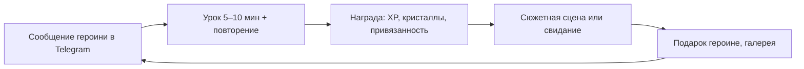
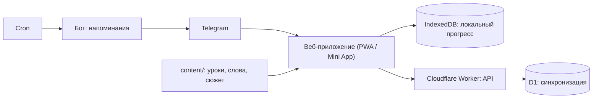

# English Club: полный план и описание функционала

> Личное приложение для изучения английского с аниме-героинями и романтической линией.
> Версия от 29.10.2026. Этот файл собирает всё в одном месте. Подробности и источники ресерча — в `docs/01`–`05`.

## Содержание

1. [О приложении](#1-о-приложении)
2. [Героини](#2-героини)
3. [Функционал](#3-функционал)
4. [Учебная программа](#4-учебная-программа)
5. [Технологии](#5-технологии)
6. [Форматы контента](#6-форматы-контента)
7. [План разработки](#7-план-разработки)
8. [Как писать сюжет](#8-как-писать-сюжет)
9. [Как понять, что работает](#9-как-понять-что-работает)
10. [Открытые вопросы](#10-открытые-вопросы)

---

## 1. О приложении

### Идея

Английский, в котором мотивацию держат не баллы, а героини и сюжет. Чтобы узнать, что будет дальше, и сблизиться с героиней, нужно учиться: юниты открывают главы истории, а выборы в диалогах сами по себе упражнения на английском.

### Принятые решения

| Вопрос | Решение |
|---|---|
| Для кого | Лично для себя. Без монетизации, сторов, соцфункций и маркетинга |
| Уровень | Примерно B1 или ниже, главная проблема — времена. Курс начинается с диагностики, первая арка посвящена системе времён |
| Платформа | Сначала веб и Telegram, потом мобильное. Одно веб-приложение работает и в браузере (PWA), и как Telegram Mini App. Позже его можно обернуть в мобильное через Capacitor |
| Учебное ядро | Уроки по CEFR + интервальное повторение (SRS) + визуальная новелла |
| Героини | Романтическая линия (механики дейтинг-сима) |
| Сеттинг и сюжет | Пишу сам. Ниже стоит черновик-заглушка |
| AI | В первой версии не используется в самом приложении. Контент (уроки, перевод сюжета) готовится заранее с помощью LLM и хранится файлами |
| Арт | Генерация нейросетью: для личного проекта это нормально и дёшево |

### Сеттинг (черновик, будет заменён моим сюжетом)

Международная академия. Новичок попадает в English Club, который закроют, если к концу семестра его участники не сдадут экзамен. Каждая героиня ведёт свою часть обучения. Чем лучше учёба, тем дальше сюжет и тем ближе отношения с героинями.

### Ежедневный цикл



### Долгий цикл

Стрик и недельная дуэль с Рэй → рост привязанности → свидания и CG-иллюстрации → экзамен клуба и кульминация в конце каждой арки. Первая арка заканчивается признанием.

---

## 2. Героини

| Героиня | Кто она | Характер | Акцент | В учёбе | Что поднимает её привязанность |
|---|---|---|---|---|---|
| **Мика** | Президент English Club, гид | Genki: энергичная, позитивная, всегда болеет за тебя | Американский | Дневная цель, стрик, новые слова | Постоянство: стрик, выполненная цель |
| **Айрис** | Аспирантка, куратор клуба | Kuudere: спокойная, строгая, тайно заботливая | Британский | Объяснения грамматики, разбор ошибок, диагностика | Точность: уроки без ошибок, работа над ошибками |
| **Рэй** | Капитан спортивной команды, соперница | Tsundere: «Я тебе не проиграю! ...И вообще, не для тебя старалась» | Австралийский | Недельная дуэль по XP, челленджи на скорость | Победы над ней в дуэли |

**Позже**: Лотти (тихая библиотекарша: чтение и аудирование), Кира (подруга-геймерша: AI-чат), Луна (айдол: произношение и песни).

### Правила

- Все героини взрослые (студентки 19+ и аспирантка), персонажи оригинальные.
- У каждой героини 8 эмоций-спрайтов: нейтральная, радость, восторг, удивление, задумчивость, грусть, смущение, недовольство.
- Реакции на ответы в характере: Мика подбадривает, Айрис вздыхает и объясняет, Рэй дразнит.
- У каждой есть профиль: биография, манера речи, любимые подарки, набор реплик-реакций.

---

## 3. Функционал

Ниже описано, что входит в первую версию и как это работает. Числа в балансе (XP, кристаллы, пороги) стартовые, их подкручиваем по ощущениям.

### 3.1. Первый запуск

1. Мика приветствует и знакомит с клубом.
2. Настройка: как к тебе обращаться, дневная цель (5, 10, 15 или 20 минут), время напоминаний.
3. **Диагностика** («вступительный тест в клуб» от Айрис): 35–45 заданий, около 15 минут. Блоки по временам + быстрая оценка словаря.
4. Результат — **карта времён**: по каждому времени видно, освоено оно, шатко или не освоено. Путь курса подстраивается: освоенные юниты помечаются как пропущенные.
5. Открывается пролог истории.

### 3.2. Главный экран (путь)

- Карта курса: арки → юниты → уроки. Статусы: закрыт, доступен, пройден, пропущен по диагностике.
- Верхняя панель: стрик, кристаллы, кольцо дневной цели.
- Кнопки: **Продолжить** (следующий урок), **Повторение** (сколько карточек на сегодня), **История** (значок, если открылась новая сцена).
- Героиня дня с короткой репликой.
- Нижнее меню: Путь, Повторение, История, Героини, Профиль.

### 3.3. Урок

- 5–10 минут, 10–15 упражнений одной темы.
- Типы упражнений (подробнее в разделе 4.5):
  - T1 выбор времени;
  - T2 раскрыть скобки;
  - T3 линия времени;
  - T4 перевод с русского;
  - T5 найди ошибку;
  - T6 трансформация;
  - T7 сигнальные слова;
  - T8 диктант;
  - T9 выбор реплики;
  - T10 неправильные глаголы.
- **Правильный ответ**: героиня радуется, начисляется XP.
- **Ошибка**: показывается правильный ответ, Айрис коротко объясняет «почему так» и при необходимости показывает линию времени. Предложение с ошибкой уходит в колоду повторения, ошибка записывается в статистику по типу (тегу).
- **Проверка ответа** учитывает сокращения (I've = I have), регистр, пунктуацию и несколько правильных вариантов.
- **Итоги урока**: точность, XP, кристаллы, привязанность, новые слова.

### 3.4. Чекпоинт юнита и экзамен арки

- В конце юнита идёт тест. Порог прохождения — 80%. Если он пройден, открывается глава истории или свидание.
- Если порог не пройден, предлагается короткая работа над ошибками и повторная попытка.
- В конце арки идёт экзамен клуба по всем временам арки. После него открывается кульминационная сцена.
- **Тест-аут**: любой юнит можно сдать сразу, не проходя уроки.

### 3.5. Повторение (SRS)

- Алгоритм **FSRS** планирует, когда показать карточку снова. Целевое запоминание — 90%.
- Три колоды:
  - **слова**: новые слова из уроков и сюжета;
  - **неправильные глаголы**: около 100 самых частых, три формы;
  - **грамматические карточки**: предложения с пропуском на нужное время. Сюда же автоматически попадают предложения, в которых была ошибка.
- Ежедневная сессия: сначала карточки, которые пора повторить, потом новые (лимит около 15 новых в день).
- Оценка ставится автоматически по правильности ответа и времени ответа.

### 3.6. Работа над ошибками

- Ошибки группируются по типам: например, «Present Perfect с ago», «will после when», «be + глагол».
- Показывается «топ-3 проблемных места» и тренировка из 10 заданий именно по ним.
- Работа над ошибками без ошибок поднимает привязанность Айрис.

### 3.7. История (визуальная новелла)

- **Сцена**: фон, 1–2 героини с эмоциями, окно реплики с печатью текста, имя говорящего.
- **Управление**: тап — следующая реплика, лог прошлых реплик, автопроигрывание, пропуск прочитанного.
- **Язык**: реплики на английском уровня B1. Перевод слова по тапу (слово можно добавить в повторение), кнопка «перевод реплики». В настройках можно выбрать «перевод всегда показан».
- **Озвучка**: на старте браузерный синтез речи с разными голосами и акцентами для героинь. Позже — заранее сгенерированные аудиофайлы.
- **Выборы-упражнения**: в ключевых местах нужно выбрать реплику. Верный вариант правилен и по грамматике, и по смыслу. Неверные построены на типичных ошибках. Верный выбор поднимает привязанность. После неверного героиня реагирует в характере, а после сцены Айрис разбирает ошибку.
- **Гейты**: глава открывается за пройденный юнит. Свидание — за юнит и порог привязанности.
- Пролог доступен сразу.

### 3.8. Романтика

| ID | Механика | Как работает |
|---|---|---|
| R1 | Привязанность | Шкала 0–100 у каждой героини. Уровни: знакомые (0) → друзья (20) → близкие (40) → симпатия (60) → пара (80+). Растёт от её «предмета» (см. таблицу героинь), верных выборов в диалогах и подарков |
| R2 | Свидания | Отдельные сцены с одной героиней. Открываются, когда пройден юнит **и** привязанность достигла порога |
| R3 | Выбор реплик = упражнение | См. 3.7. Позже — реплику нужно написать самому, а не выбрать |
| R4 | Кульминации и признание | Каждая арка заканчивается экзаменом клуба и ключевой сценой маршрута. **Признание** — сцена, где вы с героиней признаётесь друг другу в чувствах и становитесь парой. Оно бывает один раз за маршрут, в конце первой арки, и свою реплику признания нужно составить на английском самому (например, *I've liked you since the day we met*). Следующие арки заканчиваются другими вехами: первое свидание как пара, ссора и примирение, финал маршрута. Исход зависит от привязанности и точности ответов |
| R5 | Подарки | Покупаются в магазине за кристаллы. У каждой героини есть любимые подарки (+больше привязанности) и нелюбимые. Описание подарка — короткий текст на английском |
| R6 | Галерея | CG-иллюстрации со свиданий и ключевых сцен. Их можно пересматривать вместе со сценой |
| R7 | Сообщения в Telegram | Напоминания и «личные сообщения» от героини с самой высокой привязанностью (см. 3.11) |

**Экран «Героини»**: карточка каждой героини с уровнем привязанности, открытыми свиданиями, следующим порогом («до свидания с Рэй: юнит 3 и ещё 12 привязанности») и любимыми подарками (открываются по мере сближения).

### 3.9. Геймификация

**XP**

| За что | XP |
|---|---|
| Урок | 10 + 5 за урок без ошибок |
| Чекпоинт юнита | 20 |
| Карточка повторения | 1 |
| Глава истории | 10 |
| Работа над ошибками | 10 |

**Дневная цель**: минуты переводятся в XP (5 мин = 20 XP, 10 = 40, 15 = 60, 20 = 80). Кольцо на главном экране заполняется по мере набора XP.

**Стрик**
- День засчитывается, когда выполнена дневная цель.
- **Заморозка** спасает стрик за пропущенный день и срабатывает автоматически. В запасе можно держать до 2, они покупаются в магазине.
- На вехах (7, 30, 100 дней) Мика устраивает особую сцену или дарит CG.

**Кристаллы**
- Начисляются за урок (5), идеальный урок (+5), выполненную цель (10), квест (10–20), победу в дуэли (50).
- Тратятся в магазине: заморозка стрика (50), подарки героиням (20–100).

**Дневные квесты** (3 в день, обновляются в полночь). Примеры:
- «Пройди 2 урока».
- «Повтори 20 карточек».
- «Сделай урок без ошибок».
- «Ответь верно в 3 выборах в истории».

**Недельная дуэль с Рэй** (заменяет лиги)
- Неделя с понедельника по воскресенье. У Рэй своя шкала XP: она набирает примерно мой средний дневной XP за прошлую неделю плюс 10% со случайными колебаниями. Чтобы победить, нужно чуть-чуть превзойти себя.
- В течение недели Рэй комментирует счёт.
- Победа: 50 кристаллов + привязанность Рэй. Поражение: Рэй хвастается, награды нет.

### 3.10. Профиль и статистика

- Выученные слова, минуты, дни, текущий стрик и рекорд.
- **Карта времён**: прогресс по каждому времени.
- **Ошибки по типам**: что повторяется чаще всего.
- Точность за неделю, график XP по дням.
- Повторная диагностика раз в месяц (Айрис напоминает).

### 3.11. Telegram

- Приложение открывается кнопкой в боте как Mini App. Вход без регистрации, прогресс синхронизируется между телефоном и компьютером.
- **Бот присылает**:
  - напоминание в выбранное время от героини с самой высокой привязанностью;
  - «стрик под угрозой» за 3 часа до конца дня, если цель не выполнена;
  - итоги недельной дуэли (от Рэй);
  - сообщение, когда открылась новая сцена или свидание.
- Сообщения пишутся простым английским в характере героини, перевод спрятан под спойлер Telegram. Это тоже маленькая практика чтения.

### 3.12. Настройки

Дневная цель, время напоминаний, озвучка (вкл/выкл, скорость), перевод в истории (по тапу или всегда), сброс прогресса.

### 3.13. Не входит в первую версию

| Функция | Когда |
|---|---|
| AI-чат с героинями (Кира) с разбором ошибок | Следующий этап |
| Голос: диктовка ответов, оценка произношения, звонки героиням | Позже |
| Свободный ввод реплик в истории с AI-проверкой | Позже |
| Достижения и бейджи, наряды для героинь, ивенты | Позже |
| Мобильное приложение (Capacitor), Live2D-анимация, новые героини | Позже |
| Лиги с людьми, друзья, монетизация | Не нужно (личный проект) |

---

## 4. Учебная программа

### 4.1. Почему времена трудны русскоязычным

В русском три времени и вид глагола. В английском 12 форм (время × аспект), и прямого аналога Present Perfect у нас нет. Типичные ошибки:

| Ошибка | Правильно | Почему |
|---|---|---|
| I live here since 2020. | I've lived / I've been living here since 2020. | Период «до сейчас» → Present Perfect |
| I am studying English for 3 years. | I have been studying English for 3 years. | Длится до сих пор |
| I have seen him yesterday. | I saw him yesterday. | Законченное время (yesterday, ago) → Past Simple |
| Did you ever been to London? | Have you ever been to London? | Опыт → Present Perfect |
| When I will come, I'll call you. | When I come, I'll call you. | После when и if будущее выражается настоящим |
| I was go to school. | I went / I was going to school. | Смешение be + глагол |
| When he came, I watched TV. | When he came, I was watching TV. | Прерванный фон → Past Continuous |
| I am agree. / I am knowing. | I agree. / I know. | Глаголы состояния не ставятся в Continuous |
| He don't like it. | He doesn't like it. | 3-е лицо |

### 4.2. Принципы

1. **Линия времени** для каждого времени: прошлое — сейчас — будущее.
2. **Сначала смысл, потом форма**: что хочу сказать → какое время → как строится.
3. **Контрастные пары**: не «учим Past Continuous», а «Past Simple или Past Continuous?».
4. **Перевод с русского** как главный тренажёр.
5. **Сигнальные слова** служат подсказкой, но есть и упражнения-ловушки.
6. **Неправильные глаголы** — отдельная колода.
7. **Ошибки возвращаются**: предложения с ошибками уходят в повторение.
8. **Сюжет** каждой главы насыщен временем своего юнита.

### 4.3. Структура юнита

Юнит = 1 грамматическая тема + 1 лексическая тема + 1 глава истории.

| # | Урок | Что внутри |
|---|---|---|
| 1 | «Что это за время» | Объяснение Айрис: линия времени, 3 примера, узнавание |
| 2 | Форма | Утверждение, отрицание, вопрос |
| 3 | Контраст | Выбор между этим временем и соседним |
| 4 | Контекст | Текст или диалог с пропусками |
| 5 | Перевод | С русского на английский |
| 6 | Глава истории | С выборами-упражнениями |
| 7 | Чекпоинт | Тест юнита → открывает свидание или сцену |

### 4.4. Арки

**Арка 1. «Система времён» (A2+ → B1)**

| # | Грамматика | Лексика | Идея главы |
|---|---|---|---|
| 1 | Present Simple vs Present Continuous, глаголы состояния | Распорядок дня, клуб | Знакомство: «что обычно» и «что сейчас» |
| 2 | Past Simple | Выходные, события | Как героини провели выходные |
| 3 | Past Continuous vs Past Simple | Происшествия | Кто испортил плакат клуба? Алиби: *What were you doing at 8 pm?* |
| 4 | will, going to, Present Continuous для планов, настоящее после when и if | Планы, фестиваль | Подготовка к фестивалю |
| 5 | Present Perfect: опыт, ever, never, just, already, yet | Путешествия, опыт | Игра *Have you ever...?* |
| 6 | Present Perfect vs Past Simple, for и since, Present Perfect Continuous | Воспоминания | «Как давно вы знакомы?» |
| 7 | Микс всех времён: экзамен | — | Экзамен клуба → признание |

**Арка 2. «Уверенный B1»**: Past Perfect, used to и would, условные предложения 0–2, пассивный залог, косвенная речь, модальные глаголы, экзамен.

**Арка 3. «B1+ → B2»** (позже): третье и смешанное условное, wish, модальные глаголы предположения, Future Continuous и Perfect, фразовые глаголы.

**Объём арки 1**: около 40 уроков, 400–500 новых слов, 100 неправильных глаголов, 300–400 грамматических карточек.

### 4.5. Типы упражнений

| ID | Тип | Пример |
|---|---|---|
| T1 | Выбор времени в контексте | *Look! It ___ outside.* (rains / is raining) |
| T2 | Раскрой скобки | *I ___ (never / be) to Japan.* → have never been |
| T3 | Линия времени | Выбрать схему к предложению или поставить событие на шкалу |
| T4 | Перевод RU → EN | «Я живу здесь с 2020 года» → I have lived here since 2020 |
| T5 | Найди и исправь ошибку | *I have seen him yesterday.* |
| T6 | Трансформация | Сделать вопрос или отрицание, перенести в прошлое |
| T7 | Сигнальные слова | Разложить yesterday, since, right now, already по временам |
| T8 | Диктант | Прослушать и написать |
| T9 | Выбор реплики | Мика: *What did you do last weekend?* → выбрать ответ |
| T10 | Неправильные глаголы | go → went → gone |

---

## 5. Технологии

| Задача | Технология |
|---|---|
| Приложение | React + TypeScript + Vite, PWA |
| Состояние и хранение | Zustand, Dexie (IndexedDB): работает офлайн |
| Повторения | ts-fsrs |
| Сюжет | Ink (язык ветвящихся сценариев) + inkjs |
| Telegram | Telegram Mini App SDK, бот на grammY |
| Сервер | Cloudflare Workers + D1 + Cron, хостинг Cloudflare Pages (для одного пользователя бесплатно) |
| Проверка контента | zod |
| Озвучка | Web Speech API → позже TTS-файлы |
| Тесты | Vitest, Playwright |



### Арт

1. Описать внешность каждой героини: волосы, глаза, рост, одежда, палитра.
2. Сгенерировать портрет, выбрать удачный.
3. Для консистентности использовать референс персонажа (IP-Adapter) или небольшой LoRA на 15–20 картинках.
4. Сделать эмоции перерисовкой лица (inpainting) с той же позой.
5. Убрать фон у спрайтов. Отдельно сгенерировать фоны (клуб, библиотека, кафе, крыша) и CG.

Объём арки 1: 3 героини × 8 эмоций, 6–8 фонов, 5–10 CG.

---

## 6. Форматы контента

### Структура репозитория

```
app/                      # фронтенд
  src/features/lesson/    # движок упражнений
  src/features/placement/ # диагностика
  src/features/srs/       # повторения
  src/features/story/     # новелла + Ink
  src/features/game/      # XP, стрик, квесты, магазин, дуэль
  src/data/               # хранение и синхронизация
content/
  course/arc1/unit-01.json
  words/, verbs/irregular.json
  story/*.ink
  characters/*.json
assets/                   # спрайты, фоны, CG
server/                   # Worker: API, бот, cron
docs/
```

### Упражнение

```json
{
  "id": "u01-l03-e05",
  "type": "tense_choice",
  "prompt": "Look! It ___ outside.",
  "options": ["rains", "is raining"],
  "answer": "is raining",
  "explain": "Look! — действие происходит прямо сейчас → Present Continuous.",
  "tags": ["present_continuous", "contrast_ps_pc"]
}
```

### Сцена с выбором-упражнением (Ink)

```ink
VAR affection_rei = 0

Rei: So you're the new member? What did you do before you came here? #rei:pout
* [I studied in Moscow.]
    ~ affection_rei += 2
    Rei: Hmph. Not bad. #rei:blush
* [I have studied in Moscow two years ago.] #mistake:pp_with_ago
    Rei: "Have studied... ago"? Seriously? #rei:smirk
* [I was study in Moscow.] #mistake:be_plus_verb
    Rei: Iris is going to cry. #rei:smirk
```

Тег `#mistake:...` связывает неверный выбор с типом ошибки: Айрис разбирает её после сцены, а предложение уходит в повторение.

---

## 7. План разработки

Делаем вертикальными срезами: после каждого этапа есть что открыть и потрогать. Арт и сюжет до готовности заменяются заглушками. Этапы 1–5 от сюжета не зависят.

### Этап 1. Каркас
- [ ] Vite + React + TS, линтер, тесты
- [ ] PWA: установка на телефон, офлайн
- [ ] Экраны-заглушки: Путь, Урок, Повторение, История, Героини, Профиль
- [ ] Локальное хранилище прогресса
- [ ] UI-кит: кнопки, карточки, прогресс-бар, окно реплики героини
- [ ] Деплой превью на Cloudflare Pages

**Готово, когда**: ссылка открывается на телефоне и виден главный экран.

### Этап 2. Движок упражнений + юнит 1
- [ ] Схема контента (JSON + zod)
- [ ] Упражнения T1–T7
- [ ] Проверка ответов: сокращения, регистр, пунктуация, варианты
- [ ] Итоги урока, разбор ошибок от Айрис
- [ ] Контент юнита 1

**Готово, когда**: все уроки юнита 1 проходятся.

### Этап 3. Диагностика и путь
- [ ] Диагностика, карта времён
- [ ] Путь юнитов: блокировка, тест-аут, чекпоинты
- [ ] Контент юнитов 2 и 3

**Готово, когда**: после диагностики видно, какие времена проседают, и путь подстроился.

### Этап 4. Повторение
- [ ] FSRS, три колоды
- [ ] Автодобавление новых слов и предложений с ошибками
- [ ] Ежедневная сессия, лимит новых карточек
- [ ] Работа над ошибками по типам

**Готово, когда**: каждый день есть колода повторения, и ошибки в неё возвращаются.

### Этап 5. Геймификация
- [ ] XP, кольцо цели, стрик + заморозка
- [ ] Кристаллы и магазин
- [ ] Дневные квесты
- [ ] Дуэль с Рэй
- [ ] Профиль и статистика

**Готово, когда**: есть причина зайти завтра.

### Этап 6. Новелла и романтика
- [ ] Рендер сцены: фон, спрайты, эмоции, печать текста, лог, авто и пропуск
- [ ] Ink: компиляция при сборке, переменные привязанности
- [ ] Выборы-упражнения и разбор ошибок
- [ ] Перевод по тапу, перевод реплики, озвучка
- [ ] Гейты по юнитам и привязанности
- [ ] Экран «Героини», подарки, галерея
- [ ] Пролог и глава 1 по моему сюжету

**Готово, когда**: после юнита 1 открывается глава 1, и выборы меняют привязанность.

### Этап 7. Telegram и синхронизация
- [ ] Режим Mini App, вход без регистрации, проверка подписи Telegram
- [ ] API + D1: синхронизация между устройствами
- [ ] Бот: напоминания, «стрик под угрозой», итоги дуэли, новые сцены

**Готово, когда**: прогресс одинаковый на телефоне и компьютере, и вечером приходит сообщение от героини.

### Этап 8. Контент и арт арки 1
- [ ] Юниты 4–7 и экзамен
- [ ] Главы 2–7, свидания, кульминация и признание
- [ ] Арт: спрайты, фоны, CG

**Готово, когда**: арка 1 проходится от начала до признания.

### Дальше

Арка 2, AI-чат с Кирой, голос и произношение, мобильное приложение, Live2D, новые героини.

---

## 8. Как писать сюжет

- **Одна глава = один юнит.** В диалогах главы много целевого времени. Идеи в таблице арок — только подсказки.
- **Выборы реплик**: достаточно написать верный вариант. Ошибочные я построю из типичных ошибок.
- **Объём главы**: 30–60 реплик, 5–10 минут чтения.
- **Гейты**: отметь, какие сцены открываются после юнита, а какие требуют привязанности («свидание с Рэй — после юнита 3 и привязанности 40+»).
- **Признание** — в конце арки 1, для каждой героини свой вариант.
- **Формат**: обычный текст по главам, можно по-русски. Я переведу на английский уровня B1, сверстаю в Ink и вставлю упражнения.

---

## 9. Как понять, что работает

| Что | Как измеряем | Цель |
|---|---|---|
| Привычка | Стрик, дни в неделю | 6–7 дней из 7 |
| Запоминание | Доля верных ответов в повторении | 85–90% |
| Времена | Карта времён в ежемесячной диагностике, точность в T1, T3, T4 | > 85%, карта зеленеет |
| Ошибки | Типичные ошибки по тегам | Перестают повторяться |
| Интерес | Хочется ли открыть следующую сцену | Если нет, правим сюжет и награды |

---

## 10. Открытые вопросы

1. Сеттинг и сюжет: пишу сам. После этого подтвердить имена и характеры героинь.
2. Арт: генерирую сам или нужна помощь с промптами и пайплайном?
