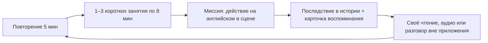
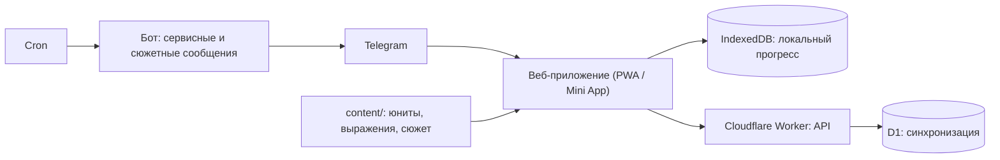

# English Club: полный план и описание функционала

> Личное приложение для изучения английского от B1 до C1 через визуальную новеллу «Комната 17» с тремя героинями и романтической линией.
> Версия 2 от 29.10.2026, правки по ревизии 30.10.2026 ([раздел 12](#12-ревизия-30102026)). Этот файл собирает всё в одном месте и заменяет версию 1. Подробности:
> [сюжетная библия](06-story-bible.md), [учебный путь B1 → C1](07-learning-path.md), [конкуренты и сторителлинг](08-competitors.md), [референсы героинь](09-heroine-references.md), [спрайты: эмоции, позы, наряды](10-sprites.md), [бриф на генерацию спрайтов](11-sprite-brief.md), [личные квесты героинь](12-personal-quests.md) и [их вычитка](13-quest-review.md).
> Документы `01`–`05` — материалы версии 1. Где они расходятся с этим файлом, верен этот файл.

## Содержание

1. [О приложении](#1-о-приложении)
2. [Героини](#2-героини)
3. [Функционал](#3-функционал)
4. [Учебная программа](#4-учебная-программа)
5. [Технологии](#5-технологии)
6. [Форматы контента](#6-форматы-контента)
7. [План разработки](#7-план-разработки)
8. [Как писать сюжет](#8-как-писать-сюжет)
9. [Как понять, что работает](#9-как-понять-что-работает)
10. [Открытые вопросы](#10-открытые-вопросы)
11. [Что изменилось по сравнению с версией 1](#11-что-изменилось-по-сравнению-с-версией-1)
12. [Ревизия 30.10.2026](#12-ревизия-30102026)

---

## 1. О приложении

### Идея

Ты приезжаешь по обмену в Bellwether Academy, по ошибке попадаешь в радиокомнату 17 и вместе с тремя однокурсницами начинаешь делать аудиогид для новичков. Английский нужен, чтобы что-то изменить внутри истории: договориться, переспросить, написать письмо, провести эфир. Учёба и сюжет переплетены, но учебные часы не являются валютой любви.

### Принятые решения

| Вопрос | Решение |
|---|---|
| Для кого | Лично для себя. Без монетизации, сторов, соцфункций и маркетинга |
| Цель | **От B1 к C1**, с промежуточной проверкой задач B2 на юните 120. Слабое место на входе — времена |
| Объём | 6 сезонов → 12 арок → 60 модулей → 240 юнитов → 1920 коротких занятий. Бюджет около 480 часов, рабочий диапазон 400–600 ([учебный путь, разделы 1, 3 и 5](07-learning-path.md)) |
| Вход | **Короткий опрос и мини-тест при первом запуске**, около 15 минут. Полный профиль по навыкам собирается в первом модуле (раздел 3.1) |
| Романтика | **Без режима дружбы.** До юнита 080 игрок дружит со всеми тремя, на 080 обязательно выбирает маршрут одной героини. Первое свидание около 100, взаимное признание около 120, дальше отношения развиваются до финала |
| Платформа | Сначала веб и Telegram, потом мобильное. Одно веб-приложение работает в браузере (PWA) и как Telegram Mini App. Позже его можно обернуть через Capacitor |
| Учебное ядро | Юниты по CEFR + интервальное повторение (SRS) + визуальная новелла, в которой практика меняет ситуацию |
| Сеттинг и сюжет | Рабочий канон — [сюжетная библия «Комната 17»](06-story-bible.md) |
| AI | В первой версии в самом приложении не используется. Контент готовится заранее с помощью LLM и хранится файлами |
| Речь и письмо | Как в Duolingo: в части заданий нужно нажать микрофон и сказать фразу, приложение распознаёт её и сверяет с принимаемыми вариантами. В части заданий ответ вводится текстом. Преподавателя и ручной проверки нет |
| Темп | Любой: хоть 5 минут в день, хоть час. Сроки прохождения приложение не показывает — сколько займёт, столько займёт |
| Арт | Генерация нейросетью по двум утверждённым референсам в `assets/refs/` ([реестр](09-heroine-references.md)) |

### Чего приложение не обещает

- Приложение не выдаёт сертификат C1. Речь проверяется распознаванием фраз, письмо — сверкой введённого текста с принимаемыми вариантами. Свободную речь и длинные тексты оно не оценивает, поэтому проверки на юнитах 120 и 240 показывают, что задачи курса выполнены, а не официальный уровень.
- Числа 240, 1920 и 480 — авторская модель для планирования контента, а не норма и не срок. Пользователю они не показываются.
- «Первые, кто совместил язык и историю» не говорим: учебные сериалы и постоянные персонажи уже есть у Busuu, Duolingo и LingoLooper ([обзор](08-competitors.md)). Наше отличие — длинная история с тремя постоянными героинями, памятью общих событий и отношениями, которые продолжаются после признания.

### Ежедневный цикл



На день не обязательно выполнять все виды активности. Минимальный день — одно короткое занятие или повторение на 5 минут. Пример на 30 минут: 5 минут повторения, одно занятие на 8 минут, 12 минут чтения или самостоятельной практики, 5 минут на завершение сцены.

### Долгий цикл

Модуль из 4 юнитов заканчивается заданием на новом материале и видимым результатом. Арка из 20 юнитов — совместным продуктом команды (маршрут, эфир, выпуск) и мини-тестом. Сезон из 40 юнитов — новым этапом общей истории. Отношения растут по событиям, а не по шкале: знакомые → свои в компании → друзья → близкие друзья → выбор маршрута (080) → первое свидание (около 100) → пара (около 120) → отношения в обычной жизни → совместный выбор будущего (240).

---

## 2. Героини

Все героини взрослые, однокурсницы игрока, на старте им 19–20 лет. Романтики с преподавателями нет. Персонажи оригинальные. Внешность не определяет архетип: Мика не карикатурная блондинка, Айрис не холодная отличница, Рэй не «вечно язвительная».

| Героиня | Чем занимается | Сила | Слабость, над которой работает | Маршрут |
|---|---|---|---|---|
| **Мика** | Организует, договаривается, считает бюджет. Хочет стать продюсером культурных событий | Превращает идею в место, время и людей | Обещает раньше, чем спросила остальных; доказывает ценность полезностью | «Вечер без программы» |
| **Рэй** | Звук и музыка; знает город по акустике | Слышит то, что другие пропускают | После того как её демо опубликовали без спроса, контролирует файлы, а в споре уходит из комнаты | «Запись остановлена» |
| **Айрис** | Тексты, редактура; хочет писать прозу и подать рассказ на конкурс | Ясность, видит противоречия | Правит чужое до тех пор, пока не пропадает голос автора; не показывает свои черновики | «Первый черновик» |

Подробные характеры, отношения между героинями и 12 узлов каждого маршрута описаны в [сюжетной библии, разделы 3 и 7](06-story-bible.md).

**Внешность** (слева направо: Рэй, Мика, Айрис):


Рэй — чёрные прямые волосы с чёлкой и пурпурными прядями, розово-бордовые глаза, чёрная альтернативная одежда, чокер с кольцом, серьги-кресты, массивные ботинки на пряжках. Мика — длинные светлые волосы в высоком хвосте с резинкой, голубые глаза, розовая палитра, серьги-кольца, кулон-сердце, белые массивные кроссовки с сердечками. Айрис — тёмный пучок, круглые очки в чёрной оправе, карие глаза, светлая блузка с закатанными рукавами, тёмно-коричневая юбка, коричневые колготки, лоферы, книги и сумка через плечо. Полный список признаков — в [реестре](09-heroine-references.md).

**Второстепенные персонажи** дают новые голоса и задачи без отдельных маршрутов: сосед по общежитию, работница кафе, авторы архива Элли и Ноа, владелец магазина пластинок, музейный координатор, музыкант, новые студенты. Новых романтических героинь не добавляем.

### Правила

- Героини не делят обучение на три педагогические функции. Каждая может объяснить, ошибиться, попросить помощи и не согласиться.
- Разбор языковых ошибок идёт в **учебной панели**, а не в репликах героинь. Если смысл реплики непонятен, героиня переспрашивает в характере: «Ты про каждый день или про сейчас?»
- Ошибка в языке и поступок разделены. Неверное время глагола не портит отношения. Последствия бывают только у осознанного решения: пообещать за команду, опубликовать чужое без спроса, не выполнить обещание.
- **Спрайты** задаются тремя осями: наряд (по месту, погоде и событию), поза (по действию: телефон, рекордер, блокнот, скрещённые руки) и эмоция (по подтексту реплики). У каждой героини 17 эмоций: 11 общих, 3 фирменных (Мика — `excited`, `pout`, `forced_smile`; Рэй — `smirk`, `deadpan`, `guarded`; Айрис — `dry_smile`, `skeptical`, `guilty`) и 3 романтических, которые открываются только у выбранной героини после юнита 081. Четыре позы на героиню, до семи нарядов по ходу кампании. Логика выбора, разметка и проверки — в [документе о спрайтах](10-sprites.md).
- Языковая ошибка игрока не вызывает у героини недовольства на лице: при переспросе допустимы только `listening`, `thinking`, `neutral`, `surprised`. Это проверяется при сборке.
- Голоса: предварительно Мика — американский акцент, Айрис — британский, Рэй — австралийский. У второстепенных персонажей другие варианты английского. Для C1 разнообразие акцентов полезно для аудирования.
- У каждой героини есть профиль: биография, манера речи, интересы, которые игрок узнаёт по ходу истории, набор реплик-переспросов.

---

## 3. Функционал

Ниже описано, что входит в первую версию и как это работает. Числа в балансе стартовые, подкручиваем по ощущениям.

### 3.1. Первый запуск: опрос, пролог и мини-тест

1. **Опрос**, 2–3 минуты:
   - как к тебе обращаться;
   - дневная цель: 5, 10, 15, 30 или 60 минут. Её можно поменять в любой момент; сроки прохождения не показываются;
   - самооценка по коротким утверждениям «могу / с трудом / не могу» для чтения, аудирования, речи и письма;
   - что мешает сильнее всего: времена, понимание на слух, страх говорить, письмо;
   - время напоминаний.
2. **Пролог «Не тот кабинет»**: путаница seventeen и seventy, первая встреча с Микой, Рэй и Айрис. Первое языковое задание — переспросить и представиться.
3. **Мини-тест**, около 10 минут. В истории это вступительная проверка в кабинете 70, куда игрок и шёл. Героини тест не ведут.
   - 12–15 заданий на грамматические контрасты, прежде всего времена;
   - короткий новый текст и 3 вопроса;
   - короткое аудио без транскрипта и 3 вопроса;
   - 2–3 задания с вводом короткого ответа текстом, проверка по принимаемым вариантам.
4. **Предварительный профиль**: например, «чтение B1+, аудирование B1, времена нестабильны, речь требует поддержки». Это не ярлык уровня. Профиль решает, с чего начать и какие юниты предложить пройти через тест-аут.
5. Приглашение вернуться в комнату 17 и начало юнита 001.

**Уточнение профиля в первом модуле (001–004).** Чтение, аудирование и ввод текста проверяются на обычных занятиях, а задания с микрофоном появляются здесь, а не в первый день. После модуля профиль уточняется, путь подстраивается.

### 3.2. Главный экран (путь)

- Карта кампании: сезон → арка → модуль → юнит → занятия. Статусы: закрыт, доступен, пройден, пройден через тест-аут.
- **Маршрут** (сделано 30.10.2026; сначала была змейка как у Duolingo, переделали, чтобы не копировать): у каждого юнита заголовок с цветной полосой (цвет его героини, нажатие открывает описание юнита) и вертикальная линия из 8 станций-занятий с названиями. Иконка станции по типу: 📖 понимание, ✏️ форма, 💬 продукция, ⚡ беглость, ★ миссия, 🏆 проверка модуля (поле `role` у занятия). Пройденный участок линии сплошной, впереди — пунктир; текущая станция подсвечена и подписана «Начать ›». Нажатие на открытую станцию запускает занятие. Справа от линии стоит героиня юнита в полный рост — в динамичной позе с предметом (бриф [`18-map-sprites-brief.md`](18-map-sprites-brief.md)), пока поз нет — обычный спрайт. При открытии карта прокручивается к текущему занятию. Заголовок юнита, который сейчас на экране, прилипает под верхней панелью; если текущее занятие ушло за экран, внизу появляется кнопка «↑ / ↓ К текущему занятию». Героини дня с приветствием над картой больше нет: героиня уже стоит у каждого юнита.
- **Rive-анимация героинь** (30.10.2026): на страницах героинь — дыхание, покачивание и моргание (`assets/rive/`, рантайм `@rive-app/react-canvas`); неподвижный кадр, пока грузится, и при «уменьшении движения». Эмоции и липсинк для диалогов — по брифу [`22-rive-brief.md`](22-rive-brief.md).
- **Тетрадь юнита** (значок 📓 в заголовке юнита на маршруте): страница «из тетради Айрис» — героиня юнита, цель, **ключевые фразы** с примером из самого юнита (реплика героини с её голосом и переводом, иначе аудио задания или правильный ответ), грамматический фокус, а после прохождения — что изменилось в истории. Списка занятий там нет, он на маршруте. Позже сюда же лягут шпаргалки по темам юнита (3.6.1).
- Верхняя панель: стрик, кольцо дневной цели в минутах, кристаллы (с этапа 6, раздел 3.9).
- Кнопки: **Продолжить** (следующее занятие), **Повторение** (сколько карточек на сегодня), **История** (значок, если открылась сцена), **Внешняя практика** (отметить чтение, видео или разговор вне приложения). Кнопки «Повторение» и «История» повторяют нижнее меню, поэтому на пути они нужны только как сигнал «там что-то есть»: число карточек или значок новой сцены. Пока раздел пуст, кнопку не показываем и не пишем ноль (открытый вопрос 4).
- **Закрытый юнит не открывается.** Статус «закрыт» означает, что занятия юнита недоступны ни с пути, ни со страницы юнита, ни по прямой ссылке. Обойти порядок можно только тест-аутом или переключателем «Открыть всё».
- **Героини дня нет** (решение 30.10.2026): героиня уже стоит у каждого юнита на маршруте, вторая над картой дублировала бы её. Поле `greeting` у героинь и его озвучка удалены; поболтать с героиней можно на её странице (раздел 3.8).
- Доска команды: реальные результаты истории — карта маршрута, записанный разговор, разрешённый архивный фрагмент, программа события.
- Нижнее меню: Путь, Повторение, Задания, Героини, Профиль. Вкладка «Задания» заменила «Историю» (решение по открытому вопросу 5).

### 3.3. Юнит и короткие занятия

**Юнит** = одна коммуникативная задача («перенести встречу», «ответить на претензию») + языковой фокус + эпизод истории с последствием. Восемь коротких занятий около 8 минут:

| # | Занятие | Что внутри |
|---|---|---|
| 1–2 | Понимание | Сцена или документ на английском; аудирование |
| 3–4 | Форма | Слова и выражения, грамматика, контраст, произношение |
| 5–6 | Продукция | Ввести ответ текстом; сказать фразу в микрофон |
| 7–8 | Беглость и миссия | Знакомый язык без постоянной опоры; действие в сцене, которое меняет ситуацию |

Вокруг занятий есть распределённая практика: повторение, дополнительное чтение или аудио по теме, повторная попытка в новом контексте. Для планирования контента закладываем около 120 минут на юнит за несколько заходов ([разбивка](07-learning-path.md)); пользователю это время не показывается.

**Ответ и ошибка**
- **Проверка ответа** учитывает сокращения (I've = I have), регистр, пунктуацию и несколько правильных вариантов.
- **Ошибка**: показывается правильный ответ и короткое объяснение в учебной панели, при необходимости линия времени. Предложение уходит в колоду повторения, ошибка записывается в статистику по тегу.
- **Отложенное задание** («Сейчас не могу говорить»): не верно и не неверно. Оно не входит в точность и не даёт бонуса «без ошибок»: занятие, где всё отложено, бонуса не получает. Отложенное задание сохраняется и возвращается в повторении (этап 4), а в профиле видно, сколько их накопилось (раздел 9).
- **Итоги занятия**: точность, XP, новые выражения, число отложенных заданий.

Типы упражнений перечислены в разделе 4.5.

### 3.4. Контроль: модуль, арка, большие проверки

- **Конец модуля** (каждые 4 юнита): задание на новом материале, но знакомом навыке. Порог 80% по всем заданиям, включая микрофон и ввод текста: они засчитываются автоматически по принимаемым вариантам, отдельной рубрики нет. Отложенные задания в порог не входят. В модуле 001–004 проверка — занятие 7 юнита 004; порог и экран результата появятся на этапе 3, пока это обычное занятие.
- **Конец арки** (каждые 20 юнитов): совместный продукт команды в истории и мини-тест по навыкам. Он заменяет ежемесячную диагностику версии 1.
- **Юниты 120 и 240**: большая проверка чтения, аудирования, ввода текста и речи на незнакомом материале (задачи B2 и C1). Это внутренняя проверка курса, не официальный экзамен.
- **Повторная попытка** допускается без потери сюжетного выбора. При слабом результате предлагается адресная ветка, а не перепрохождение сезона. Отношения из-за учебного результата не откатываются.
- **Тест-аут**: любой юнит можно закрыть диагностическим вариантом, не проходя занятия. Сцена при этом открывается.

### 3.5. Повторение (SRS)

- Алгоритм **FSRS** планирует, когда показать карточку снова. Целевое запоминание — 90%.
- Колоды:
  - **выражения**: слова, сочетания и речевые функции (*make a decision*, *as far as I know*, *what I meant was*). У карточки есть значение, пример, произношение, контекст и отметка «узнаю / могу употребить»;
  - **неправильные глаголы**: около 100 самых частых, три формы;
  - **грамматические карточки**: предложения с пропуском. Сюда же автоматически попадают предложения, в которых была ошибка.
- Ежедневная сессия: сначала карточки, которые пора повторить, потом новые (лимит около 15 в день).
- Оценка ставится автоматически по правильности и времени ответа.
- Слово сначала понимают в контексте, потом воспроизводят без подсказки, потом используют в другой задаче. Правильный выбор из четырёх вариантов — слабое доказательство владения.

### 3.6. Работа над ошибками: «После уроков»

Сделано 30.10.2026. Вкладка «Повторение» — пустой класс после занятий; арт по брифу [`19-after-class-brief.md`](19-after-class-brief.md).

- **Сцена:** за партами две героини, пара меняется каждый день. Айрис увлечённо подпёрла щёку, Рэй развалилась на парте, Мика скучает в телефоне. Первая из пары говорит реплику по ситуации: есть что разобрать, всё ждёт своего дня, ничего не накопилось, раунд окончен (`content/after-class.json`, с озвучкой).
- **Что копится:** каждая ошибка сохраняется целым предложением с темами из реестра тегов (3.6.1), тема открывается для повторения. Отложенные задания с микрофоном («Сейчас не могу говорить») ждут здесь же. На вкладке — значок с числом тем, которым пора, и отложенных заданий.
- **Интервалы:** тема уходит, когда её разобрали без ошибок в три разных дня — сразу, через день, через три дня (шаги ●○○). Ошибка в разборе возвращает тему на начало, со следующего дня. Повтор раньше срока можно, но шаги он не двигает.
- **Раунд:** до трёх тем, самые насущные первыми (больше ошибок, потом самые старые). На каждую тему — 3 близкие вариации из банка (`content/practice/{тема}.json`: новые предложения, другой тип задания, только слова пройденных юнитов), потом то самое предложение, где была ошибка, затем до трёх отложенных заданий с микрофоном. Механика как в занятии: ошибка показывает правильный ответ и возвращается в конец очереди.
- **Итог раунда:** что верно с первого раза, XP как за занятие, куда сдвинулась каждая тема («дальше через день», «разобрана ✓»).
- Позже: шпаргалка темы перед её вариациями (3.6.1), колоды выражений и неправильных глаголов (3.5).
- Работа над ошибками на отношения с героинями не влияет: это учебная механика.

### 3.6.1. Шпаргалки: тетрадь Айрис

Наглядные таблицы по темам, где сделана ошибка: не абзац текста с правилом, а свёрстанная карточка на один экран телефона. Решения 30.10.2026:

- **Не отдельный раздел.** Шпаргалки живут внутри занятия и повторения. В сюжете это страницы тетради Айрис (подпись «Из тетради Айрис»), но отдельной вкладки или экрана-справочника нет.
- **Когда показывается:**
  - в разборе ошибки — кнопка «Шпаргалка: <тема>», открывается шторкой снизу;
  - **автоматически после второй ошибки в одной теме** за занятие, перед повтором задания;
  - в повторении и работе над ошибками: тема с ошибками → шпаргалка → задания по этой теме. Повторение — это не только карточки.
- **Из чего состоит** (одинаковые блоки и цвета во всех шпаргалках): формула-таблица (группы подлежащих → вспомогательный глагол → глагол, окончание подсвечено), три формы (утверждение / отрицание / вопрос; на телефоне — вкладками), шкала времени, пары ✓ / ✗, слова-сигналы, особые случаи. Примеры — из сюжета, их можно послушать голосами героинь.
- **Привязка:** у заданий уже есть теги тем, и ошибки хранятся с ними. Теги делятся на темы (у них есть шпаргалка) и навыки (`speaking`, `listening` — без шпаргалки). Задание может указать конкретную строку шпаргалки, тогда при ошибке она подсвечивается.
- **Реестр тегов** `content/tags.json`: у каждого тега вид (тема или навык), русское название для статистики и, у темы, файл шпаргалки. Тест не пропускает тег, которого нет в реестре. Служебные метки вроде `vocab_u001` и `module_check` тегами ошибок не считаются: принадлежность к юниту и проверке модуля и так видна по заданию. Реестр сделан 30.10.2026: 16 тем и 4 навыка; `signal_words` влит в `contrast_ps_pc`.
- **Формат:** `content/cheatsheets/{тема}.json` из блоков, схема и проверки как у юнитов.
- **Первый набор (модуль 001–004):** to be, do / does в вопросах и отрицаниях, -s у he / she / it, Present Simple против Continuous, глаголы состояния, at / on / in со временем, место always / usually / never, фразы «как переспросить».

### 3.7. История (визуальная новелла)

- **Сцена**: фон, до трёх героинь на экране (по умолчанию как на референсах: Рэй слева, Мика в центре, Айрис справа), окно реплики с печатью текста, имя говорящего. Говорящая подсвечена, остальные слегка затемнены и могут реагировать своей эмоцией. Эмоция и поза держатся, пока их не сменили; нарисованного варианта нет — движок берёт ближайшую замену и отмечает её в отчёте сборки.
- **Управление**: тап — следующая реплика, лог прошлых реплик, автопроигрывание, пропуск прочитанного.
- **Язык**: реплики на английском, сложность растёт с курсом. Перевод слова по тапу (слово можно добавить в повторение), кнопка «перевод реплики», замедленное воспроизведение. В настройках можно включить «перевод всегда показан», но чтение перевода не засчитывается как английский входной материал. Подробнее — в разделе 3.7.2.
- **Форматы одной истории**: разговор, сообщение, письмо, объявление, интервью, рецензия, статья. Так один конфликт тренирует разные навыки.
- **Озвучка**: заранее сгенерированные файлы ElevenLabs `eleven_v4`, по голосу на героиню. Эмоция и состояние голоса задаются тегами: по эмоции спрайта автоматически, а сюжетный контекст (запыхалась, шепчет у микрофона, кашляет) — полем `delivery` у реплики. На экране тегов не видно. Правила — в [`14-voice.md`](14-voice.md). Если файла нет или он не загрузился (например, без сети), работает браузерный синтез. Файлы кэшируются для работы офлайн так же, как спрайты.
- **Выбор в два шага**:
  1. **Намерение**: уточнить, согласиться, отказаться, пошутить, назвать свою проблему. Это содержательный выбор, он может менять флаги памяти и тон сцены.
  2. **Выражение на английском**: собрать или написать реплику. Это упражнение; принимается несколько корректных вариантов. Нельзя объявлять единственно верным английским вариант, который льстит героине.
- **При языковой ошибке** героиня переспрашивает, если смысл непонятен. Разбор формы — в учебной панели после сцены.
- **Последствие**: каждый юнит что-то меняет в истории — проект, знание о героине, выполненное обещание, возможность новой встречи. Если единственное изменение — «+3 привязанности», сцену переписываем.
- **Гейты**: эпизод юнита открывается вместе с юнитом, миссия встроена в занятия 7–8. Личные сцены открываются по событиям истории (раздел 3.8). Пролог доступен сразу.

### 3.7.1. Как занятия связаны с сюжетом

Юнит — это маленький эпизод истории, а каждое из 8 занятий — его момент. Задания не висят в воздухе: у каждого есть место в истории и причина его делать.

| Занятия | Роль в эпизоде | Пример в юните 001 |
|---|---|---|
| 1–2, понимание | Ситуация приходит к игроку: письмо, объявление, голоса героинь | Айрис приносит письмо академии; Мика проверяет, понятно ли звучат их представления |
| 3–4, форма | Подготовка вместе с героиней: её заметки, её список, её правки | Айрис раскладывает карточки для гида; Мика просит проверить её вопросы для новичков |
| 5–6, продукция | Репетиция и запись своего | Рэй просит отрепетировать фразы, потом включает запись |
| 7–8, беглость и миссия | Живая сцена, где английский меняет ситуацию | Строчка игрока попадает в аудиогид |

Как это устроено в приложении:
- **Сцена-рамка** перед занятием: место, 1–3 реплики героини со спрайтом — где мы и зачем это нужно.
- **Метка задания** — чем оно является в истории: «Карточка из заметок Айрис», «Вопрос из списка Мики», «Расшифровка записи для гида».
- **Сцена-итог** после занятия: что изменилось. Юнит в целом заканчивается видимым последствием (`outcome`).
- **Выбор в сцене запоминается** (флаг): какой вопрос игрок задал и кому. Поздние сцены смогут на это сослаться.
- **Оценка правильности не превращается в реакцию героини.** Внутри обычных заданий героини молчат: разбор ошибок идёт в учебной панели. В сценах героиня реагирует на смысл, а при языковой ошибке переспрашивает.
- **Проверки при сборке.** Каждая реплика героини указывает на нарисованный спрайт; переспрос никогда не бывает недовольным; романтические эмоции не встречаются до юнита 081.

### 3.7.2. На каком языке говорят героини и как понять незнакомое

**В мире истории все говорят по-английски.** Bellwether — англоязычная академия, а героини и второстепенные персонажи не знают русского. Ни одна героиня не переходит на русский «ради игрока»: в мире истории для этого нет причины.

**По-русски звучит только то, что не является речью персонажей:** интерфейс, задания, учебная панель, выбор намерения («Сказать, что ты новенький») и внутренний голос игрока. Намерение — это мысль героя, поэтому оно на родном языке; вслух он говорит по-английски.

**Героини подстраиваются под новичка — и это обосновано сюжетом.** Они делают гид для новых студентов, поэтому им самим важно, чтобы новичок понял. В начале они говорят короче и медленнее, повторяют, Айрис пишет маршрут на листке, Рэй показывает жестом. Первый навык курса, заданный уже в прологе, — попросить повторить, сказать медленнее или написать: «Could you say that again?». Переспрашивать — нормальная часть общения, а не провал.

**Сложность растёт вместе с курсом.** На этапе B1 реплики короткие и на частотной лексике, к B2 и C1 появляются длинные фразы, подтекст и сложные документы. Голос героини при этом сохраняется: Мика не начинает говорить как статья.

**Если слово незнакомо** (часть уже работает в приложении):
- **перевести можно любое слово**: тап показывает перевод прямо под текстом. Подчёркнуты только выражения, которые учит юнит, и их перевод подписан «Учим в этом юните». Устойчивые сочетания из глоссария юнита (*dining hall*) не выделены, но переводятся целиком;
- **перевод у слова один — из словаря курса** (`content/dictionary.json`). Юнит только перечисляет, какие выражения подчеркнуть (`expressions`) и какие сочетания переводить целиком (`glossary`); фраза из нескольких слов получает свою статью в словаре. Словарь переведён по значению в наших текстах и работает без интернета. Формы находятся по основе (*dropped → drop*), у неправильных форм и сокращений свои статьи. Тесты проверяют, что каждое слово реплик и текстов и каждое выражение юнита есть в словаре;
- у каждой реплики есть кнопка «Перевод»; в настройках его можно показывать всегда;
- аудио можно переслушать и замедлить; транскрипт и перевод появляются после ответов на вопросы, чтобы не подсказывать. Транскрипт заранее показывается, только если звук воспроизвести совсем нечем: нет ни записанного файла, ни браузерного синтеза;
- слова, которые игрок открывал, уже запоминаются (сколько раз и когда) и попадут в колоду повторения (этап 4).

**Если не знаешь даже простых слов.** Мини-тест при первом запуске это покажет. Тогда включается **режим поддержки** (этап 3): перевод под каждой репликой сразу, больше заданий со сборкой из плиток вместо ввода, медленная озвучка по умолчанию. Режим ослабевает сам по мере того, как растёт точность, и его можно включить или выключить вручную. Честное ограничение: курс рассчитан на старт примерно с A2+/B1. С полного нуля приложение будет тяжёлым; для этого понадобится отдельный вводный курс, его в плане пока нет.

### 3.8. Отношения и романтика

**Режима дружбы нет.** Романтическая линия обязательна, но не торопится: до выбора маршрута сцены не подразумевают, что все три героини влюблены.

| ID | Механика | Как работает |
|---|---|---|
| R1 | Этапы отношений | Вместо шкалы 0–100 — качественные этапы для каждой героини (таблица ниже). Этап меняется событием истории, а не накопленными очками. Если движку нужно число, сюжетные потолки не дают открыть позднюю сцену фармом |
| R2 | Память | Карточки уникальных событий с коротким английским описанием: напиток, любимое место, обещание. Поздние сцены используют эти детали. Повторное прохождение карточки доверия не добавляет |
| R3 | Выбор маршрута | На юните 080, после разрешённого конфликта арки 4, нужно выбрать одну героиню. Интерфейс заранее объясняет значение выбора. Две другие остаются друзьями со своими сюжетами. Другой маршрут можно пройти позже из сохранённой точки, не повторяя курс |
| R4 | Личные узлы | 12 узлов на каждую героиню, по одному на арку. До 080 доступны дружеские узлы всех трёх, после — парные варианты выбранной |
| R5 | Романтические вехи | Первое свидание около юнита 100, взаимное признание около 120, затем первая парная трудность, разлука, разные результаты, совместный выбор будущего на 240. Своё признание игрок формулирует на английском сам; ошибку в конструкции героиня посреди признания не исправляет |
| R6 | Подарки и сувениры | Сувениры и вещи для комнаты 17 за кристаллы. Реакция одноразовая, любовь подарком не покупается. Значимый подарок открывается после того, как игрок узнал интерес героини |
| R7 | Галерея | CG-иллюстрации ключевых сцен (по 4 на маршрут: например, у Рэй — общий наушник, выключенный рекордер, имя в титрах, дорога после выступления). CG открывается событием, а не покупкой или стриком |

| Юниты | Этап | Что меняется в поведении |
|---|---|---|
| 001–020 | Знакомые | Помнят имя, дают место и небольшую роль |
| 021–040 | Свои в компании | Шутят с учётом общей истории, зовут после дела |
| 041–060 | Друзья | Личные сообщения без задания, первая ограниченная откровенность |
| 061–080 | Близкие друзья | Несогласие не разрушает контакт; выбор маршрута |
| 081–100 | Осознанная симпатия | Выбранная героиня ищет личного времени; первое свидание |
| 101–120 | Возможная пара → пара | Несколько встреч, разговор о будущем, взаимное признание |
| 121–160 | Отношения в обычной жизни | Работа и личное, привычки, временная разлука |
| 161–200 | Устойчивая близость | Разные мнения и результаты, помощь без растворения |
| 201–240 | Совместный выбор будущего | Конкретные планы, самостоятельность, принятие перемен |

**Условия романтических сцен** ([библия, раздел 11](06-story-bible.md)): сюжетное условие — пройденные личные события; учебное условие — завершена практика соответствующего юнита, подсказки разрешены, тест-аут возможен. Идеальный B2 для признания не требуется. Все три маршрута закрывают одни и те же учебные цели: героиню не выбирают по тому, у кого полезнее уроки.

**Экран «Героини»** (работает с юнита 001): список с аватарками, этапом и счётчиками; по нажатию — страница героини:
- **Поболтать** — тап по героине: короткая реплика с озвучкой и переводом, набор реплик растёт по ходу истории;
- **Что ты о ней знаешь** — факты, открытые пройденными юнитами и твоими выборами в сценах;
- **Общие воспоминания** — карточки событий на английском с переводом; открываются один раз;
- **Личные квесты** — по шесть на героиню ([документ](12-personal-quests.md)): закрытые показывают окно юнитов, пройденные — что изменилось в героине;
- **Этап отношений** — у каждой героини свой, меняется событиями истории (R1); романтические этапы появятся с выбором маршрута на 080. Сейчас этап считается по числу пройденных юнитов и одинаков у всех трёх, а до юнита 020 всегда «Знакомые». Это временная замена: до этапа 5 строку этапа не показываем.

Дальше сюда добавятся галерея CG, подарки и сувениры и переписка героини. Где повторять пройденные сцены — во вкладке «История» или здесь, — открытый вопрос 5.

### 3.9. Геймификация

**XP** показывает активность, а не уровень языка. Учебный прогресс виден отдельно — на карте навыков.

| За что | XP |
|---|---|
| Короткое занятие | 10 + 5 без ошибок (если хотя бы одно задание выполнено, а не отложено) |
| Миссия юнита | 20 |
| Задание конца модуля | 30 |
| Карточка повторения | 1 |
| Работа над ошибками | 10 |
| Внешняя практика | 1 за минуту, до 30 в день |

**Дневная цель** задаётся **в минутах**: 5, 10, 15, 30 или 60. Кольцо заполняется временем активной практики в приложении плюс отмеченной внешней практикой. В версии 1 цель задавалась в минутах, а считалась в XP; эти величины не совпадали, теперь считаем то, что задаём. Любая цель нормальна: приложение не сравнивает её с «нужным» объёмом и не показывает сроки.

**Стрик**
- День засчитывается, когда выполнена дневная цель **того дня**. Цель сохраняется в записи дня, поэтому смена цели не пересчитывает прошлые дни и не обрывает стрик задним числом.
- **Заморозка** спасает стрик за пропущенный день и срабатывает автоматически. В запасе можно держать до 2, они покупаются в магазине.
- На вехах (7, 30, 100 дней) — вещь для комнаты 17 или сувенир. Сюжетных сцен и CG за стрик нет.
- После перерыва — краткий пересказ и лёгкая практика. Никакого «ты меня бросил».

**Кристаллы**
- Пока магазина нет (этап 6), счётчик кристаллов в верхней панели не показываем: постоянный «💎 0» выглядит как поломка.
- Начисляются за занятие (5), занятие без ошибок (+5), выполненную цель (10), квест (10–20), недельный челлендж (50).
- Тратятся в магазине: заморозка стрика (50), сувениры и вещи для комнаты (20–100).

**Дневные квесты** (3 в день, обновляются в полночь). Примеры:
- «Пройди 2 занятия».
- «Повтори 20 карточек».
- «Запиши одну устную попытку».
- «Отметь 10 минут внешнего чтения или аудио».

**Недельный челлендж с Рэй** (заменяет лиги, добровольный)
- Неделя с понедельника по воскресенье. Цель Рэй — примерно мой средний дневной объём прошлой недели плюс 10%. Чтобы победить, нужно чуть-чуть превзойти себя. Скорость ответов не учитывается.
- Победа: 50 кристаллов и короткая реплика Рэй. Поражение ничего не отнимает и на отношения не влияет.
- Челлендж можно выключить в настройках.

### 3.10. Профиль и статистика

- **Карта навыков**: чтение, аудирование, речь, письмо, грамматические ветки (на старте — карта времён), с датами последних проверок.
- Выражения: «узнаю» и «могу употребить».
- Минуты в приложении и внешняя практика, дни, текущий стрик и рекорд.
- Сколько юнитов и арок пройдено (без прогноза, когда закончится курс).
- Ошибки по тегам, точность за неделю.
- Отложенные задания с микрофоном: сколько накопилось и сколько из них потом сделано.

### 3.11. Telegram

- Приложение открывается кнопкой в боте как Mini App. Вход без регистрации, прогресс синхронизируется между телефоном и компьютером.
- **Сервисные сообщения** от бота English Club, нейтральным тоном:
  - напоминание в выбранное время;
  - мягкое напоминание за 3 часа до конца дня, если цель не выполнена (можно выключить);
  - итоги недельного челленджа;
  - уведомление, что открылась новая сцена.
- **Сюжетные сообщения** от героинь отделены от сервисных. Это часть истории, написанная заранее, простым английским в характере героини, перевод спрятан под спойлер Telegram. Все такие сообщения дублируются в приложении: если Telegram выключен, личная сцена не теряется.
- Сообщения не давят на чувство вины и не пишутся от имени героини, «которая обиделась».

### 3.12. Настройки

Дневная цель, время напоминаний, сервисные сообщения и сюжетная переписка в Telegram (отдельно), озвучка (вкл/выкл, скорость), перевод в истории (по тапу или всегда), недельный челлендж (вкл/выкл), сброс прогресса. Для тестирования — «Открыть всё»: занятия в любом порядке и всё, что открывается по ходу истории (факты, воспоминания, реплики и личные квесты героинь, позже — разделы и функции).

### 3.13. Не входит в первую версию

| Функция | Когда |
|---|---|
| Оценка свободной речи и длинных текстов | Не планируется: речь и письмо проверяются распознаванием и сверкой с вариантами |
| AI-собеседник для свободного разговора, который не переписывает канон и не открывает сцены раньше времени | Позже |
| Оценка произношения, диктовка ответов | Позже |
| Свободный ввод реплик в истории с AI-проверкой | Позже |
| Достижения и бейджи, украшение комнаты 17 как отдельная мета-игра | Позже |
| Мобильное приложение (Capacitor), Live2D-анимация | Позже |
| Новые романтические героини | Не нужно: три постоянных героини и второстепенные персонажи |
| Лиги с людьми, друзья, монетизация | Не нужно (личный проект) |

---

## 4. Учебная программа

Полная программа — в [учебном пути](07-learning-path.md): что означает цель C1, расчёт часов, баланс четырёх направлений практики, карта 60 модулей и 240 юнитов. Здесь — короткая сводка.

### 4.1. Этапы

| Юниты | Учебная задача | Бюджет | Сюжетный масштаб |
|---|---|---:|---|
| 001–040 | Проверить и укрепить B1, особенно времена и общение | 80 ч | Академия и близкий круг |
| 041–120 | Расширять навыки до целей B2 | 160 ч | Город, интервью, поездка, публичный проект |
| 121–200 | Сложные задачи B2+/C1 | 160 ч | Заказчики, аудитории, разные позиции и жанры |
| 201–240 | Интеграция и проверка задач C1 | 80 ч | Самостоятельный проект и передача опыта |

| Этап | Работа над языком |
|---|---|
| Укрепление B1 | Present, Past, Future; Perfect и Continuous в контрасте; вопросы; артикли и количества; частотные предлоги; базовые модальные |
| Переход к B2 | Narrative tenses; условные; reported speech; passive; relative clauses; verb patterns; точные модальные значения; связки, словообразование |
| Работа к C1 | Уточнение всей системы; hedging; сложные noun phrases; cohesion; emphasis, cleft sentences, отдельные inversion и ellipsis по необходимости |
| На всех этапах | Collocations, фразовые глаголы в контексте, многозначность, произношение, connected speech, интонация |

Номера юнитов показывают состав контента, а не автоматически присвоенный уровень. Новая форма вводится там, где даёт нужный смысл, и затем возвращается в другой задаче.

### 4.2. Почему времена трудны русскоязычным

Времена — главный фокус арок 1–3. В русском три времени и вид глагола, в английском 12 форм (время × аспект), и прямого аналога Present Perfect у нас нет. Типичные ошибки, из которых строим неверные варианты:

| Ошибка | Правильно | Почему |
|---|---|---|
| I live here since 2020. | I've lived / I've been living here since 2020. | Период «до сейчас» → Present Perfect |
| I am studying English for 3 years. | I have been studying English for 3 years. | Длится до сих пор |
| I have seen him yesterday. | I saw him yesterday. | Законченное время (yesterday, ago) → Past Simple |
| Did you ever been to London? | Have you ever been to London? | Опыт → Present Perfect |
| When I will come, I'll call you. | When I come, I'll call you. | После when и if будущее выражается настоящим |
| I was go to school. | I went / I was going to school. | Смешение be + глагол |
| When he came, I watched TV. *(если имелся в виду фон)* | When he came, I was watching TV. | Прерванный фон → Past Continuous. Сама фраза с watched грамматична, но значит «пришёл, и после этого я стал смотреть» |
| I am agree. / I am knowing. | I agree. / I know. | agree — глагол; глаголы состояния обычно не ставятся в Continuous |
| He don't like it. | He doesn't like it. | 3-е лицо |

### 4.3. Принципы

1. **Сначала намерение, потом форма**: что хочу сказать → какие средства → как они строятся.
2. **Контрастные пары**: не «учим Past Continuous», а «Past Simple или Past Continuous?».
3. **Линия времени** для каждого времени: прошлое — сейчас — будущее.
4. **Перевод с русского** — тренажёр переноса на этапе B1, но не главный формат всего курса. Чем дальше, тем больше задач без русской опоры.
5. **Баланс четырёх направлений** (Four Strands, Пол Нейшен): понятный входной материал, собственная речь и письмо, работа над формой, беглость на знакомом материале. Баланс проверяется по модулю, а не по каждому дню.
6. **Выражения, а не только слова**: 10–12 целевых слов, сочетаний или функций на юнит.
7. **Ошибки возвращаются**: предложения с ошибками уходят в повторение, старые слабые места возвращаются в новых задачах.
8. **Материал расширяется вместе с уровнем**: письма, интервью, рецензии, предложения проектов, сопоставление источников. Чужие полные тексты и аудио в приложение не включаем без прав, используем как ссылки для практики.

### 4.4. Первые арки

Карта всех 60 модулей — в [учебном пути, раздел 7](07-learning-path.md). Начало:

| Юниты | Четыре юнита | Фокус и результат в истории |
|---|---|---|
| 001–004 | Представиться; уточнить вопрос; прочитать расписание; объяснить свой день | Present forms и вопросы; вступить в разговор, не притворяясь, что всё понял |
| 005–008 | Найти комнату; описать проблему; договориться о помощи; рассказать о предпочтениях | Пространство, просьбы, описания; обустроить радиокомнату |
| 009–012 | Заказать обед; уточнить состав; сравнить цены; составить общий список | Количества, сравнение, ограничения; совместная покупка |
| 013–016 | Различить привычное и текущее; описать помеху; перенести встречу; подтвердить договорённость | Simple и Continuous, будущие договорённости; запись во дворе |
| 017–020 | Объяснить маршрут; проверить инструкцию; уточнить непонятное; провести новичка | Понятная последовательность; пилотный гид |
| 021–040 | Арка 2 «Вчера всё было иначе» | Past Simple и Continuous, причины, транспорт, телефон; первый городской репортаж |

### 4.5. Типы упражнений

| ID | Тип | Пример |
|---|---|---|
| T1 | Выбор формы в контексте | *Look! It ___ outside.* (rains / is raining) |
| T2 | Раскрой скобки | *I ___ (never / be) to Japan.* → have never been |
| T3 | Линия времени | Выбрать схему к предложению или поставить событие на шкалу |
| T4 | Перевод RU → EN | «Я живу здесь с 2020 года» → I have lived here since 2020 |
| T5 | Найди и исправь ошибку | *I have seen him yesterday.* |
| T6 | Трансформация | Сделать вопрос или отрицание, перенести в прошлое, позже — сменить регистр |
| T7 | Сигнальные слова | Разложить yesterday, since, right now, already по временам; есть задания-ловушки |
| T8 | Диктант | Прослушать фразу и написать её или собрать из плиток |
| T9 | Реплика в сцене | Выбрать намерение, затем собрать или написать реплику; несколько принимаемых вариантов |
| T10 | Неправильные глаголы | go → went → gone |
| T11 | Понимание текста | Сообщение, письмо, объявление, позже статья: вопросы на смысл, позицию и неявное |
| T12 | Аудирование без транскрипта | Голосовое сообщение, интервью, обсуждение; транскрипт открывается после ответа |
| T13 | Ввод текста | Написать реплику, ответ на сообщение, короткое предложение в письмо; проверка по принимаемым вариантам с допуском на сокращения, регистр и пунктуацию |
| T14 | Скажи фразу | Нажать микрофон и сказать реплику; распознанный текст сверяется с принимаемыми вариантами. Есть кнопка «Сейчас не могу говорить»: задание откладывается без штрафа |
| T15 | Пересказ и медиация | Передать чужие слова, сжать длинный разговор, объяснить третьему |
| T16 | Сочетания и функции | Собрать collocation, подобрать фразу под функцию: уточнить, возразить, смягчить |
| T17 | Пары | Соединить слова или выражения с переводом |

Типы T1–T10 нужны с первой арки. T11–T14 и T17 тоже нужны с первого модуля: занятия на понимание и продукцию есть в каждом юните. T15–T16 становятся основными с арки 3. Сборка фразы из плиток — не отдельный тип, а способ ответа в T4, T8 и T9: в начале курса чаще плитки, позже чаще ввод.

---

## 5. Технологии

| Задача | Технология |
|---|---|
| Приложение | React + TypeScript + Vite, PWA |
| Состояние и хранение | Zustand, Dexie (IndexedDB): работает офлайн. Сервис-воркер кэширует при первом показе спрайты и файлы озвучки |
| Повторения | ts-fsrs |
| Сюжет | Ink (язык ветвящихся сценариев) + inkjs |
| Распознавание речи | Web Speech API (SpeechRecognition). Работает в Chrome и Safari; во встроенном браузере Telegram на Android может быть недоступно — тогда задание предлагается открыть в браузере или пропустить кнопкой «Сейчас не могу говорить» |
| Telegram | Telegram Mini App SDK, бот на grammY |
| Сервер | Cloudflare Workers + D1 + Cron, хостинг Cloudflare Pages (для одного пользователя укладывается в бесплатный тариф) |
| Проверка контента | zod |
| Озвучка | Заранее сгенерированные файлы ElevenLabs `eleven_v4` (`scripts/generate_audio.py`, [правила](14-voice.md)); браузерный синтез (Web Speech API), если файла нет или он не загрузился |
| Звуки интерфейса и движение губ | Web Audio: один общий `AudioContext` на приложение, разблокируется первым тапом (iOS) |
| Тесты | Vitest, Playwright |
| Сборка и публикация | GitHub Actions: проверки на каждый PR, деплой на GitHub Pages при изменениях в `app/`, `content/` и `assets/` |



### Арт

1. Брать внешность из утверждённых референсов в `assets/refs/` ([реестр](09-heroine-references.md)).
2. Для консистентности использовать референс персонажа (IP-Adapter) или небольшой LoRA на 15–20 картинках, собранных по референсам.
3. Сделать эмоции перерисовкой лица (inpainting) с той же позой: все эмоции одной позы совпадают попиксельно, кроме лица. Позы брать из выразительного референса, внешность — из фронтального. Холст 1024 × 1536, прозрачный фон, ноги на одной линии, постоянный масштаб. Готовые промпты и чек-листы файлов по аркам — в [брифе на генерацию](11-sprite-brief.md).
4. Стиль: уверенный тёмный контур, чистые заливки, простые тени, без зернистости, взрослые пропорции. Наряды меняются по месту и погоде.
5. Убрать фон у спрайтов. Отдельно сгенерировать фоны и CG.

Объём арки 1: около 50 спрайтов героинь (основная поза с 12 эмоциями и рабочая поза — телефон, рекордер, блокнот — с 5 эмоциями у каждой; [список](10-sprites.md)), 1–2 второстепенных персонажа по 3–4 эмоции, 6–8 фонов (коридор старого корпуса, комната 17, двор, столовая, магазин оборудования, новый корпус), 1–2 CG. Большая часть CG приходится на маршруты после юнита 080.

---

## 6. Форматы контента

### Структура репозитория

Отметка «(план)» — папки, которых ещё нет.

```
app/src/                    # фронтенд
  app/                      # оболочка: роутинг, верхняя панель, нижнее меню, автообновление
  content/                  # схемы zod и загрузка контента из /content
  data/                     # Dexie, store, стрик; позже синхронизация
  lesson/                   # движок занятий: упражнения, проверка ответов, перевод по тапу
  speech/                   # озвучка, распознавание речи, звуки, движение губ
  story/                    # спрайты, цепочка замен, сцена; позже Ink
  ui/                       # UI-кит
  features/                 # экраны: path, lesson (страница юнита), review, story, heroines, profile
  features/placement/       # (план) опрос, мини-тест, профиль навыков
  srs/                      # (план) FSRS и колоды повторения; экран — features/review
  features/game/            # (план) XP, стрик, квесты, магазин, челлендж
content/
  course/s1/a1/unit-001.json  # сезон / арка / юнит
  dictionary.json           # словарь курса: единственный источник перевода слов
  characters/*.json         # страницы героинь: факты, воспоминания, реплики, квесты
  voices.json               # голоса ElevenLabs и теги по эмоциям
  tags.json                 # (план) реестр тегов: тема или навык, шпаргалка
  cheatsheets/{тема}.json   # (план) шпаргалки
  expressions/, verbs/irregular.json  # (план)
  placement/                # (план) опрос и мини-тест
  story/common/*.ink        # (план) общий сюжет
  story/routes/{mika,rei,iris}/*.ink  # (план)
  locations.json            # (план) фоны и наряды по умолчанию
  calendar.json             # (план) сезоны по юнитам
assets/
  refs/                     # утверждённые референсы героинь
  characters/{id}/{outfit}/{pose}/{expr}.webp   # и кадры речи {expr}_talk@x,y,w,h.webp
  audio/{speaker}/{hash}.mp3  # озвучка, ключ — хеш голоса и текста с тегами
  bg/, cg/                  # (план)
scripts/                    # генерация озвучки, импорт кадров речи
server/                     # (план) Worker: API, бот, cron
docs/
```

**Манифест спрайтов** пока строится по именам файлов в `assets/characters/`: какие наряды, позы и эмоции нарисованы. Отдельный файл понадобится, только когда появятся данные сверх имён файлов (наряд по умолчанию для локации, точки привязки). Тогда он ляжет в `content/sprites/{id}.json`, потому что `content/characters/` уже заняты страницами героинь.

### Упражнение

```json
{
  "id": "u013-s4-e5",
  "type": "choice",
  "prompt": "Look! It ___ outside.",
  "options": ["rains", "is raining"],
  "answer": "is raining",
  "explain": "Look! — действие происходит прямо сейчас → Present Continuous.",
  "tags": ["present_continuous", "contrast_ps_pc"],
  "context": "Карточка из заметок Айрис"
}
```

- `id` — `u{юнит}-s{занятие}-e{задание}`, уникален во всём курсе.
- У выбора из вариантов (`choice`, `timeline`, вопросы `reading` и `listening`) правильный ответ один — поле `answer`. У заданий с вводом, плитками и микрофоном (`fill`, `translate`, `fix`, `transform`, `write`, `dictation`, `speak`, реплика в `scene`) принимаемых вариантов несколько — массив `answers`.
- `context` — метка задания в истории (раздел 3.7.1), `tags` — теги из реестра (раздел 3.6.1).
- Полная схема — `app/src/content/schema.ts`.

### Эпизод с выбором намерения и языковой задачей (Ink)

```ink
EXTERNAL remember(flag)
VAR needed_clarification = false  // движок выставляет после языковой задачи

=== u013_courtyard ===
# bg: courtyard
# cast: rei@left, mika@center, iris@right
Rei: I need ten seconds of this courtyard. And one line for the guide. #rei:recorder/focused
* [Описать двор: что обычно и что сейчас #intent:describe]
    -> describe
* [Спросить, зачем записывать тишину #intent:ask]
    Rei: So I can fill the gaps where Mika breathes. #rei:smirk #mika:surprised
    Mika: I have expressive breathing. #mika:pout #iris:dry_smile
    -> describe

= describe
Rei: Go on. Usually... and right now? #rei:neutral #task:u013-courtyard-line
{ needed_clarification:
    Rei: Every day, or right now? #clarify #rei:listening
}
Rei: Good. That goes in the guide. #rei:recorder/happy
~ remember("u013_player_line_in_guide")
-> END
```

- Выбор в квадратных скобках — **намерение**. Его тег сохраняется в истории выборов.
- Тег `#task:...` ставит сцену на паузу: движок показывает упражнение из JSON (собрать или написать реплику, несколько принимаемых ответов). Если ответ не совпал по смыслу, движок выставляет `needed_clarification`, и героиня переспрашивает в характере. Ошибка формы записывается по тегу, разбирается в учебной панели после сцены и уходит в повторение.
- `remember(...)` создаёт карточку воспоминания. Языковая ошибка этапы отношений не меняет.
- `# bg` и `# cast` задают фон и расстановку; наряд берётся по фону. `#rei:smirk` меняет эмоцию, `#rei:recorder/happy` — позу и эмоцию, тег другой героини на чужой реплике — её реакцию. `#clarify` помечает переспрос: на нём запрещены недовольные эмоции. Полная разметка — в [документе о спрайтах](10-sprites.md).

---

## 7. План разработки

Делаем вертикальными срезами: после каждого этапа есть что открыть и потрогать. Арт до готовности заменяется заглушками. Сюжетная основа уже есть, поэтому эпизоды можно делать параллельно с движком.

Главный риск — не код, а объём: 240 юнитов, 1920 занятий и десятки тысяч слов сюжета. Поэтому сначала собираем один модуль со всеми восемью типами занятий, проверяем реальное время, сложность, нагрузку повторений и различимость героинь, и только потом масштабируем.

### Этап 1. Каркас — готов
- [x] Vite + React + TS, линтер, тесты
- [x] PWA: установка на телефон, офлайн (озвучка кэшируется с этапа 2.1)
- [x] Экраны-заглушки: Путь, Занятие, Повторение, История, Героини, Профиль
- [x] Локальное хранилище прогресса
- [x] UI-кит: кнопки, карточки, прогресс-бар, окно реплики, учебная панель
- [x] Деплой на GitHub Pages: https://nook2b.github.io/english-learning/ (Cloudflare понадобится к этапу 7)

**Готово, когда**: ссылка открывается на телефоне и виден главный экран.

### Этап 2. Движок занятий + модуль 001–004
- [x] Схема контента (JSON + zod) для юнита, занятия и упражнения
- [x] Упражнения T1–T9, T11–T14, T17 (ввод текста, плитки и микрофон с распознаванием)
- [x] Проверка ответов: сокращения, регистр, пунктуация, числа, варианты
- [x] Итоги занятия, разбор ошибок в учебной панели
- [x] Перевод по тапу и кнопка «Перевод» у реплик (раздел 3.7.2)
- [x] Спрайты героинь арки 1, сцены-рамки и итоги занятий, метки заданий, запоминание выборов (раздел 3.7.1)
- [x] Профиль: «Открыть все занятия» для тестирования, сброс прогресса и полный сброс
- [x] Как в Duolingo: неверно отвеченное задание возвращается в конец занятия, пока не будет решено (точность считается по первой попытке)
- [x] Героини на экране во время заданий занятия, пауза и стоп в аудио, кнопка озвучки у каждой реплики
- [x] Страницы героинь: поболтать, факты, воспоминания, личные квесты
- [x] Озвучка ElevenLabs v4 с тегами эмоций: все реплики модуля 001–004, аудирование, диктанты и страницы героинь (153 фрагмента)
- [x] Контент модуля 001–004: 4 юнита по 8 занятий (около 180 заданий), проверка модуля — занятие 7 юнита 004 (пока без порога 80%, он в этапе 3)

**Готово, когда**: модуль проходится целиком, микрофон работает в браузере телефона, и известно фактическое время на юнит (для планирования контента).

### Этап 2.1. Исправления по ревизии 30.10.2026

Ошибки, найденные при ревизии (раздел 12). Делаем до этапа 3: часть из них искажает данные, на которых строятся этапы 4 и 6.

Поведение:
- [x] Закрытый юнит не открывается ни со страницы юнита, ни по прямой ссылке; сейчас первое занятие любого юнита доступно всегда (3.2)
- [x] Отложенные задания («Сейчас не могу говорить») сохраняются в БД; надпись «вернёмся к этому позже» становится правдой (3.3)
- [x] Занятие, где все задания отложены, не даёт 100% и бонуса «без ошибок» (3.3, 3.9)
- [x] Стрик считается по цели того дня: цель сохраняется в записи дня (3.9)
- [x] Транскрипт аудирования и диктанта до ответа не показывается, если есть записанный файл; кнопка «Как звучит» работает и без браузерного синтеза (3.7.2)
- [x] Озвучка офлайн: сервис-воркер кэширует mp3; если файл не загрузился, включается браузерный синтез (3.7, раздел 5)
- [x] Распознавание речи останавливается, когда игрок уходит с задания
- [x] Карточка «Юнит пройден» в итогах — только в момент прохождения юнита, а не при каждом повторе его занятий

Разделы (по решениям открытых вопросов 4–6):
- [ ] Пустые разделы: «Повторение», «История» — по решению вопроса 4 (кристаллы скрыты, кнопки «Повторение · 0» на пути больше нет)
- [x] «Открыть всё» открывает и личные квесты (3.12)
- [x] Строку «Этап отношений» не показываем до этапа 5 (3.8)
- [x] Поле `greeting` убрать вместе с озвучкой: героини дня больше нет (3.2)
- [ ] Пролог и начало юнита 001 — по решению вопроса 6

Контент и проверки:
- [x] Один источник перевода: переводы `glossary` и `expressions` юнитов сверить со словарём, в юнитах оставить только список подчёркиваемых слов; тест на совпадение (3.7.2)
- [x] Реестр тегов `content/tags.json` и тест, что у каждого задания теги из реестра (3.6.1)
- [x] Тест переспроса по белому списку: `listening`, `thinking`, `neutral`, `surprised`, а не по списку запрещённых эмоций (раздел 2, [спрайты, раздел 8](10-sprites.md))
- [x] Тест, что у каждой реплики героини, аудирования и диктанта есть файл озвучки: изменённая реплика иначе молча переходит на синтез
- [x] Деплой на GitHub Pages срабатывает и на изменения в `assets/**`

Техдолг:
- [x] Один `AudioContext` на приложение вместо двух (звуки ответов и движение губ), разблокировка первым тапом для обоих
- [x] Убрать повторы: подписи типов занятий (`KIND_LABELS`) в двух файлах, список героинь (`HEROINES` и `HEROINE_IDS`), список вкладок (роутер и нижнее меню), число занятий в юните (константа, схема и роутер)
- [x] Удалить неиспользуемый CSS `.sprite-stub`, поправить устаревшие комментарии (заморозки стрика — этап 6, а не 5) и `app/README.md` (сделан модуль 001–004, а не один юнит)

### Этап 3. Первый запуск и путь
- [ ] Опрос и выбор дневной цели
- [ ] Мини-тест: грамматика, чтение, аудирование, ввод текста
- [ ] Предварительный профиль и его уточнение в модуле 001–004
- [ ] Путь кампании: тест-аут; контроль конца модуля — порог 80% и экран результата для занятия 7 юнита 004 и следующих модулей (3.4)
- [ ] Контент модулей 005–012

**Готово, когда**: после мини-теста виден профиль по навыкам, и путь подстроился.

### Этап 4. Повторение
- [ ] FSRS, колоды: выражения, неправильные глаголы, грамматика
- [ ] Автодобавление новых выражений и предложений с ошибками
- [ ] Ежедневная сессия, лимит новых карточек
- [x] Работа над ошибками по тегам из реестра: экран «После уроков», интервалы сразу / через день / через три дня, банк вариаций по 16 темам модуля 001–004 (192 задания) (3.6)
- [x] Отложенные задания с микрофоном возвращаются в повторение
- [ ] Арт «После уроков»: фон класса и героини за партами (бриф 19)
- [ ] Шпаргалки (тетрадь Айрис, 3.6.1): блоки, первый набор, показ в разборе, автоматически после второй ошибки, в повторении

**Готово, когда**: каждый день есть колода повторения, и ошибки в неё возвращаются.

### Этап 5. Новелла и отношения
- [ ] Рендер сцены: фон, до трёх спрайтов, позы и эмоции, реакции молчащих, подсветка говорящей, плавная смена лица, печать текста, лог, авто и пропуск
- [x] Цепочка замен спрайтов и проверка «каждая реплика — нарисованный спрайт» (сделано на этапе 2)
- [ ] Манифест спрайтов (`content/sprites/`, если имён файлов не хватит), таблица локаций, отчёт о недостающих спрайтах
- [ ] Линтер Ink: теги против манифестов, на `#clarify` только `listening`, `thinking`, `neutral`, `surprised`, романтические эмоции только на маршруте
- [ ] Ink: компиляция при сборке, намерения, теги `#task`, переспрос
- [x] Флаги выборов и карточки воспоминаний на страницах героинь (сделано на этапе 2)
- [ ] Этапы отношений: свои у каждой героини, по событиям истории (R1)
- [x] Перевод по тапу, перевод реплики, озвучка, замедление (сделано на этапе 2)
- [x] Экран «Героини» (сделано на этапе 2)
- [ ] Доска команды
- [ ] Повтор пройденных сцен — во вкладке «История» или на странице героини (открытый вопрос 5)
- [ ] Пролог и эпизоды юнитов 001–012

**Готово, когда**: пролог ведёт к мини-тесту, а миссия юнита 001 меняет что-то в истории.

### Этап 6. Геймификация
- [ ] XP, цель в минутах, стрик + заморозка, внешняя практика
- [ ] Кристаллы и магазин (заморозки, сувениры, вещи для комнаты)
- [ ] Дневные квесты
- [ ] Недельный челлендж с Рэй (выключаемый)
- [ ] Профиль: карта навыков, минуты, пройденные юниты

**Готово, когда**: есть причина зайти завтра, и никакая механика не давит виной.

### Этап 7. Telegram и синхронизация
- [ ] Режим Mini App, вход без регистрации, проверка подписи Telegram
- [ ] API + D1: синхронизация между устройствами
- [ ] Бот: сервисные напоминания и сюжетные сообщения раздельно, дубли в приложении

**Готово, когда**: прогресс одинаковый на телефоне и компьютере, напоминание приходит вовремя.

### Этап 8. Арка 1 целиком и проверка модели
- [ ] Юниты 013–020, эпизоды, сцена «Десять секунд тишины» (юнит 013), кульминация с настоящим новичком
- [ ] Мини-тест конца арки
- [ ] Арт: около 50 спрайтов героинь по списку арки 1 из документа о спрайтах, фоны, 1–2 CG; отчёт о заменах пустой
- [ ] Сверка: фактическое время против плановых 120 минут на юнит, нагрузка повторений, интерес к следующей сцене. По итогам — правка объёма юнита и порогов

**Готово, когда**: арка 1 проходится от пролога до «четырёх чашек на общем столе», и модель курса подтверждена или исправлена.

### Дальше

Арка 2 и сезон I (до юнита 040) → сезон II с выбором маршрута на 080 → маршруты трёх героинь. AI-собеседник, произношение, мобильное приложение, Live2D.

---

## 8. Как писать сюжет

Основа — [сюжетная библия](06-story-bible.md): шесть сезонов, двенадцать арок, три маршрута и шесть готовых сценарных образцов.

- **Один юнит — один короткий эпизод.** Четыре эпизода модуля: завязка, развитие, затруднение, результат. Развязка модуля входит в четвёртый эпизод.
- **Схема сцены**: ситуация → намерение игрока → языковая подготовка → действие → последствие → поздний возврат.
- **У каждого юнита есть видимое последствие**: человек доверил работу, сам написал, принял несогласие, обозначил приглашение, выполнил обещание. «+3 привязанности» последствием не считается.
- **Ритм**: между тяжёлыми эпизодами — спокойные и смешные. Ссоры не возникают каждые десять юнитов ради удержания. «Она покраснела и убежала» не считается новым событием.
- **Сложность растёт за счёт задачи и материалов, а не голоса героини**: Мика не начинает говорить как академическая статья.
- **Объём эпизода**: 30–60 реплик на этапе B1, позже меньше реплик и больше документов, писем, интервью.

**Карточка авторинга эпизода**: номер; место; цели участников; препятствие; действие игрока; языковая цель; нужный материал; варианты намерения; принимаемые языковые ответы; ошибка и переспрос; видимое изменение; флаг воспоминания; условия открытия; следующий вопрос; нужный арт и аудио, включая новые позы, эмоции или наряды, которых ещё нет в манифесте.

**Эмоции в тексте**: эмоцию выбираем по подтексту реплики, а не по её словам — что героиня хочет и что чувствует на самом деле. Фирменная эмоция предпочтительнее общей, позу меняем при смене действия. Примеры разметки сценарных образцов — в [документе о спрайтах, раздел 9](10-sprites.md).

**Формат передачи**: текст эпизода можно писать по-русски по карточке. Его переводят на английский нужного уровня, верстают в Ink и встраивают упражнения.

---

## 9. Как понять, что работает

| Что | Как измеряем | Цель |
|---|---|---|
| Привычка | Стрик, дни в неделю | Захожу почти каждый день, пусть и на 5 минут |
| Размер юнита | Фактическое время на юнит (внутренняя метрика, не показывается) | Если юнит сильно дольше 100–150 минут — режем его |
| Запоминание | Доля верных ответов в повторении | 85–90% |
| Навыки | Задания конца модуля, мини-тесты арок, проверки на 120 и 240 | Профиль растёт по всем четырём навыкам, а не только по грамматике |
| Ошибки | Типичные ошибки по тегам | Перестают повторяться |
| Речь и письмо | Доля засчитанных заданий с микрофоном и вводом текста | Растёт; задания «Сейчас не могу говорить» не копятся неделями |
| Интерес | Хочется ли открыть следующую сцену; различимы ли героини по речи | Если нет — правим сюжет, а не награды |

---

## 10. Открытые вопросы

1. **Распознавание речи в Telegram.** Проверить на телефоне, работает ли микрофон во встроенном браузере Telegram. Если нет — задания с речью открывать в обычном браузере.
2. **Пороги романтики.** Свидание около 100 и признание около 120 — это до 200–240 часов практики. Проверить на первых арках, не слишком ли долго.
3. **Акценты героинь.** Подтвердить или заменить предварительные американский, британский и австралийский.
4. **Пустые разделы до своих этапов.** «Повторение» (этап 4) и «История» (этап 5) сейчас заглушки, в верхней панели «💎 0», на пути кнопка «Повторение · 0». Варианты:
   - (а) скрыть вкладки, кнопки и кристаллы, пока в разделе ничего нет; нижнее меню на время — Путь, Героини, Профиль;
   - (б) оставить вкладки, но без нулей и сюжетной заглушки: короткая подпись, когда раздел откроется;
   - (в) наполнить раньше срока: в «Повторении» уже сейчас показать ошибки по темам из сохранённых ошибок (зачаток раздела 3.6), «Историю» сделать журналом пройденных сцен (вопрос 5).

   Рекомендация: «Повторение» — (в), это малый объём и полезно сразу; «История» — по решению вопроса 5; кристаллы и кнопки на пути — (а).
5. **Где повторять пройденные сцены. Решено 30.10.2026:** журнала сцен не будет. Вкладка «История» заменена на **«Задания»**: задания дня и недельный челлендж с Рэй (этап 6) и ближайший личный квест каждой героини (уже сейчас). Сюжет идёт в занятиях, воспоминания — на страницах героинь.
6. **Пролог и юнит 001.** Пролога «Не тот кабинет» ([библия, сцена 1](06-story-bible.md)) пока нет. Юнит 001 начинается с «You dropped this» в коридоре, а со второго занятия игрок уже в комнате 17, хотя знакомства не было. Миссия юнита 001 при этом частично повторяет пролог («I'm looking for Room 70»), а его языковая задача (переспросить и представиться) совпадает с целью юнита. Варианты:
   - (а) считать начало юнита 001 прологом: переписать рамку занятия 1 по сцене 1 библии (дверь, кабель, seventeen / seventy, «Could you say that again?»), отдельный пролог из этапа 5 убрать;
   - (б) сделать пролог отдельной сценой до мини-теста (этапы 3 и 5), а из юнита 001 убрать повтор про Room 70 и начать его с возвращения в комнату 17.

   Рекомендация: (б), как задумано в 3.1: пролог ведёт к мини-тесту, а юнит 001 — уже знакомство с работой над гидом. До этапа 5 рамку занятия 1 юнита 001 можно поправить так, чтобы она не противоречила будущему прологу.

Решено 29.10.2026:
- вход — опрос и мини-тест при первом запуске;
- режима дружбы нет;
- речь — микрофон с распознаванием фраз, письмо — ввод текста в части заданий; преподавателя и ручной проверки нет;
- темп свободный (от 5 минут в день), сроки прохождения не показываются;
- референсы героинь лежат в `assets/refs/`.

---

## 11. Что изменилось по сравнению с версией 1

Ошибки и противоречия версии 1 и что с ними сделано:

| Было в версии 1 | Проблема | Стало |
|---|---|---|
| Уровень «B1 или ниже», 3 арки до B2, арка 1 из 7 юнитов | Не соответствует подтверждённой цели C1 | B1 → C1, 240 юнитов, около 480 часов |
| Сеттинг «клуб закроют, если не сдадут экзамен», героиня-аспирантка и куратор | Устарел; аспирантка-куратор — роль преподавателя, а романтики с преподавателями по канону нет | «Комната 17», три однокурсницы 19–20 лет |
| Архетипы genki, kuudere, tsundere; каждая героиня «ведёт свою часть обучения» | Противоречит библии: внешность и роль не задают характер, героини не педагогические функции | Характеры из библии, разбор ошибок в учебной панели |
| Шкала привязанности 0–100, рост за стрик, точность, победы в дуэли и подарки | Любовь покупается учёбой и кристаллами; сцены можно фармить | Качественные этапы по событиям, память, подарки без покупки любви |
| Верный грамматический выбор поднимает привязанность, неверный — нет | Языковая ошибка наказывается в отношениях | Намерение и выражение разделены; ошибка ведёт к переспросу |
| Признание в конце арки 1 | Слишком рано для кампании на 240 юнитов; после него нечему развиваться | Выбор маршрута на 080, свидание около 100, признание около 120, отношения продолжаются до 240 |
| Дневная цель в минутах, а кольцо считается в XP (5 мин = 20 XP) | Урок 5–10 минут даёт 10–15 XP, поэтому «5 минут» требовали двух уроков | Цель и кольцо в минутах |
| Диагностика 35–45 заданий на времена + ежемесячная повторная | Один ярлык по временам; нет чтения, аудирования, продукции | Опрос + мини-тест по навыкам, уточнение в первом модуле, мини-тесты арок, проверки на 120 и 240 |
| Порог 80% как доказательство уровня | Подходит только закрытым заданиям | Порог 80% остаётся порогом модуля, а не доказательством уровня; задания с микрофоном и вводом засчитываются по принимаемым вариантам, без рубрики (решение второго раунда, 3.4) |
| Напоминания от героини с самой высокой привязанностью, «стрик под угрозой» | Сервис смешан с сюжетом; давление виной | Сервисный бот отдельно, сюжетные сообщения отдельно и дублируются в приложении |
| CG и сцены за стрик | Романтический контент за фарм | За стрик — вещи для комнаты; CG только за события |
| Дуэль по XP: победа над Рэй поднимает привязанность | Отношения зависят от скорости и объёма | Добровольный челлендж, на отношения не влияет |
| Будущие героини Лотти, Кира, Луна | Противоречит канону трёх постоянных героинь | Только второстепенные персонажи без маршрутов |
| «When he came, I watched TV» как ошибка | Фраза грамматична, но меняет смысл | Помечено «если имелся в виду фон» |
| Объём арки 1: 400–500 новых слов на 7 юнитов | Около 60–70 слов на юнит — перегруз | 10–12 целевых выражений на юнит |
| Пример Ink: привязанность за верную грамматику, тсундэрэ-реплики | Противоречит обоим пунктам выше | Пример с намерением, языковой задачей и переспросом |

Ошибки, исправленные в новых документах при встраивании:

- **Библия**: убран режим дружбы (дружеские финалы и варианты «остаться друзьями» в сценах 4–6, арках 5, 6, 8, 12 и разделе 11), выбор маршрута на 080 обязателен. Разлука арки 8 была «летней», хотя по календарю второго года лето между сезонами III и IV — заменено на семестровую программу. Сцена 3 перенесена с юнита 079 на 077, где по карте модулей отрабатывается навык «назвать свою границу». В прологе был заявлен навык «представиться», но знакомства не было — добавлено. В сцене 2 «сейчас» переводилось как *Today* — исправлено на *Right now*. Фраза «отказ от публикации без согласования — содержательный выбор» говорила обратное задуманному — исправлено. Сквозных вопросов было пять на шесть сезонов — добавлен шестой. Ссылки на файлы указывают на новые имена в `docs/`.
- **Учебный путь**: вход описан как опрос и мини-тест с уточнением в первом модуле; английское *alongside* посреди русского текста заменено.
- **Референсы**: изображения добавлены в `assets/refs/`, признаки внешности уточнены по ним (например, у Айрис коричневые колготки и круглые очки).

Второй раунд решений (29.10.2026): канал компетентной обратной связи убран — речь проверяется микрофоном с распознаванием, письмо вводом текста; прогноз сроков убран из опроса, профиля и метрик, дневная цель от 5 минут.

---

## 12. Ревизия 30.10.2026

Сверка плана с кодом и контентом после модуля 001–004. Тесты, линтер и проверка типов проходят; озвучка полная (153 фрагмента, лишних нет). Ниже — что найдено и куда записано исправление.

**Ошибки в приложении** — задачи в [этапе 2.1](#этап-21-исправления-по-ревизии-30102026):

| Что | Чем мешает | Правило в плане |
|---|---|---|
| Первое занятие любого юнита открыто, хотя на пути юнит «закрыт» | Порядок курса обходится одним тапом | 3.2 |
| «Сейчас не могу говорить» нигде не сохраняется | Обещание «вернёмся позже» ложное; метрику «отложенные не копятся» нельзя посчитать | 3.3, 3.10, раздел 9 |
| Всё отложено — точность 100% и бонус «без ошибок» | Бонус за пропуск | 3.3, 3.9 |
| Стрик сверяет прошлые дни с текущей целью | Подняли цель — стрик обнулился задним числом | 3.9 |
| Без браузерного синтеза транскрипт показывается до ответа, хотя файл озвучки есть | Ответ виден заранее | 3.7.2 |
| mp3 не кэшируются сервис-воркером | Без сети героини молчат, синтез не включается | 3.7, раздел 5 |
| Деплой не реагирует на `assets/**` | Коммит только со спрайтами или озвучкой не попадёт на сайт | раздел 5 |
| Тест переспроса проверяет четыре запрещённые эмоции, а не четыре разрешённые | `pout`, `skeptical`, `smirk` на переспросе пройдут | раздел 2 |
| Проверка модуля — обычное занятие без порога | Отмечено готовым, хотя порога 80% нет | 3.4, этап 3 |

**Дублирование:**
- переводы слов в двух местах (юнит и словарь курса), 25 расхождений → один источник, словарь (3.7.2);
- приветствие «героини дня» и «Поболтать» → одна функция, реплики из «Поболтать» (3.2);
- кнопки «Повторение» и «История» на пути и в нижнем меню → кнопка только как сигнал «там что-то есть» (3.2, вопрос 4);
- повтор пройденных сцен обещан во вкладке «История» и на странице героини → открытый вопрос 5;
- пролог и начало юнита 001 → открытый вопрос 6;
- в коде: два `AudioContext`, повторяющиеся списки и константы → техдолг этапа 2.1.

**Заглушки и неактуальное:** «Повторение · 0», «💎 0», сюжетная заглушка во вкладке «История», одинаковый у всех героинь этап «Знакомые» (вопрос 4, 3.8, 3.9).

**Ошибки в самом плане, исправлены в этой версии:**
- нумерация раздела 3: шпаргалки — 3.6.1, связь занятий с сюжетом — 3.7.1, язык героинь — 3.7.2;
- раздел 5: озвучка описывалась как «Web Speech API → позже TTS-файлы», хотя работают файлы ElevenLabs;
- раздел 6: пример упражнения не совпадал со схемой (`form_choice` и `answer`-массив вместо `choice` и строки, другой формат `id`); структура репозитория не совпадала с кодом; `content/characters/*.json` описывались как манифесты спрайтов, хотя это страницы героинь;
- раздел 7: в этапе 5 стояли невыполненными пункты, сделанные на этапе 2 (перевод, озвучка, экран «Героини», цепочка замен); «Дальше» обещал канал обратной связи для речи и письма, хотя его убрали во втором раунде решений; число фрагментов озвучки устарело;
- раздел 11: «рубрика для продукции» противоречила решению «без ручной проверки»;
- теги ошибок не имели реестра, хотя на них опираются шпаргалки и работа над ошибками (3.6.1).
