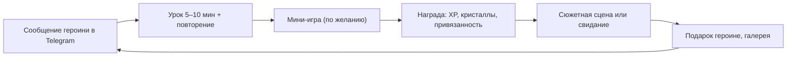
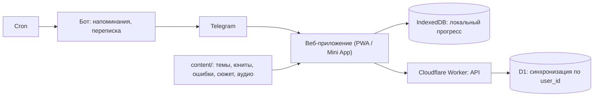

# English Club: полный план и описание функционала

> Приложение для изучения английского с аниме-героинями и романтической линией. Сначала для меня, но устроено так, чтобы им мог пользоваться и другой человек с другим уровнем и другими проблемами.
> Версия от 29.10.2026, редакция 2. Этот файл собирает всё в одном месте и считается главным: если другой документ ему противоречит, верен этот. Подробности и источники — в `docs/01`–`06`.

## Содержание

1. [О приложении](#1-о-приложении)
2. [Героини](#2-героини)
3. [Функционал](#3-функционал)
4. [Учебная программа](#4-учебная-программа)
5. [Если приложением пользуется другой человек](#5-если-приложением-пользуется-другой-человек)
6. [Технологии](#6-технологии)
7. [Форматы контента](#7-форматы-контента)
8. [План разработки](#8-план-разработки)
9. [Как писать сюжет](#9-как-писать-сюжет)
10. [Как понять, что работает](#10-как-понять-что-работает)
11. [Открытые вопросы](#11-открытые-вопросы)

---

## 1. О приложении

### Идея

Английский, в котором мотивацию держат не баллы, а героини и сюжет. Чтобы узнать, что будет дальше, и сблизиться с героиней, нужно учиться: юниты открывают главы истории, а выборы в диалогах сами по себе упражнения на английском.

### Принятые решения

| Вопрос | Решение |
|---|---|
| Для кого | Сначала для меня. Потом, возможно, для других людей (друг, родственник) с другим уровнем и другими проблемами. Поэтому программа, диагностика и сюжет не завязаны на мои слабые места (раздел 5). Монетизации, сторов, соцфункций и маркетинга нет |
| Уровень | Курс начинается с диагностики, которая строит карту навыков и личный путь. У меня уровень примерно B1 или ниже и главная проблема — времена, поэтому мой путь начинается с арки «Система времён». У другого человека путь будет другим. Приложение рассчитано на уровень от A2 |
| Платформа | Сначала веб и Telegram, потом мобильное. Одно веб-приложение работает и в браузере (PWA), и как Telegram Mini App. Позже его можно обернуть в мобильное через Capacitor |
| Учебное ядро | Уроки по CEFR + интервальное повторение (SRS) + визуальная новелла + мини-игры на пройденном материале |
| Героини | Романтическая линия (механики дейтинг-сима). В настройках можно выбрать дружескую линию |
| Сеттинг и сюжет | Пишу сам. Ниже стоит черновик-заглушка |
| AI | В первой версии не используется в самом приложении. Контент (уроки, перевод сюжета) готовится заранее с помощью LLM и хранится файлами |
| Арт | Генерация нейросетью: для личного проекта это нормально и дёшево |

### Сеттинг (черновик, будет заменён моим сюжетом)

Международная академия. Новичок попадает в English Club, который закроют, если к концу семестра его участники не сдадут экзамен. Каждая героиня ведёт свою часть обучения. Чем лучше учёба, тем дальше сюжет и тем ближе отношения с героинями.

### Ежедневный цикл



### Долгий цикл

Стрик, недельная дуэль с Рэй и «неделя с Микой» → рост привязанности → свидания и CG-иллюстрации → экзамен клуба и кульминация в конце каждой арки. Первая арка заканчивается признанием.

---

## 2. Героини

| Героиня | Кто она | Характер | Акцент | В учёбе | Что поднимает её привязанность |
|---|---|---|---|---|---|
| **Мика** | Президент English Club, гид | Genki: энергичная, позитивная, всегда болеет за тебя | Американский | Дневная цель, стрик, новые слова | Постоянство: выполненная цель, вехи стрика, «неделя с Микой» |
| **Айрис** | Аспирантка, куратор клуба | Kuudere: спокойная, строгая, тайно заботливая | Британский | Объяснения грамматики, разбор ошибок, диагностика | Точность: уроки без ошибок, работа над ошибками |
| **Рэй** | Капитан спортивной команды, соперница | Tsundere: «Я тебе не проиграю! ...И вообще, не для тебя старалась» | Австралийский | Недельная дуэль по XP, игры на скорость | Победы над ней в дуэли, рекорды в блице |

**Позже**: Лотти (тихая библиотекарша: чтение и аудирование), Кира (подруга-геймерша: AI-чат), Луна (айдол: произношение и песни).

### Правила

- Все героини взрослые (студентки 19+ и аспирантка), персонажи оригинальные.
- Реакции на ответы в характере: Мика подбадривает, Айрис вздыхает и объясняет, Рэй дразнит.
- У каждой есть профиль: биография, манера речи, любимые и нелюбимые подарки, день рождения, набор реплик-реакций.

### Эмоции

У каждой героини 8 базовых эмоций и 1 фирменная. ID эмоций используются в тегах сцен (`#rei:smirk`).

| ID | Эмоция | ID | Эмоция |
|---|---|---|---|
| `neutral` | нейтральная | `thinking` | задумчивость |
| `happy` | радость | `sad` | грусть |
| `excited` | восторг | `blush` | смущение |
| `surprised` | удивление | `pout` | недовольство |

Фирменные: Мика — `wink` (подмигивает), Айрис — `sigh` (вздыхает), Рэй — `smirk` (ухмыляется).

---

## 3. Функционал

Ниже описано, что входит в первую версию и как это работает. Числа в балансе (XP, кристаллы, пороги) стартовые, их подкручиваем по ощущениям.

### 3.1. Первый запуск

1. Мика приветствует и знакомит с клубом.
2. Настройка:
   - как к тебе обращаться: имя и род для русских текстов («ты сделал» или «ты сделала»);
   - зачем английский: сериалы и аниме, путешествия, работа, экзамен, общение (влияет на темы лексики);
   - что даётся труднее всего: времена, артикли и предлоги, слова, понимание на слух, свой вариант (подсказка для диагностики);
   - дневная цель (5, 10, 15 или 20 минут) и время напоминаний;
   - линия героинь: романтическая или дружеская.
3. **Диагностика** («вступительный тест в клуб» от Айрис), 15–20 минут:
   - общий блок: 2–3 задания на каждую грамматическую тему каталога (раздел 4.2) с подстройкой под уровень, плюс оценка словаря (отметить знакомые слова из списка; среди них есть несуществующие, чтобы ловить угадывание);
   - углублённый блок по темам, где были ошибки (у меня это все времена).
4. Результат — **карта навыков**: по каждой теме видно, освоена она, шаткая или не освоена, плюс примерный словарный запас и уровень CEFR. Из карты строится личный путь (раздел 4.3). Освоенные темы помечаются «освоено по диагностике».
5. Открывается пролог истории.

### 3.2. Главный экран (путь)

- Карта курса: арки → юниты → уроки. Статусы: закрыт, доступен, пройден, освоено по диагностике.
- Верхняя панель: стрик, кристаллы (тап открывает магазин), кольцо дневной цели.
- Кнопки: **Продолжить** (следующий урок), **Повторение** (сколько карточек на сегодня), **История** (значок, если открылась новая сцена).
- Героиня дня с короткой репликой.
- Нижнее меню: **Путь, Тренировка, История, Героини, Профиль**. «Тренировка» объединяет повторение, работу над ошибками и мини-игры.

### 3.3. Урок

- 5–10 минут, 10–15 упражнений одной темы.
- Типы упражнений (подробнее в разделе 4.5):
  - T1 выбор варианта;
  - T2 вписать форму;
  - T3 схема (для времён — линия времени);
  - T4 перевод с русского;
  - T5 найди ошибку;
  - T6 трансформация;
  - T7 разложи по группам;
  - T8 диктант;
  - T9 выбор реплики;
  - T10 пары;
  - T11 собери фразу;
  - T12 вопрос на понимание.
- **Правильный ответ**: героиня радуется, начисляется XP.
- **Ошибка**: показывается правильный ответ, Айрис коротко объясняет «почему так» и при необходимости показывает схему. Ошибка записывается в статистику по тегу (например, `tense.pp_with_ago` или `article.missing`), предложение становится кандидатом в колоду повторения (см. 3.5).
- **Проверка ответа** учитывает сокращения (I've = I have), регистр, пунктуацию и несколько правильных вариантов.
- **Итоги урока**: точность, XP, кристаллы, новые слова, привязанность.

### 3.4. Чекпоинт юнита, экзамен арки, тест-аут

- В конце юнита идёт тест. Порог прохождения — 80%. Если он пройден, открывается следующая глава истории или свидание.
- Если порог не пройден, предлагается короткая работа над ошибками и повторная попытка.
- В конце арки идёт экзамен клуба по всем темам арки. После него открывается кульминационная сцена.
- **Тест-аут**: любой юнит можно сдать сразу чекпоинтом, не проходя уроки.
- Юнит, освоенный по диагностике или сданный тест-аутом, **считается пройденным для всех гейтов**: глава истории открывается, квесты и пороги не блокируются. Пройти его уроки всё равно можно.

### 3.5. Повторение (SRS)

- Алгоритм **FSRS** планирует, когда показать карточку снова. Целевое запоминание — 90%.
- Три колоды:
  - **слова**: ключевые слова из уроков и слова, добавленные из сюжета;
  - **неправильные глаголы**: около 100 самых частых, три формы;
  - **грамматические карточки**: предложения с пропуском на нужную форму. Сюда же попадают предложения, в которых была ошибка.
- **Лимит новых карточек в день** зависит от дневной цели: 5 минут → 3, 10 → 5, 15 → 8, 20 → 10. Его можно поменять в настройках. Почему так мало: по симуляции FSRS при 15 новых карточках в день через 1–3 месяца выходит 80–110 показов в день, при 10 секундах на карточку это 13–18 минут только на повторение. При 5 новых — около 30–35 показов, 5–6 минут.
- **Очередь новых карточек** (что попадает в колоду первым):
  1. предложения с ошибками, не больше 2 в день и по одному на тег;
  2. неправильные глаголы, которые нужны текущему юниту;
  3. ключевые слова уроков (5–8 на урок, помечены в контенте);
  4. слова, добавленные вручную из сюжета.

  Остальная лексика урока остаётся пассивной: она встречается в уроках и сюжете, перевод — по тапу.
- Ежедневная сессия: сначала карточки, которые пора повторить, потом новые. Если долг повторений больше двух обычных дневных норм, новые карточки не добавляются, пока долг не уменьшится.
- Оценка ставится автоматически: ошибка → Again, верно, но с подсказкой или заметно дольше обычного → Hard, верно → Good. Easy — только кнопкой «слишком легко».

### 3.6. Работа над ошибками

- Ошибки группируются по тегам: например, «Present Perfect с ago», «will после when», «пропущен артикль».
- Показывается «топ-3 проблемных места» и тренировка из 10 заданий именно по ним.
- На один тег берутся разные предложения, чтобы не выучить ответ на конкретное (это главная претензия к «призрачным» повторениям Bunpro, см. [`06-games.md`](06-games.md)).
- Работа над ошибками без ошибок поднимает привязанность Айрис.

### 3.7. История (визуальная новелла)

- **Сцена**: фон, 1–2 героини с эмоциями, окно реплики с печатью текста, имя говорящего.
- **Управление**: тап — следующая реплика, лог прошлых реплик, автопроигрывание, пропуск прочитанного.
- **Язык**: реплики на английском уровня B1. Перевод слова по тапу (слово можно добавить в повторение), кнопка «перевод реплики». В настройках можно выбрать «перевод всегда показан»: это нужно на уровне A2.
- **Озвучка**: заранее сгенерированные аудиофайлы с голосами героинь (американский, британский, австралийский акцент). Браузерный синтез речи — только запасной вариант: в WebView Telegram на Android его часто нет, а набор голосов и акцентов зависит от устройства.
- **Выборы-упражнения**: в ключевых местах сцены стоит **слот-упражнение**. Автор пишет верную реплику, а неверные варианты приложение подбирает из банка типичных ошибок под **слабые места конкретного ученика**: у меня это ошибки во временах, у другого человека — в артиклях или предлогах. Верный выбор поднимает привязанность. После неверного героиня реагирует в характере, после сцены Айрис разбирает ошибку, а предложение уходит в повторение. Где нужно, можно написать и фиксированные варианты (формат в разделе 7).
- **Вопросы на понимание**: после главы 2–3 вопроса по сюжету (T12).
- **Гейты**: глава N открывается после N-го пройденного юнита личного пути, какой бы темы он ни был. Свидание — после нужного юнита и порога привязанности.
- Пролог доступен сразу.

### 3.8. Романтика

| ID | Механика | Как работает |
|---|---|---|
| R1 | Привязанность | Шкала 0–100 у каждой героини. Уровни: знакомые (0) → друзья (20) → близкие (40) → симпатия (60) → признание → пара. Источники — в таблице баланса ниже |
| R2 | Свидания | Отдельные сцены с одной героиней. Открываются, когда пройден нужный юнит **и** привязанность достигла порога: первое свидание — 20, второе — 40 |
| R3 | Выбор реплик = упражнение | См. 3.7. Позже — реплику нужно написать самому, а не выбрать |
| R4 | Кульминации и признание | Каждая арка заканчивается экзаменом клуба и ключевой сценой маршрута. **Признание** — сцена, где вы с героиней признаётесь друг другу в чувствах и становитесь парой. Оно бывает один раз за маршрут, в конце первой арки, и свою реплику признания нужно составить на английском самому (например, *I've liked you since the day we met*). **Маршрут выбирается перед кульминацией арки 1**: из героинь с привязанностью 60+ выбираешь, к кому идти. Остальные остаются подругами, их сцены признания можно открыть позже, когда их привязанность тоже дойдёт до 60. Если 60 нет ни у кого, играется дружеская концовка арки, а признание откроется, когда порог будет набран. В дружеской линии вместо признания — сцена «лучшие друзья». Следующие арки заканчиваются другими вехами: первое свидание как пара, ссора и примирение, финал маршрута |
| R5 | Подарки | Покупаются в магазине за кристаллы. У каждой героини любимые, обычные и нелюбимые подарки. Каждой героине засчитывается не больше 2 подарков в неделю, в день рождения подарок даёт вдвое больше (как в Stardew Valley). Описание подарка — короткий текст на английском |
| R6 | Галерея | CG-иллюстрации со свиданий и ключевых сцен. Их можно пересматривать вместе со сценой |
| R7 | Сообщения в Telegram | Напоминания, «личные сообщения» и переписка (мини-игра M3) от героини с самой высокой привязанностью (см. 3.12) |

**Баланс привязанности** (стартовый):

| Источник | Мика | Айрис | Рэй |
|---|---|---|---|
| Её «предмет» | +1 за выполненную дневную цель, +3 на вехах стрика (7, 14, 30 дней), +3 за «неделю с Микой» | +1 за урок без ошибок, +2 за работу над ошибками без ошибок | +5 за победу в дуэли, +1 за рекорд в блице (не чаще раза в день) |
| Верный выбор в сцене с ней | +2 | +2 | +2 |
| Верный ответ в переписке (M3) | +1 | +1 | +1 |
| Подарок (до 2 в неделю) | любимый +3, обычный +1, нелюбимый −1, в день рождения ×2 | так же | так же |

Цифры подобраны так, чтобы за арку 1 (6–10 недель регулярных занятий) до 60 доходили одна-две героини, на чей «предмет» делаешь упор.

**Экран «Героини»**: карточка каждой героини с уровнем привязанности, открытыми свиданиями, следующим порогом («до свидания с Рэй: ещё 1 юнит и 12 привязанности») и любимыми подарками (открываются по мере сближения).

### 3.9. Геймификация

**XP**

| За что | XP |
|---|---|
| Урок (5–10 минут) | 30 + 5 за урок без ошибок |
| Чекпоинт юнита | 40 |
| Карточка повторения | 1 |
| Глава истории | 20 |
| Работа над ошибками | 15 |
| Мини-игра | 5–10, не больше 30 XP в день из мини-игр |

Ставки подобраны так, чтобы минута любой активности давала примерно 4 XP: урок 5–10 минут — около 30 XP, карточка — 10–15 секунд. Тогда кольцо цели честно показывает минуты, и XP не получится быстро набрать чем-то одним, например только карточками.

**Дневная цель**: 5 минут = 20 XP, 10 = 40, 15 = 60, 20 = 80. Например, цель 10 минут — это урок и 10 карточек. Кольцо на главном экране заполняется по мере набора XP.

**Стрик**
- День засчитывается, когда выполнена дневная цель.
- День считается по часовому поясу из настроек. Конец дня можно сдвинуть с полуночи (например, на 03:00), чтобы ночные занятия не ломали стрик.
- **Заморозка** спасает стрик за пропущенный день и срабатывает автоматически. В запасе можно держать до 2, они покупаются в магазине.
- На вехах (7, 30, 100 дней) Мика устраивает особую сцену или дарит CG.

**Кристаллы**
- Начисляются за урок (5), идеальный урок (+5), выполненную цель (10), квест (10), «неделю с Микой» (30), победу в дуэли (50).
- Тратятся в магазине: заморозка стрика (50), подарки героиням (20–60). Если кристаллы начнут копиться, добавим наряды (D7).

**Дневные квесты** (3 в день, обновляются в конце дня). Квесты генерируются только из того, что сегодня можно сделать: квест на выборы в истории появляется, только если есть непрочитанная глава. Примеры:
- «Пройди 2 урока».
- «Повтори 20 карточек».
- «Сделай урок без ошибок».
- «Побей свой рекорд в “Парах на скорость”».
- «Ответь верно в 3 выборах в истории».

**Недельная дуэль с Рэй** (заменяет лиги)
- Неделя с понедельника по воскресенье. Итог Рэй за неделю = база × случайный множитель от 1,05 до 1,15. База — медиана моего недельного XP за 3 прошлые недели, но не меньше «дневная цель × 7» и не больше «дневная цель × 7 × 1,5». В первую неделю база = дневная цель × 7.
- Зачем так: если считать «прошлая неделя + 10%», то после каждой победы планка растёт ещё на 10%, и через 8 побед подряд она уже вдвое выше. Медиана и потолок держат дуэль посильной.
- Счёт Рэй растёт в течение недели, она комментирует его.
- Победа: 50 кристаллов + привязанность Рэй. Поражение: Рэй хвастается, награды нет.

**Неделя с Микой** (кооперация)
- Совместная цель: выполнить дневную цель 5 дней из 7. Мика «занимается вместе» и отмечает свои дни на общей шкале.
- Награда: 30 кристаллов и привязанность Мики, раз в месяц — открытка.
- Зачем: по мета-анализу геймификации сочетание соревнования и кооперации работает лучше одного соревнования. Рэй — соревнование за объём, Мика — сотрудничество за регулярность.

### 3.10. Мини-игры

Короткие игры на 1–3 минуты на уже пройденном материале: словах, неправильных глаголах, грамматических карточках и ошибках ученика. Поэтому они подходят любому ученику: у каждого в игре его собственные карточки. Разбор конкурентов, научные данные и полный каталог M1–M11 — в [`06-games.md`](06-games.md).

**В первой версии**

| ID | Игра | Как работает | Идея взята у |
|---|---|---|---|
| M1 | Пары на скорость | 60 секунд, соединить пары: слово ↔ перевод, go ↔ went ↔ gone, предложение ↔ время. Серия без ошибок даёт комбо | Duolingo Match Madness, Quizlet Match |
| M2 | Блиц с Рэй | 60 секунд: верно ответить на как можно больше знакомых грамматических карточек. Рядом «призрак» Рэй, чей результат чуть выше твоего рекорда | Испытания Duolingo на время |
| M3 | Переписка | Героиня пишет в Telegram вопрос на английском, ответ выбирается кнопками (упражнение T9). Верный ответ поднимает привязанность. Пропущенная переписка просто сгорает, без штрафа | Mystic Messenger |

**Позже (v1.x)**: M4 «Звездопад», M5 «Допрос», M6 «Стихи для героини», M7 «Собери фразу на время», M8 «Слово дня», M9 «Легендарный юнит». **v2**: M10 «Песня Луны», M11 RPG-бой.

**Правила**
- Скоростные игры берут только карточки, которые в повторении не меньше недели: скорость тренирует беглость на знакомом, а новое под таймером даёт ошибки.
- Мини-игры не меняют расписание FSRS, но ошибки из них записываются в статистику по тегам и попадают в работу над ошибками.
- 5–10 XP за игру, не больше 30 XP в день: игры дополняют уроки, но не заменяют их.
- Каждый день одна «игра дня» с бонусом, новые игры открываются постепенно. Интерес к геймификации заметно падает примерно через 4 недели (эффект новизны), поэтому набор ротируется.

### 3.11. Профиль и статистика

- Выученные слова, минуты, дни, текущий стрик и рекорд.
- **Карта навыков**: прогресс по каждой теме (у меня в ней подробно раскрыты времена).
- **Ошибки по тегам**: что повторяется чаще всего.
- Точность за неделю, график XP по дням, время на повторение в день.
- Рекорды в мини-играх.
- Повторная диагностика раз в месяц (Айрис напоминает). Задания берутся из банка, у каждого 3 варианта, чтобы не запоминать ответы.

### 3.12. Telegram

- Приложение открывается кнопкой в боте как Mini App. Вход без регистрации по данным Telegram, сервер проверяет их подпись.
- В обычном браузере (PWA) вход через виджет «Войти через Telegram»: тот же аккаунт и тот же прогресс. Без этого браузерная версия не узнает пользователя, потому что данные Telegram есть только внутри Mini App.
- У каждого пользователя свой Telegram-аккаунт и свой прогресс. Доступ только по списку разрешённых аккаунтов.
- **Бот присылает**:
  - напоминание в выбранное время от героини с самой высокой привязанностью;
  - «стрик под угрозой» за 3 часа до конца дня, если цель не выполнена;
  - итоги недельной дуэли (от Рэй) и «недели с Микой»;
  - сообщение, когда открылась новая сцена или свидание;
  - переписку (мини-игра M3).
- Сообщения пишутся простым английским в характере героини, перевод спрятан под спойлер Telegram. Это тоже маленькая практика чтения.

### 3.13. Настройки

Обращение (имя и род), дневная цель, лимит новых карточек, время напоминаний, часовой пояс и конец дня, линия героинь (романтическая или дружеская), озвучка (вкл/выкл, скорость), перевод в истории (по тапу или всегда), сброс прогресса.

### 3.14. Не входит в первую версию

| Функция | Когда |
|---|---|
| AI-чат с героинями (Кира) с разбором ошибок | Следующий этап |
| Голос: диктовка ответов, оценка произношения, звонки героиням | Позже |
| Свободный ввод реплик в истории с AI-проверкой | Позже |
| Мини-игры M4–M9, параметры героя, восстановление стрика, ивенты, достижения | v1.x, сразу после первой версии |
| Аудирование и чтение в диагностике | Когда будут аудиофайлы и тексты для них |
| Наряды для героинь, мобильное приложение (Capacitor), Live2D-анимация, новые героини, M10–M11 | Позже |
| Лиги с людьми, друзья, монетизация | Не нужно |

---

## 4. Учебная программа

### 4.1. Как устроена: карта навыков → личный путь

- Программа — не один фиксированный курс, а **каталог модулей** (юнитов) по темам и уровням CEFR. Диагностика строит карту навыков, из неё получается **личный путь**: сначала слабые темы, с учётом того, что от чего зависит (например, Present Perfect Continuous идёт после Present Perfect).
- **Арка** — отрезок пути из 6 юнитов и экзамена со своей сюжетной аркой. Сюжет у всех один, а юниты внутри арки у каждого свои.
- Интерфейс на русском, сюжет на английском уровня B1.
- Подробно: [`04-curriculum.md`](04-curriculum.md).

### 4.2. Каталог тем (A2–B2)

| Группа | Темы |
|---|---|
| Времена | Present Simple и Continuous, глаголы состояния; Past Simple; Past Continuous; будущее (will, going to, Present Continuous для планов, настоящее после when и if); Present Perfect; Present Perfect или Past Simple, for и since, Present Perfect Continuous; Past Perfect; used to и would; Future Continuous и Perfect |
| Артикли и определители | a/an, the, нулевой артикль; some, any, no; much, many, a lot of; few, little |
| Существительные | Исчисляемые и неисчисляемые, притяжательный падеж |
| Предлоги | Времени (in, on, at), места и движения, после глаголов и прилагательных (depend on, good at) |
| Вопросы и порядок слов | Вспомогательный глагол в вопросах, вопросительные слова, косвенные вопросы, there is и there are |
| Модальные глаголы | can, could, must, have to, should, might; предположение (must have, can't have) |
| Условные предложения | 0, 1, 2, 3 и смешанные; wish и if only |
| Залог и речь | Пассивный залог, косвенная речь |
| Формы глагола | Герундий и инфинитив (enjoy doing, want to do), make и let + глагол |
| Прилагательные и наречия | Степени сравнения, -ed и -ing, наречия образа действия |
| Сложные предложения | Относительные придаточные (who, which, that), связки (although, however, because of) |
| Лексика | Частотные слова (NGSL) по уровням + темы под цель ученика; фразовые глаголы; ложные друзья переводчика |
| Навыки | Чтение (сюжет, вопросы на понимание), аудирование (диктант, озвученные сцены), письмо (перевод; позже AI-проверка), говорение (позже) |

### 4.3. Как строится путь

1. Темы «не освоено» входят в путь в порядке уровня CEFR и зависимостей.
2. Темы «шатко» получают короткую версию юнита: контраст, перевод и чекпоинт.
3. Темы «освоено» в путь не входят, но их грамматические карточки изредка появляются в повторении.
4. Если в диагностике всё ровно, путь идёт по уровням CEFR от уровня ученика вверх.
5. Путь можно поправить вручную: переставить юнит или добавить тему.
6. После ежемесячной диагностики путь пересчитывается.

### 4.4. Структура юнита

Юнит = 1 грамматическая тема + 1 лексическая тема + 1 глава истории.

| # | Урок | Что внутри |
|---|---|---|
| 1 | «Что это» | Объяснение Айрис: схема (для времён — линия времени), 3 примера, узнавание |
| 2 | Форма | Утверждение, отрицание, вопрос |
| 3 | Контраст | Выбор между этой темой и соседней (Past Simple или Present Perfect, a или the) |
| 4 | Контекст | Текст или диалог с пропусками |
| 5 | Перевод | С русского на английский |
| 6 | Глава истории | Со слотами-упражнениями |
| 7 | Чекпоинт | Тест юнита → открывает свидание или сцену |

### 4.5. Типы упражнений

Типы общие для любых тем. В JSON упражнения указан тип движка (`type`) и теги навыков (`skills`).

| ID | Тип (`type`) | Пример |
|---|---|---|
| T1 | Выбор варианта (`choice`) | *Look! It ___ outside.* (rains / is raining); *I have ___ car.* (a / the / —) |
| T2 | Вписать форму (`gap_input`) | *I ___ (never / be) to Japan.* → have never been |
| T3 | Схема (`scheme`) | Выбрать линию времени к предложению или поставить событие на шкалу; для предлогов — схему in, on, at |
| T4 | Перевод RU → EN (`translate`) | «Я живу здесь с 2020 года» → I have lived / have been living here since 2020 |
| T5 | Найди и исправь ошибку (`fix_error`) | *I have seen him yesterday.*; *She is teacher.* |
| T6 | Трансформация (`transform`) | Сделать вопрос или отрицание, перенести в прошлое, в пассив, в косвенную речь |
| T7 | Разложи по группам (`sort`) | yesterday, since, right now, already — по временам; advice, chair, information — исчисляемые или нет |
| T8 | Диктант (`dictation`) | Прослушать и написать |
| T9 | Выбор реплики (`dialogue_choice`) | Мика: *What did you do last weekend?* → выбрать ответ |
| T10 | Пары (`match`) | go → went → gone; слово ↔ перевод |
| T11 | Собери фразу (`build`) | *you / where / do / live* → Where do you live? |
| T12 | Вопрос на понимание (`comprehension`) | После главы: *Why was Rei angry?* |

### 4.6. Типичные ошибки русскоязычных

Из этих ошибок строятся неверные варианты в упражнениях и в слотах сюжета. У каждой ошибки есть тег: по тегам ведётся статистика и подбираются задания. Полная библиотека — в [`04-curriculum.md`](04-curriculum.md), раздел 7.

**Времена**

| Ошибка | Правильно | Почему | Тег |
|---|---|---|---|
| I live here since 2020. | I've lived / I've been living here since 2020. | Период «до сейчас» → Present Perfect | `tense.present_for_since` |
| I am studying English for 3 years. | I have been studying English for 3 years. | Длится до сих пор | `tense.present_for_since` |
| I have seen him yesterday. | I saw him yesterday. | Законченное время (yesterday, ago) → Past Simple | `tense.pp_with_ago` |
| Did you ever been to London? | Have you ever been to London? | Опыт → Present Perfect | `tense.ever_past` |
| When I will come, I'll call you. | When I come, I'll call you. | После when и if будущее выражается настоящим | `tense.will_after_when` |
| I was go to school. | I went / I was going to school. | Смешение be + глагол | `grammar.be_plus_verb` |
| When he came, I watched TV. (если смотрел до его прихода) | When he came, I was watching TV. | Грамматически возможно, но значит «когда он пришёл, я начал смотреть». Фон, прерванный событием → Past Continuous | `tense.ps_vs_pc` |
| I am agree. | I agree. | agree — глагол, be перед ним не нужен | `grammar.be_plus_verb` |
| I am knowing. | I know. | Глаголы состояния не ставятся в Continuous | `tense.stative_continuous` |
| He don't like it. | He doesn't like it. | 3-е лицо в Present Simple | `grammar.third_person` |

**Другие темы** (примеры)

| Ошибка | Правильно | Тег |
|---|---|---|
| I have car. / She is teacher. | I have a car. / She is a teacher. | `article.missing` |
| The life is beautiful. | Life is beautiful. | `article.the_general` |
| in Monday, at the morning | on Monday, in the morning | `prep.time` |
| Where you live? | Where do you live? | `order.question` |
| Tell me where is the station. | Tell me where the station is. | `order.indirect_question` |
| informations, advices | information, advice | `noun.uncountable` |
| I enjoy to swim. | I enjoy swimming. | `verb.gerund_inf` |
| He said me. | He told me. / He said to me. | `verb.say_tell` |
| magazine (в значении «магазин») | shop | `word.false_friend` |

### 4.7. Мой путь: арка 1 «Система времён»

В русском три времени и вид глагола. В английском 12 форм (время × аспект), и прямого аналога Present Perfect у нас нет. Поэтому мой путь начинается с времён. Принципы:

1. **Линия времени** для каждого времени: прошлое — сейчас — будущее.
2. **Сначала смысл, потом форма**: что хочу сказать → какое время → как строится.
3. **Контрастные пары**: не «учим Past Continuous», а «Past Simple или Past Continuous?».
4. **Перевод с русского** как главный тренажёр.
5. **Сигнальные слова** служат подсказкой, но есть и упражнения-ловушки.
6. **Неправильные глаголы** — отдельная колода.
7. **Ошибки возвращаются**: предложения с ошибками уходят в повторение.
8. **Сюжет**: главы арки 1 насыщены временами. Это полезно любому ученику, потому что времена есть в любом диалоге.

| # | Грамматика | Лексика | Идея главы |
|---|---|---|---|
| 1 | Present Simple vs Present Continuous, глаголы состояния | Распорядок дня, клуб | Знакомство: «что обычно» и «что сейчас» |
| 2 | Past Simple | Выходные, события | Как героини провели выходные |
| 3 | Past Continuous vs Past Simple | Происшествия | Кто испортил плакат клуба? Алиби: *What were you doing at 8 pm?* |
| 4 | will, going to, Present Continuous для планов, настоящее после when и if | Планы, фестиваль | Подготовка к фестивалю |
| 5 | Present Perfect: опыт, ever, never, just, already, yet | Путешествия, опыт | Игра *Have you ever...?* |
| 6 | Present Perfect vs Past Simple, for и since, Present Perfect Continuous | Воспоминания | «Как давно вы знакомы?» |
| 7 | Микс всех времён: экзамен | — | Экзамен клуба → признание |

**Арка 2. «Уверенный B1»** (мой путь): Past Perfect, used to и would, условные предложения 0–2, пассивный залог, косвенная речь, модальные глаголы, экзамен.

**Арка 3. «B1+ → B2»** (позже): третье и смешанное условное, wish, модальные глаголы предположения, Future Continuous и Perfect, фразовые глаголы.

**Объём арки 1**: около 30 уроков, 6 чекпоинтов и экзамен. В уроках и сюжете встретится 400–500 новых слов, из них в повторение уйдут около 250–300 ключевых. Плюс 100 неправильных глаголов и грамматические карточки (из ошибок и по 5 на юнит). Всего около 450–550 карточек: при 5–8 новых в день это 2–3 месяца. Повторение немного отстаёт от уроков, это нормально: карточки продолжают вводиться и во время арки 2.

---

## 5. Если приложением пользуется другой человек

### Что подстраивается под ученика

| Что | У меня | У другого ученика |
|---|---|---|
| Диагностика | Подробно раскрыты времена | Подробно раскрыты его слабые темы |
| Путь | Арка 1 = времена | Арка 1 = его слабые темы |
| Сюжет | Общий | Тот же: главы открываются по числу пройденных юнитов, а не по конкретным темам |
| Выборы в сценах | Неверные варианты — ошибки во временах | Неверные варианты — ошибки по его тегам |
| Повторение | Своя колода, лимит по моей цели | Своя колода, лимит по его цели |
| Мини-игры | На моих карточках | На его карточках |
| Героини | Романтическая линия | Романтическая или дружеская, свой род обращения |
| Telegram | Мой аккаунт и прогресс | Свой аккаунт и прогресс |

### Пример: проверка на втором ученике

Аня, уровень B1. Времена в порядке, но путает артикли и предлоги, знает мало слов и плохо понимает на слух.

1. **Онбординг**: цель «сериалы и путешествия», трудности «слова, на слух», обращение «она», линия — по её выбору.
2. **Диагностика**: времена освоены, артикли и предлоги не освоены, словарь около 1500 слов.
3. **Путь**: артикли → предлоги времени и места → исчисляемые и неисчисляемые, much и many → ... Юниты по временам помечены «освоено по диагностике».
4. **История** та же. Глава 1 открывается после её первого юнита (артикли), а в слотах-упражнениях неверные варианты подбираются под артикли и предлоги.
5. **Повторение**: упор на слова, лексика по темам «путешествия» и «сериалы».
6. **Мини-игры** те же: «Пары на скорость» на её словах, позже «Звездопад» с a, an и the.
7. **Чего не хватит**: модулей по артиклям и предлогам ещё нет, их нужно сделать тем же конвейером, что и арку 1 (раздел 8, этап 9). Аудирование до этапа 6 слабое, а говорения в первой версии нет.

### Что заложить в архитектуру сразу

Это дёшево сделать сейчас и дорого переделывать потом:
- `user_id` во всех данных и в синхронизации, профиль ученика.
- Теги навыков (`tense.*`, `article.*`, `prep.*`...) вместо «времён» в схеме контента, статистике и карте навыков.
- Каталог тем с зависимостями и построитель пути вместо жёсткого порядка юнитов.
- Гейты истории по числу пройденных юнитов.
- Слоты-упражнения в сценах и банк неверных вариантов по тегам.
- Русские тексты интерфейса и сообщений бота с формами рода через ключи («ты сделал» / «ты сделала»).

### Ограничения первой версии

- Нет говорения и произношения. Если человеку трудно именно говорить, первая версия поможет только косвенно (AI-чат и голос — следующий этап).
- Аудирование слабое, пока не готовы аудиофайлы (этап 6).
- Для уровня A1 первая версия не подходит: сюжет на B1. С A2 — с включённым переводом.
- Контент готовится под конкретного ученика: модули, которых пока нет, делаются, когда появляется ученик, которому они нужны.
- Героев-мужчин для романтической линии не планируется: это новый арт и новые сценарии. Архитектура позволит добавить персонажа (новый профиль в `characters/`), но это отдельная большая работа.

---

## 6. Технологии

| Задача | Технология |
|---|---|
| Приложение | React + TypeScript + Vite, PWA |
| Состояние и хранение | Zustand, Dexie (IndexedDB): работает офлайн |
| Повторения | ts-fsrs |
| Сюжет | Ink (язык ветвящихся сценариев) + inkjs |
| Telegram | Telegram Mini App SDK, виджет «Войти через Telegram» для браузера, бот на grammY |
| Сервер | Cloudflare Workers + D1 + Cron, хостинг Cloudflare Pages (для нескольких пользователей бесплатно) |
| Проверка контента | zod + тесты контента |
| Озвучка | Аудиофайлы, заранее сгенерированные TTS-сервисом при сборке (голоса с американским, британским и австралийским акцентом). Запасной вариант — Web Speech API с проверкой, что он доступен |
| Тесты | Vitest, Playwright |



### Арт

1. Описать внешность каждой героини: волосы, глаза, рост, одежда, палитра.
2. Сгенерировать портрет, выбрать удачный.
3. Для консистентности использовать референс персонажа (IP-Adapter) или небольшой LoRA на 15–20 картинках.
4. Сделать эмоции перерисовкой лица (inpainting) с той же позой.
5. Убрать фон у спрайтов. Отдельно сгенерировать фоны (клуб, библиотека, кафе, крыша) и CG.

Объём арки 1: 3 героини × 9 эмоций (8 базовых + фирменная), 6–8 фонов, 5–10 CG.

---

## 7. Форматы контента

### Структура репозитория

```
app/                        # фронтенд
  src/features/lesson/      # движок упражнений
  src/features/placement/   # диагностика, карта навыков, построение пути
  src/features/srs/         # повторения
  src/features/story/       # новелла + Ink + слоты-упражнения
  src/features/game/        # XP, стрик, квесты, магазин, дуэль, неделя с Микой
  src/features/minigames/   # мини-игры
  src/data/                 # хранение и синхронизация (всё с user_id)
content/
  catalog.json              # каталог тем: уровень, зависимости
  units/                    # юниты по темам: tense-pp-vs-ps.json, article-basics.json
  diagnostic/               # банк заданий диагностики
  errors/ru.json            # библиотека типичных ошибок русскоязычных по тегам
  words/, verbs/irregular.json
  story/*.ink               # сцены
  story/slots/*.json        # слоты-упражнения: верные реплики и неверные варианты
  characters/*.json
assets/                     # спрайты, фоны, CG, аудио
server/                     # Worker: API, бот, cron
docs/
```

### Упражнение

```json
{
  "id": "tense-ps-pc-l03-e05",
  "type": "choice",
  "prompt": "Look! It ___ outside.",
  "options": ["rains", "is raining"],
  "answer": "is raining",
  "explain": "Look! — действие происходит прямо сейчас → Present Continuous.",
  "skills": ["tense.present_continuous", "tense.contrast_ps_pc"]
}
```

### Юнит в каталоге тем

```json
{
  "id": "tense-pp-vs-ps",
  "title": "Present Perfect или Past Simple",
  "cefr": "B1",
  "skills": ["tense.present_perfect", "tense.past_simple"],
  "requires": ["tense-past-simple", "tense-present-perfect"]
}
```

### Сцена со слотом-упражнением (Ink + JSON)

```ink
VAR affection_rei = 0
VAR last_mistake = ""

Rei: So you're the new member? What did you do before you came here? #rei:pout
+ [ok #exercise:ch01-e03]
    ~ affection_rei += 2
    Rei: Hmph. Not bad. #rei:blush
+ [mistake]
    { last_mistake == "tense.pp_with_ago": Rei: "Have studied... ago"? Seriously? #rei:smirk }
    { last_mistake != "tense.pp_with_ago": Rei: Iris is going to cry. #rei:smirk }
- Rei: Anyway. Welcome to the club. #rei:neutral
```

```json
{
  "id": "ch01-e03",
  "correct": ["I studied in Moscow.", "I was a student in Moscow."],
  "distractors": [
    { "text": "I have studied in Moscow two years ago.", "tag": "tense.pp_with_ago" },
    { "text": "I was study in Moscow.", "tag": "grammar.be_plus_verb" },
    { "text": "I studied in the Moscow.", "tag": "article.the_with_city" },
    { "text": "I studied at Moscow.", "tag": "prep.place" }
  ]
}
```

Как это работает. Увидев тег `#exercise:...` на варианте выбора, приложение показывает одну верную реплику и 2–3 неверные, выбирая теги, в которых ученик ошибается чаще всего. Ответ передаётся в Ink: верно → первый вариант, ошибка → второй, а тег ошибки кладётся в переменную `last_mistake`, чтобы героиня реагировала по-разному. После сцены Айрис разбирает ошибку, а предложение уходит в повторение. Схема проверена на inkjs 2.3.2.

**Фиксированный выбор** тоже можно написать прямо в Ink. Тогда тег ошибки ставится **внутри** квадратных скобок:

```ink
* [I studied in Moscow.]
    ~ affection_rei += 2
* [I was study in Moscow. #mistake:grammar.be_plus_verb]
    Rei: Iris is going to cry. #rei:smirk
```

Тег после `]` к выбору не привязывается: inkjs отдаёт его отдельной пустой строкой уже после выбора, и приложение не узнает заранее, какой вариант ошибочный.

---

## 8. План разработки

Делаем вертикальными срезами: после каждого этапа есть что открыть и потрогать. Арт и сюжет до готовности заменяются заглушками. Этапы 1–5 от сюжета не зависят. Ни один этап не опирается на то, что появится позже: например, подарки и привязанность приходят вместе с новеллой на этапе 6.

### Этап 1. Каркас
- [ ] Vite + React + TS, линтер, тесты
- [ ] PWA: установка на телефон, офлайн
- [ ] Экраны-заглушки: Путь, Урок, Тренировка, История, Героини, Профиль
- [ ] Локальное хранилище прогресса, все данные с `user_id`, профиль ученика (имя, род, цель, дневная цель)
- [ ] UI-кит: кнопки, карточки, прогресс-бар, окно реплики героини
- [ ] Деплой превью на Cloudflare Pages

**Готово, когда**: ссылка открывается на телефоне и виден главный экран.

### Этап 2. Движок упражнений + юнит 1
- [ ] Схема контента (JSON + zod): упражнения с тегами навыков, юниты, каталог тем
- [ ] Упражнения T1–T7, T9, T10, T11 (T8 — на этапе 6, когда будут аудиофайлы; T12 — вместе с историей)
- [ ] Проверка ответов: сокращения, регистр, пунктуация, варианты
- [ ] Итоги урока, разбор ошибок от Айрис, запись ошибок по тегам
- [ ] Тесты контента: у каждого упражнения есть ответ, варианты не повторяются, теги есть в словаре тегов
- [ ] Контент юнита 1 моего пути

**Готово, когда**: все уроки юнита 1 проходятся.

### Этап 3. Диагностика и путь
- [ ] Банк заданий диагностики: общий блок по каталогу тем, углублённый блок по временам, оценка словаря; у каждого задания 3 варианта
- [ ] Карта навыков
- [ ] Построение личного пути по каталогу и зависимостям, ручная правка пути
- [ ] Путь юнитов: блокировка, тест-аут, чекпоинты; «освоено по диагностике» считается пройденным
- [ ] Контент юнитов 2 и 3

**Готово, когда**: после диагностики видно, какие темы проседают, и путь собрался из них. Проверка: пройти диагностику «за другого ученика» (времена без ошибок, ошибки в артиклях) — путь должен получиться другим.

### Этап 4. Повторение
- [ ] FSRS, три колоды
- [ ] Очередь новых карточек с приоритетами и лимитом по дневной цели, стоп новых при долге
- [ ] Автодобавление ключевых слов и предложений с ошибками
- [ ] Неправильные глаголы (T10) в колоде
- [ ] Ежедневная сессия
- [ ] Работа над ошибками по тегам, разные предложения на один тег

**Готово, когда**: каждый день есть колода повторения, ошибки в неё возвращаются, а на повторение уходит не больше половины дневной цели.

### Этап 5. Геймификация и первые мини-игры
- [ ] XP по таблице 3.9, кольцо цели, стрик + заморозка, часовой пояс и конец дня
- [ ] Кристаллы и магазин (пока только заморозки)
- [ ] Дневные квесты, только выполнимые сегодня
- [ ] Дуэль с Рэй по формуле из 3.9 и «неделя с Микой» (пока с наградой кристаллами)
- [ ] Раздел «Тренировка», мини-игры M1 «Пары на скорость» и M2 «Блиц с Рэй»
- [ ] Профиль и статистика: карта навыков, ошибки по тегам, рекорды

**Готово, когда**: есть причина зайти завтра.

### Этап 6. Новелла и романтика
- [ ] Рендер сцены: фон, спрайты, эмоции, печать текста, лог, авто и пропуск
- [ ] Ink: компиляция при сборке, переменные привязанности
- [ ] Слоты-упражнения: подбор неверных вариантов под теги ученика, реакции, разбор от Айрис
- [ ] Вопросы на понимание после главы (T12)
- [ ] Перевод по тапу, перевод реплики
- [ ] Аудио: генерация TTS-файлов при сборке, проигрыватель, запасной браузерный синтез; диктант (T8)
- [ ] Гейты по числу пройденных юнитов и привязанности
- [ ] Привязанность по таблице баланса, в том числе за дуэль, «неделю с Микой» и вехи стрика
- [ ] Экран «Героини», подарки в магазине, галерея, квесты на выборы в истории
- [ ] Пролог и глава 1 по моему сюжету

**Готово, когда**: после юнита 1 открывается глава 1, и выборы меняют привязанность.

### Этап 7. Telegram и синхронизация
- [ ] Режим Mini App, вход по данным Telegram, проверка подписи на сервере
- [ ] Вход через виджет Telegram в браузерной версии
- [ ] API + D1: синхронизация по `user_id`, список разрешённых аккаунтов
- [ ] Бот: напоминания, «стрик под угрозой», итоги дуэли и «недели с Микой», новые сцены
- [ ] Мини-игра M3 «Переписка»

**Готово, когда**: прогресс одинаковый на телефоне и компьютере, и вечером приходит сообщение от героини.

### Этап 8. Контент и арт арки 1
- [ ] Юниты 4–7 моего пути и экзамен
- [ ] Главы 2–7, свидания, выбор маршрута, кульминация, признание и дружеская версия
- [ ] Арт: спрайты (3 × 9 эмоций), фоны, CG
- [ ] Озвучка всех реплик

**Готово, когда**: арка 1 проходится от начала до признания.

### Этап 9 (v1.x). Больше игр и второй ученик
- [ ] Мини-игры M4–M9
- [ ] Параметры героя, восстановление стрика, сезонные ивенты, достижения, итоги месяца
- [ ] Модули под второго ученика по его диагностике (тем же конвейером: LLM → проверка схемой и тестами → ручная вычитка)

**Готово, когда**: второй человек сам проходит онбординг и диагностику и получает свой путь из готовых юнитов.

### Дальше

Арка 2, AI-чат с Кирой, голос и произношение, мобильное приложение, Live2D, новые героини, мини-игры M10–M11.

---

## 9. Как писать сюжет

- **Одна глава на один юнит.** Глава открывается после очередного пройденного юнита, какой бы темы он ни был, поэтому сюжет не обязан быть про конкретное время. Главы арки 1 всё равно стоит насыщать временами (идеи в таблице арки 1 — только подсказки): времена есть в любом диалоге, так что это полезно и другому ученику.
- **Выборы реплик**: достаточно написать верный вариант и отметить место выбора. Неверные варианты под разные типичные ошибки я добавлю в банк слота.
- **Объём главы**: 30–60 реплик, 5–10 минут чтения.
- **Гейты**: отметь, какие сцены открываются после юнита, а какие требуют привязанности («свидание с Рэй — после 3-го юнита и привязанности 40+»).
- **Признание** — в конце арки 1, для каждой героини свой вариант. Плюс дружеская версия той же сцены.
- **Род игрока**: в английских репликах он почти никогда не важен. В русских текстах отметь места, где нужен род («ты пришёл» / «ты пришла»).
- **Формат**: обычный текст по главам, можно по-русски. Я переведу на английский уровня B1, сверстаю в Ink и вставлю слоты-упражнения.

---

## 10. Как понять, что работает

| Что | Как измеряем | Цель |
|---|---|---|
| Привычка | Стрик, дни в неделю | 6–7 дней из 7 |
| Запоминание | Доля верных ответов в повторении | 85–90% |
| Навыки | Карта навыков в ежемесячной диагностике, точность в упражнениях по слабым темам (у меня T1, T3, T4 по временам) | > 85%, карта зеленеет |
| Ошибки | Типичные ошибки по тегам | Перестают повторяться |
| Нагрузка | Время на повторение в день | Не больше половины дневной цели |
| Интерес | Хочется ли открыть следующую сцену; в какие мини-игры играю через месяц | Если нет, правим сюжет, награды, ротацию игр |
| Второй ученик | Прошёл ли онбординг и диагностику без моей помощи | Путь собрался из его слабых тем |

---

## 11. Открытые вопросы

1. Сеттинг и сюжет: пишу сам. После этого подтвердить имена и характеры героинь.
2. Арт: генерирую сам или нужна помощь с промптами и пайплайном?
3. Второй пользователь: кто он, какой у него уровень и цели? От этого зависит, какие модули готовить после арки 1.
4. Нужна ли дружеская линия уже в первой версии или достаточно романтической?
