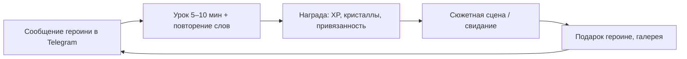

# План: личное приложение для изучения английского с аниме-героинями

## 0. Принятые решения

| Вопрос | Решение |
|---|---|
| Для кого | **Для меня лично.** Без монетизации, сторов, соц. функций и маркетинга |
| Платформа | **Сначала веб и Telegram, потом мобильное.** Одно веб-приложение работает и в браузере (PWA), и как Telegram Mini App. Позже его можно обернуть в мобильное через Capacitor |
| Учебное ядро MVP | **Уроки по системе времён + карточки SRS** и **сюжет (визуальная новелла)** |
| Отложено | AI-чат с героинями, голосовые звонки, оценка произношения |
| Героини | **Романтическая линия** (механики дейтинг-сима) |
| Мой уровень | **Примерно B1 или ниже, проблемы с временами.** Начинаем с диагностики, первая арка курса — «система времён». Программа: [`04-curriculum.md`](04-curriculum.md) |
| Сеттинг и сюжет | **Пишу сам.** Сеттинг ниже — черновик-заглушка |
| Кто что делает | **Я**: сеттинг, сюжет, арт. **Claude** (AI-ассистент): код, учебный контент, вёрстка сюжета в Ink, помощь с арт-пайплайном |
| Сервер | **Cloudflare**: один Worker (приложение, API, бот, Cron) и база D1. Для одного пользователя бесплатно |

Что меняется из-за того, что проект личный:
- **Арт можно генерировать нейросетями**: приложение никуда не распространяется. Это главная экономия. Оговорка: приложение доступно по публичной ссылке, поэтому ссылку не публикую, а API пускает только меня.
- **Лиги** заменяем **соперницей-героиней**: недельная дуэль по XP с персонажем, а не с людьми.
- **Пуши**: напоминания от героинь приходят в Telegram через бота. Это проще и приятнее мобильных пушей.
- **Контент** (уроки, сюжет) Claude генерирует заранее, и он лежит в репозитории файлами. В рантайме AI не нужен, поэтому платить за AI-API не придётся.
- **Но LLM ошибается**, а на уровне B1 я не замечу неверный «правильный» ответ и выучу ошибку. Поэтому у контента есть проверка: схема, поиск второго верного ответа, выборочная вычитка и кнопка «пожаловаться на задание» в приложении (см. [`05-dev-plan.md`](05-dev-plan.md)).

---

## 1. Концепция

**Сеттинг (черновик, заменю своим сюжетом)**: международная академия (университетского типа, все студенты взрослые). Ты переводишься в неё и попадаешь в English Club. Клуб закроют, если к концу семестра его участники не сдадут экзамен. Каждая героиня ведёт свою часть обучения. Чем лучше ты учишься, тем дальше сюжет и тем ближе отношения с героинями.

### Основной цикл (каждый день)

### Мета-цикл (недели и месяцы)

Стрик и недельная дуэль с Рэй → уровни привязанности → свидания и CG-иллюстрации → **экзамен клуба и кульминационная сцена в конце каждой арки**. Каждая учебная арка — это сюжетная арка. Первая заканчивается признанием.

---

## 2. Героини (MVP: классическое трио дейтинг-сима)

| Героиня | Роль | Архетип | Акцент | В учёбе отвечает за | Сюжетная механика |
|---|---|---|---|---|---|
| **Мика** | Президент English Club, твой гид | Genki: энергичная, позитивная | Американский | Дневная цель, стрик, новые слова | Привязанность растёт от стрика: она ценит постоянство |
| **Айрис** | Аспирантка, куратор клуба | Kuudere: спокойная, строгая, тайно заботливая | Британский | Подсказки по грамматике, работа над ошибками | Привязанность растёт от точности: она ценит правильные ответы |
| **Рэй** | Капитан спортивной команды, соперница | Tsundere: «Я тебе не проиграю! ...И вообще, не для тебя старалась» | Австралийский | Недельная дуэль по XP, челленджи на скорость | Привязанность растёт от побед над ней: она уважает сильных |

**Позже (v1.x и v2)**: Лотти (dandere, библиотекарша: чтение и аудирование), Кира (подруга-геймерша: AI-чат), Луна (айдол: произношение и песни).

Все героини взрослые (студентки 19+ и аспирантка), персонажи оригинальные.

---

## 3. Романтическая линия: как учёба связана с отношениями

| ID | Механика | Как работает |
|---|---|---|
| R1 | **Привязанность** | Шкала 0–100 у каждой героини. Уровни: знакомые → друзья → близкие → симпатия → пара. Растёт от её «предмета» (см. таблицу героинь), от правильных выборов в диалогах и от подарков. Значения хранит приложение: сцена на Ink получает их перед началом и возвращает изменения после, поэтому учёба и сюжет не расходятся |
| R2 | **Свидания** | Сюжетная сцена, которая открывается, когда привязанность достигла порога **и** пройден чекпоинт учебного юнита. Учёба — ключ к сюжету |
| R3 | **Выбор реплик = упражнение** | В диалоге нужно выбрать уместную и грамматически верную английскую реплику. Позже — написать её самому. Ошибка → героиня реагирует в характере (Рэй дразнит, Айрис вздыхает и объясняет, Мика подбадривает), привязанность не растёт, а фраза уходит в повторение |
| R4 | **Кульминации арок и признание** | Каждая учебная арка заканчивается экзаменом клуба, после него идёт ключевая сцена маршрута. **Признание** — сцена, где вы с героиней признаётесь друг другу в чувствах и становитесь парой. Оно бывает в конце первой арки. Свою реплику признания нужно составить на английском самому, например на Present Perfect: *I've liked you since the day we met*. Следующие арки заканчиваются другими вехами: первое свидание как пара, ссора и примирение, финал маршрута. Исход зависит от привязанности и точности ответов. Как совместить признание с маршрутами всех трёх героинь — открытый вопрос 1 (раздел 8) |
| R5 | **Подарки** | Покупаются в магазине за кристаллы, которые зарабатываются учёбой. У каждой героини любимые подарки (описания подарков — тоже мини-чтение на английском) |
| R6 | **Галерея воспоминаний** | CG-иллюстрации со свиданий и ключевых сцен, их можно пересматривать с текстом и переводом |
| R7 | **Сообщения в Telegram** | Напоминания и «личные сообщения» от героини, с которой у тебя самая высокая привязанность, в её характере. Пока привязанности нет, пишет Мика. Простые фразы на английском — это тоже практика |

---

## 4. Итоговый состав MVP

Полный каталог с ID в [`02-features.md`](02-features.md).

**Обучение**
- A1 диагностика времён и уровня (см. [`04-curriculum.md`](04-curriculum.md), раздел 3), A3 дневная цель
- B1 путь юнитов арки 1, B2 типы упражнений T1–T12 ([`04-curriculum.md`](04-curriculum.md), раздел 5), B3 подсказки по грамматике от Айрис
- B5 SRS-повторение (FSRS): слова, неправильные глаголы, грамматика; B6 работа над ошибками по тегам
- B7 сюжет / визуальная новелла
- H2 личная статистика: слова, минуты, точность, ошибки по тегам, уровень

**Героини и романтика**
- D1 трио героинь, D2 эмоции-спрайты, D3 озвучка (заранее сгенерированные аудиофайлы, см. раздел 5)
- R1–R7 (раздел 3)

**Геймификация**
- E1 XP, E2 стрик + заморозка, E3 кольцо дневной цели, E4 кристаллы + магазин подарков, E5 дневные квесты
- D9 недельная дуэль с Рэй (вместо лиг)

**Сервис**
- A5 в упрощённом виде: вход через Telegram и синхронизация между устройствами
- H1 напоминания от героинь через бота
- Экспорт и импорт прогресса в файл: страховка, пока нет синхронизации
- Кнопка «пожаловаться на задание»

**Не делаем в MVP**: AI-чат, голосовой ввод, произношение, лиги с людьми, друзья, монетизация, Live2D, гача.

---

## 5. Технологии

| Слой | Выбор | Почему |
|---|---|---|
| Клиент | **React + TypeScript + Vite**, PWA | Один код для браузера и Telegram Mini App. Позже можно обернуть в мобильное через Capacitor |
| Telegram | Mini App (официальный `telegram-web-app.js` или `@telegram-apps/sdk`) + бот на **grammY** | Вход без регистрации, напоминания от героинь |
| Сюжет | **Ink** (язык ветвящихся сценариев от inkle) + inkjs | Удобно писать диалоги с выборами и переменными (привязанность). Проверен на коммерческих играх |
| Сцены новеллы | Свой лёгкий рендер на React: фон + спрайт героини + эмоция + реплика + выборы | Полный контроль, чтобы встраивать упражнения прямо в диалоги |
| SRS | **ts-fsrs** | Готовая реализация FSRS |
| Данные | IndexedDB (Dexie) как локальный кэш, **сервер — источник истины** | Хранилище WebView внутри Telegram не гарантированно постоянное. Офлайн-режим — только для PWA в браузере |
| Сервер | **Cloudflare Workers** со статическими ассетами + D1 + Cron Triggers | Для новых проектов Cloudflare рекомендует Workers вместо Pages. Один Worker отдаёт приложение, API и вебхук бота, Cron шлёт напоминания |
| Озвучка | Аудиофайлы, которые скрипт заранее генерирует через TTS (голоса en-US, en-GB, en-AU). Браузерный TTS (Web Speech API) — только запасной вариант | В Telegram на Android браузерного TTS нет: Android WebView не поддерживает `speechSynthesis`. Файлы звучат одинаково везде, и у каждой героини свой голос |
| Арт | Генерация нейросетью (Stable Diffusion с аниме-моделями, Niji Journey и т. п.) | Для личного проекта это нормально и дёшево |

### Арт: как получить консистентных героинь

1. Описать внешность каждой героини: волосы, глаза, рост, одежда, палитра.
2. Сгенерировать базовый портрет и выбрать удачный.
3. Для консистентности использовать референс персонажа (character reference / IP-Adapter) или обучить небольшой LoRA на 15–20 картинках.
4. Сделать эмоции перерисовкой лица (inpainting) или редактированием по текстовой инструкции с той же позой. Восемь эмоций, коды нужны для тегов в Ink: `neutral` (нейтральная), `happy` (радость), `blush` (смущение), `surprised` (удивление), `sad` (грусть), `pout` (недовольство), `thinking` (задумчивость), `smug` (ухмылка: без неё не обойтись тсундэрэ Рэй).
5. Удалить фон у спрайтов, отдельно сгенерировать фоны (клуб, библиотека, кафе, крыша академии) и CG для свиданий.

Пайплайн лучше начать параллельно первому этапу разработки: консистентность героинь — самая долгая часть работы с артом.

### Контент как файлы в репозитории

Структура папок и форматы файлов описаны в [`05-dev-plan.md`](05-dev-plan.md).

Словарь: частотность берём из открытого списка NGSL (лицензия CC BY-SA). Уровней CEFR в NGSL нет, их берём из CEFR-J Wordlist или Oxford 3000/5000. Переводы и примеры генерирует Claude, они проходят ту же проверку, что и упражнения.

---

## 6. Этапы

Пошаговый план разработки с чек-листами: [`05-dev-plan.md`](05-dev-plan.md).

Коротко: каркас и деплой → движок упражнений и диагностика → юнит 1, путь и конвейер контента → повторение (SRS) → Telegram и синхронизация → геймификация → новелла и романтика → сюжет и арт арки 1. Учебный контент юнитов готовится отдельным треком, на 1–2 юнита впереди моего прохождения. Этапы 1–6 не зависят от сюжета, поэтому на его написание есть время до этапа 7.

---

## 7. Как понять, что работает

- **Привычка**: держится ли стрик, сколько дней в неделю я реально захожу.
- **Запоминание**: доля правильно вспомненных слов в SRS (цель 85–90%).
- **Прогресс**: ежемесячная диагностика, количество выученных слов.
- **Качество контента**: доля заданий, на которые я пожаловался и жалоба подтвердилась (цель — меньше 1%).
- **Интерес**: хочется ли открыть следующую сцену. Если нет, правим сюжет и награды.

---

## 8. Открытые вопросы

1. **Маршруты и признание.** Курс линейный, конец арки 1 наступает один раз, поэтому при первом прохождении признание может быть только одно. Рекомендация: арка 1 — общий маршрут со всеми тремя героинями, признание в конце — выбор героини, арки 2–3 идут по её маршруту. Маршруты остальных открываются для перепрохождения сюжета, где гейты-юниты заменены повторением и пересдачей экзамена арки. Решить до начала этапа 7.
2. Сеттинг и сюжет пишу сам. Как привязать главы к юнитам — в [`04-curriculum.md`](04-curriculum.md), раздел 8.
3. Имена и характеры героинь подтвердить после сюжета.
4. Арт генерирую сам или нужна помощь с промптами и пайплайном?
