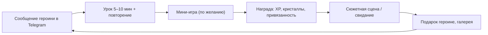

# План: приложение для изучения английского с аниме-героинями

Если этот документ расходится с [`00-full-plan.md`](00-full-plan.md), верен `00`.

## 0. Принятые решения

| Вопрос | Решение |
|---|---|
| Для кого | **Сначала для меня.** Потом, возможно, для других людей с другим уровнем и другими проблемами, поэтому программа, диагностика и сюжет не завязаны на мои слабые места. Без монетизации, сторов, соцфункций и маркетинга |
| Платформа | **Сначала веб и Telegram, потом мобильное.** Одно веб-приложение работает и в браузере (PWA), и как Telegram Mini App. Позже его можно обернуть в мобильное через Capacitor |
| Учебное ядро | **Уроки по CEFR + карточки SRS + сюжет (визуальная новелла) + мини-игры** на пройденном материале |
| Отложено | AI-чат с героинями, голосовые звонки, оценка произношения |
| Героини | **Романтическая линия** (механики дейтинг-сима), в настройках можно выбрать дружескую |
| Уровень | Диагностика строит карту навыков и личный путь. У меня примерно B1 или ниже и проблемы с временами, поэтому мой путь начинается с арки «Система времён». Программа: [`04-curriculum.md`](04-curriculum.md) |
| Сеттинг и сюжет | **Пишу сам.** Сеттинг ниже — черновик-заглушка |

Что меняется из-за того, что проект личный:
- **Арт можно генерировать нейросетями**: приложение никуда не распространяется. Это главная экономия.
- **Лиги** заменяем **соперницей-героиней**: недельная дуэль по XP с Рэй, а не с людьми. Кооперацию даёт «неделя с Микой».
- **Пуши**: напоминания и переписка с героинями приходят в Telegram через бота. Это проще и приятнее мобильных пушей.
- **Контент** (уроки, сюжет) генерируется заранее с помощью LLM и лежит в репозитории файлами. В рантайме AI не нужен, поэтому платить за AI-API не придётся.

---

## 1. Концепция

**Сеттинг (черновик, заменю своим сюжетом)**: международная академия. Ты переводишься в неё и попадаешь в English Club. Клуб закроют, если к концу семестра его участники не сдадут экзамен. Каждая героиня ведёт свою часть обучения. Чем лучше ты учишься, тем дальше сюжет и тем ближе отношения с героинями.

### Основной цикл (каждый день)



### Мета-цикл (недели и месяцы)

Стрик, недельная дуэль с Рэй и «неделя с Микой» → уровни привязанности → свидания и CG-иллюстрации → **экзамен клуба и кульминационная сцена в конце каждой арки**. Каждая учебная арка — это сюжетная арка. Первая заканчивается признанием.

---

## 2. Героини (первая версия: классическое трио дейтинг-сима)

| Героиня | Роль | Архетип | Акцент | В учёбе отвечает за | Сюжетная механика |
|---|---|---|---|---|---|
| **Мика** | Президент English Club, твой гид | Genki: энергичная, позитивная | Американский | Дневная цель, стрик, новые слова | Привязанность растёт от постоянства: выполненная цель, вехи стрика, «неделя с Микой» |
| **Айрис** | Аспирантка, куратор клуба | Kuudere: спокойная, строгая, тайно заботливая | Британский | Объяснения грамматики, работа над ошибками | Привязанность растёт от точности: уроки и работа над ошибками без ошибок |
| **Рэй** | Капитан спортивной команды, соперница | Tsundere: «Я тебе не проиграю! ...И вообще, не для тебя старалась» | Австралийский | Недельная дуэль по XP, игры на скорость | Привязанность растёт от побед над ней в дуэли и рекордов в блице |

**Позже (v1.x и v2)**: Лотти (dandere, библиотекарша: чтение и аудирование), Кира (подруга-геймерша: AI-чат), Луна (айдол: произношение и песни).

Все героини взрослые (студентки 19+ и аспирантка), персонажи оригинальные. У каждой 8 базовых эмоций и 1 фирменная (Мика — `wink`, Айрис — `sigh`, Рэй — `smirk`), список ID — в `00`, раздел 2.

---

## 3. Романтическая линия: как учёба связана с отношениями

| ID | Механика | Как работает |
|---|---|---|
| R1 | **Привязанность** | Шкала 0–100 у каждой героини. Уровни: знакомые (0) → друзья (20) → близкие (40) → симпатия (60) → признание → пара. Растёт от её «предмета», от верных выборов в диалогах, от переписки и подарков. Таблица баланса — в `00`, раздел 3.8 |
| R2 | **Свидания** | Сюжетная сцена, которая открывается, когда пройден нужный юнит **и** привязанность достигла порога (20 для первого, 40 для второго). Учёба — ключ к сюжету |
| R3 | **Выбор реплик = упражнение** | В диалоге нужно выбрать уместную и грамматически верную реплику. Неверные варианты подбираются под слабые места ученика. Позже реплику нужно будет написать самому. Ошибка → героиня реагирует в характере (Рэй дразнит, Айрис вздыхает и объясняет, Мика подбадривает), привязанность не растёт |
| R4 | **Кульминации арок и признание** | Каждая учебная арка заканчивается экзаменом клуба, после него идёт ключевая сцена маршрута. **Признание** — сцена, где вы с героиней признаётесь друг другу в чувствах и становитесь парой. Оно бывает **один раз** за маршрут, в конце первой арки. Свою реплику признания нужно составить на английском самому, например *I've liked you since the day we met*. **Маршрут выбирается перед кульминацией**: из героинь с привязанностью 60+. Признания остальных открываются позже, когда их привязанность тоже дойдёт до 60. Если 60 нет ни у кого, играется дружеская концовка, а признание откроется позже. Следующие арки заканчиваются другими вехами: первое свидание как пара, ссора и примирение, финал маршрута |
| R5 | **Подарки** | Покупаются в магазине за кристаллы, которые зарабатываются учёбой. Любимые, обычные и нелюбимые подарки, не больше 2 в неделю каждой героине, в день рождения вдвое больше привязанности. Описания подарков — тоже мини-чтение на английском |
| R6 | **Галерея воспоминаний** | CG-иллюстрации со свиданий и ключевых сцен, их можно пересматривать с текстом и переводом |
| R7 | **Сообщения в Telegram** | Напоминания, «личные сообщения» и переписка с выбором ответа (мини-игра M3) от героини с самой высокой привязанностью, в её характере. Простые фразы на английском — это тоже практика |

---

## 4. Состав первой версии

Полный каталог функций с ID — в [`02-features.md`](02-features.md), подробное описание — в `00`, раздел 3.

**Обучение**
- A1 диагностика → карта навыков и личный путь, A2 цель обучения, A3 дневная цель
- B1 путь уроков по каталогу тем, B2 12 типов упражнений (T1–T12), B3 объяснения от Айрис
- B5 SRS-повторение (FSRS) с лимитом новых карточек по дневной цели, B6 работа над ошибками по тегам
- B7 сюжет / визуальная новелла со слотами-упражнениями
- H2 личная статистика: слова, минуты, точность, карта навыков

**Героини и романтика**
- D1 трио героинь, D2 эмоции-спрайты, D3 озвучка (заранее сгенерированные аудиофайлы)
- R1–R7 (раздел 3)

**Геймификация**
- E1 XP, E2 стрик + заморозка, E3 кольцо дневной цели, E4 кристаллы + магазин, E5 дневные квесты
- D9 недельная дуэль с Рэй (вместо лиг), «неделя с Микой» (кооперация)
- E10 мини-игры M1 «Пары на скорость», M2 «Блиц с Рэй», M3 «Переписка» (см. [`06-games.md`](06-games.md))

**Не делаем в первой версии**: AI-чат, голос, произношение, лиги с людьми, друзья, монетизация, Live2D, гача, мини-игры M4–M11.

---

## 5. Технологии

| Слой | Выбор | Почему |
|---|---|---|
| Клиент | **React + TypeScript + Vite**, PWA | Один код для браузера и Telegram Mini App. Позже можно обернуть в мобильное через Capacitor |
| Telegram | Telegram Mini App SDK + виджет «Войти через Telegram» + бот на **grammY** | Вход без регистрации и в Telegram, и в браузере; напоминания и переписка с героинями |
| Сюжет | **Ink** (язык ветвящихся сценариев от inkle) + inkjs | Удобно писать диалоги с выборами и переменными (привязанность). Проверен на коммерческих играх |
| Сцены новеллы | Свой лёгкий рендер на React: фон + спрайт героини + эмоция + реплика + выборы | Полный контроль, чтобы встраивать слоты-упражнения прямо в диалоги |
| SRS | **ts-fsrs** | Готовая реализация FSRS |
| Данные | IndexedDB локально + синхронизация с сервером по `user_id` | Работает офлайн, прогресс не теряется, у каждого ученика свой |
| Сервер | **Cloudflare** (Pages + Workers + D1 + Cron) или Supabase | Для нескольких пользователей бесплатно. Cron нужен для напоминаний бота |
| Озвучка | Аудиофайлы, заранее сгенерированные TTS-сервисом при сборке, с голосами героинь. Web Speech API — запасной вариант | Браузерный синтез ненадёжен: в WebView Telegram на Android его часто нет, а голоса и акценты зависят от устройства |
| Арт | Генерация нейросетью (Stable Diffusion с аниме-моделями, Niji Journey и т. п.) | Для личного проекта это нормально и дёшево |

### Арт: как получить консистентных героинь

1. Описать внешность каждой героини: волосы, глаза, рост, одежда, палитра.
2. Сгенерировать базовый портрет и выбрать удачный.
3. Для консистентности использовать референс персонажа (character reference / IP-Adapter) или обучить небольшой LoRA на 15–20 картинках.
4. Сделать эмоции перерисовкой лица (inpainting) с той же позой: 8 базовых (нейтральная, радость, восторг, удивление, задумчивость, грусть, смущение, недовольство) и 1 фирменную.
5. Удалить фон у спрайтов, отдельно сгенерировать фоны (клуб, библиотека, кафе, крыша школы) и CG для свиданий.

### Контент как файлы в репозитории

```
content/
  catalog.json                # каталог тем: уровень CEFR, зависимости
  units/tense-present.json    # юнит: уроки, слова, упражнения
  errors/ru.json              # типичные ошибки русскоязычных по тегам
  words/b1.json               # словарь уровня с переводом и примерами
  story/common/ch-01.ink      # общий маршрут
  story/mika/date-01.ink      # свидания и маршруты героинь
  story/slots/ch-01.json      # слоты-упражнения главы
  characters/mika.json        # профиль: имя, акцент, подарки, день рождения, реплики-реакции
assets/
  characters/mika/{neutral,happy,blush,...,wink}.png
  bg/, cg/, audio/
```

Основа для словаря — открытый список NGSL + распределение по уровням CEFR.

---

## 6. Этапы

Пошаговый план разработки с чек-листами: [`05-dev-plan.md`](05-dev-plan.md).

Коротко: каркас → движок упражнений и юнит 1 → диагностика и путь → повторение (SRS) → геймификация и первые мини-игры → новелла и романтика → Telegram и синхронизация → контент и арт арки 1 → больше игр и второй ученик. Первые пять этапов не зависят от сюжета.

---

## 7. Как понять, что работает

- **Привычка**: держится ли стрик, сколько дней в неделю я реально захожу.
- **Запоминание**: доля правильно вспомненных карточек в SRS (цель 85–90%).
- **Нагрузка**: на повторение уходит не больше половины дневной цели.
- **Прогресс**: карта навыков в ежемесячной диагностике, количество выученных слов.
- **Интерес**: хочется ли открыть следующую сцену, играю ли в мини-игры через месяц. Если нет, правим сюжет, награды и ротацию игр.

---

## 8. Открытые вопросы

1. Сеттинг и сюжет пишу сам. Как привязать главы к юнитам — в [`04-curriculum.md`](04-curriculum.md), раздел 10.
2. Имена и характеры героинь подтвердить после сюжета.
3. Арт генерирую сам или нужна помощь с промптами и пайплайном?
4. Второй пользователь: кто он, какой уровень и цели?
5. Нужна ли дружеская линия уже в первой версии?
