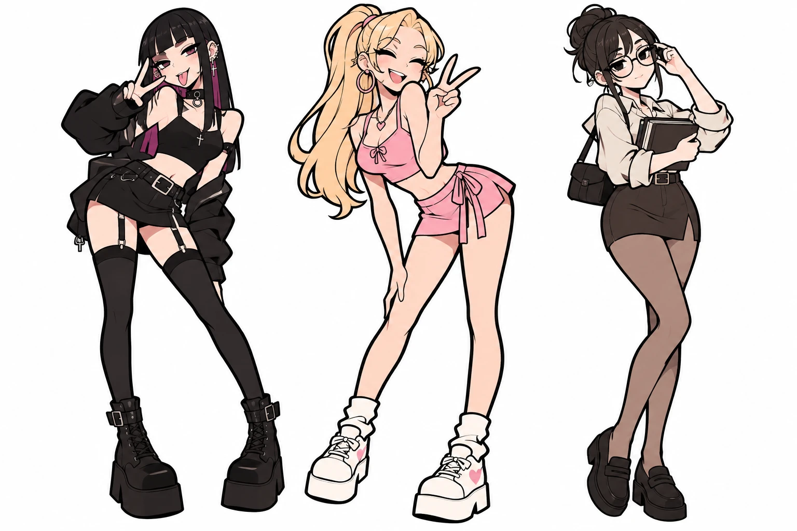

# English Club — референсы героинь

Зафиксированы 29.10.2026. Изображения предоставлены Иваном и лежат в репозитории в `assets/refs/`. Это основной источник внешности для спрайтов, фонов с героинями и CG.

Соответствие на обоих изображениях: слева Рэй, в центре Мика, справа Айрис. Имена и характеры описаны в [сюжетной библии](06-story-bible.md).

## ref_01_expressive

- Файл: `assets/refs/ref_01_expressive.webp`, 1536 × 1024.
- Назначение: выразительные позы и эмоции. Рэй показывает язык и V-жест, Мика наклоняется вперёд с закрытыми глазами, Айрис поправляет очки в полуобороте.
- SHA-256: `5f26bd2c4ab96b9a1f5d654386eb085f3c023b5dfccc0f300747e98b99ea11c5`.

## ref_02_front

- Файл: `assets/refs/ref_02_front.webp`, 1536 × 1024.
- Назначение: основной фронтальный референс внешности, полный рост, нейтральная стойка.
- SHA-256: `27402c10bf2f3f320943512b07b9b436e6ffa1ebdabbc6b62bcd02d707429662`.

Исходные PNG из библиотеки ChatGPT (`Готическая, гламурная и умная троица(1).png` и `Три героини_ готика, поп и классика.png`) имели другие хеши: в репозиторий попали версии в WebP.

## Признаки, которые нужно сохранять

| Героиня | Лицо и волосы | Базовый образ |
|---|---|---|
| Рэй | Чёрные прямые длинные волосы, ровная чёлка, пурпурные пряди снизу; розово-бордовые глаза; несколько проколов в ушах, серьги-кресты | Чокер с кольцом, кулон-крест; чёрный кроп-топ, объёмная чёрная куртка, спущенная с плеч; чёрная мини-юбка с ремнём и цепочкой; чулки на подвязках; чёрные ботинки на платформе с пряжками |
| Мика | Длинные светлые волосы, высокий хвост с розовой резинкой; голубые глаза | Большие розовые серьги-кольца, кулон-сердце; розовый топ с бантиком, розовая юбка с запахом и завязкой, маленькая розовая сумочка; белые гольфы гармошкой; белые кроссовки на платформе с розовыми сердечками |
| Айрис | Тёмные волосы в небрежном пучке с выбившимися прядями; круглые очки в чёрной оправе; карие глаза | Светлая кремовая блузка с закатанными рукавами, тёмно-коричневая юбка-карандаш с ремнём; коричневые колготки; чёрные лоферы; книги в руках и тёмная сумка через плечо |

Единый стиль: уверенный тёмный контур, чистые цветовые заливки, простые тени, без зернистости. На листах персонажей белый фон. Взрослые пропорции сохраняются.

Базовый образ — для листа персонажа и сцен в академии. В сценах наряд меняется по месту и погоде (куртка и пальто на улице, дождевик на рынке, более закрытая одежда на интервью и в музее), а лицо, причёска, цвета и ключевые детали — кресты и чокер у Рэй, хвост и сердечки у Мики, очки и пучок у Айрис — остаются узнаваемыми.

Для сценария внешность не определяет обязательный архетип характера. Указанные детали не являются описанием реальных людей.
