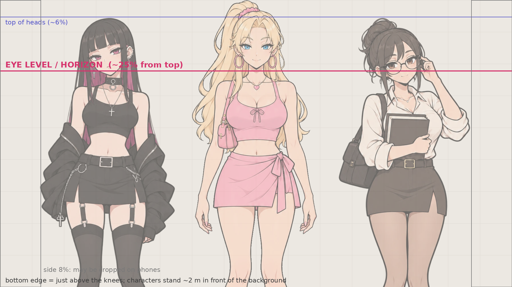

# English Club — бриф: фоны локаций для сцен

Версия 1 · 31.10.2026. Стиль — как у фона «После уроков» (`assets/after-class/classroom.webp`): его и прикладывать как образец. Героини и их стиль — [бриф спрайтов 11](11-sprite-brief.md).

## 1. Зачем

Сейчас героини стоят на пустом фоне, и непонятно, где идёт сцена. Фон за ними сразу говорит «комната 17», «двор», «библиотека», а при смене локации игрок видит, что история переместилась. Фон подключу в сценах, рамках занятий и реакциях; у каждой сцены в контенте появится поле с локацией.

## 2. Масштаб: главное правило

Героини на сцене всегда **одного размера** (так сделано 31.10.2026) и показаны **от макушки до колен**. Фон должен быть нарисован так, чтобы они в нём стояли естественно, а не висели великанами или куклами.

Приложите к генерации **калибровочную картинку** [`assets/backgrounds-calibration.png`](assets/backgrounds-calibration.png) как образец раскладки (не стиля):



- **Линия горизонта — на уровне глаз героинь, около 25% от верха кадра.** Камера на высоте глаз стоящего человека, смотрит прямо, без наклона. Верхний край кадра — чуть выше их голов, нижний — чуть выше колен.
- Героини стоят **примерно в 2 м перед фоном**. Ближайшая стена, стеллаж или стол — за ними, не перед ними. Дверь за героиней по высоте чуть выше её головы.
- **Центр и низ кадра закрыты фигурами.** Всё, что объясняет место (окно, доска, микрофоны, стеклянные двери, вывеска), — в **верхней трети и по бокам**.
- Края по 8% с каждой стороны на телефоне могут обрезаться — ничего важного там нет.
- На переднем плане ничего: ни мебели, ни людей у нижнего края.

## 3. Технические требования

- **1920 × 1080** (16:9), PNG, без прозрачности. Конвертирую в WebP сам.
- **Без людей**, без текста и логотипов (надписи генераторы портят; если нужен номер «17» или «70» — только крупные цифры на табличке, иначе без них).
- Стиль как у `classroom`: 2D аниме-фон, чистые контуры, плоская заливка, мягкие тени, тёплый свет; **без зерна, шума, текстуры, живописных эффектов**.
- Фон **чуть спокойнее героинь**: немного ниже контраст и насыщенность, лёгкая глубина резкости на дальнем плане. Героини должны читаться поверх, особенно в тёмной теме.
- Одно время суток на картинке. Варианты одной локации (вечер, дождь) — **с той же точки и той же раскладкой**, меняется только свет и погода.

## 4. Локации

Собраны по всем написанным сценам (пролог, юниты 001–004), плану арки 1 (005–020) и арке 2 из [библии](06-story-bible.md). Делать по волнам: первая нужна уже сейчас.

### Волна 1 — уже в сюжете

| Файл | Место | Где в сюжете | Что видно |
|---|---|---|---|
| `old_corridor` | Коридор старого корпуса, утро | Пролог: «вошёл в старый корпус, на двери 17» | Длинный коридор, старые деревянные двери с табличками, на ближней двери крупно **17**, высокие окна с утренним светом, доска объявлений сбоку |
| `room17` | Комната 17, день | Юниты 001–004, большинство сцен | Маленькая студенческая радиостудия в старом корпусе: стол с двумя-тремя микрофонами на стойках, рекордер, спутанный кабель, наушники, старый пульт; полка с кассетами и пластинками; маркерная доска; над дверью красная лампа «в эфире» (не горит); окно на двор |
| `room17_evening` | Комната 17, вечер | Вечерние сцены, «запись идёт» | То же с той же точки: тёплый свет настольных ламп, за окном сумерки, **красная лампа над дверью горит** |
| `room17_rain` | Комната 17, дождь | 004, миссия: «во дворе начался дождь» | То же, дневной серый свет, дождь на стекле |
| `courtyard` | Внутренний двор академии, день | 002 (интервью с новичками), будущая сцена 013 «Десять секунд тишины» | Каменная плитка, деревья, скамейки, арки старого корпуса; на дальнем плане стеклянный фасад нового корпуса |
| `new_building` | Вход в новый корпус | Пролог: «через двор, потом стеклянные двери», путь в кабинет 70 | Современный светлый холл за стеклянными дверями, стойка информации, указатели-пиктограммы без текста |
| `room70` | Кабинет 70, новый корпус | Вступительная проверка | Современная аудитория: ряды светлых столов, большой экран с нейтральной заставкой (без текста), тишина, утренний свет |
| `library` | Библиотека, второй этаж, у окна | 004, занятие 1 | Высокие стеллажи, длинный деревянный стол, большое окно во двор, мягкий дневной свет, лампы с зелёными абажурами |
| `dorm_evening` | Комната игрока в общежитии, вечер | 003: голосовые сообщения, общий чат | Стол с ноутбуком и лампой, кровать сбоку, окно с вечерним городом, на столе телефон |

### Волна 2 — арка 1, юниты 005–020

| Файл | Место | Юниты |
|---|---|---|
| `new_corridor` | Коридор нового корпуса: таблички аудиторий, указатели | 005 «Найти комнату», 017–020 маршруты |
| `dining_hall` | Студенческая столовая: раздача, витрина с блюдами, длинные столы | 009–012 «Заказать обед», «Уточнить состав», «Составить общий список» |
| `shop` | Небольшой магазин электроники или музыки: полки с кабелями, наушниками, ценники без текста | 011 «Сравнить цены», поход за оборудованием |
| `student_office` | Студенческий офис: стойка, стенд с листовками, принтер | 003 (звонок Мики), 007 «Договориться о помощи» |
| `closed_passage` | Закрытый проход: решётка или дверь с лентой в переходе между корпусами | Поворот арки 1: идеальный маршрут ведёт в закрытый проход |
| `archive` | Старый архив: металлические стеллажи, коробки, катушки плёнки, пыльный свет из узкого окна | Финал арки 1: команда находит архив |

### Волна 3 — арка 2 (021–040) и дальше

| Файл | Место |
|---|---|
| `bus_stop` | Городская остановка у моря, павильон, расписание без текста |
| `town_street` | Улица прибрежного городка: магазины, вывески без текста |
| `record_store` | Магазин пластинок: ящики с винилом, проигрыватель, тёплый свет |
| `listening_evening` | Маленький зал или кафе на вечер прослушивания: стулья, колонки, гирлянда |
| `embankment` | Набережная: перила, море, фонари (дневной и вечерний варианты) |
| `cafe` | Кафе: стойка, столики у окна, чашки |

## 5. Промпт

Приложить: **`classroom.webp`** (стиль) и **`backgrounds-calibration.png`** (раскладка и масштаб).

```
Background illustration for a visual novel in the exact art style of the first attached
image: 2D anime background, clean dark outlines, flat cel-shaded colors, simple soft
shadows, warm natural light, no grain, no noise, no texture, no painterly effects.
Use the second attached image ONLY for camera and scale: eye level / horizon line at
about 25% from the top, camera at the standing eye level of a person, looking straight
ahead, no tilt. Characters (not drawn) will stand about 2 meters in front of this
background and cover the centre and the lower part of the frame, so put the details
that explain the place in the upper third and on the left and right sides. Nothing in
the foreground. No people.
<МЕСТО>
Slightly lower contrast and saturation than the characters, gentle depth of field on
the far plane. Landscape 1920x1080, no text, no logos, no watermark.
```

`<МЕСТО>` по локациям волны 1:

| Файл | `<МЕСТО>` |
|---|---|
| `old_corridor` | `A long corridor in an old university building in the morning: old wooden doors with small number plates, the nearest door on the right has a large plate with the number 17, tall windows with soft morning light on the left, a notice board with blank papers, worn parquet floor.` |
| `room17` | `A small student radio studio in an old university building, daytime: a wooden table with two or three microphones on stands, a portable audio recorder, a tangled cable, headphones, an old mixing desk; a shelf with cassettes and vinyl records; a whiteboard on the wall; a small red "on air" lamp above the door, switched off; a window to a courtyard with trees.` |
| `room17_evening` | `The same small student radio studio from the same viewpoint and layout, in the evening: warm light from desk lamps, dusk outside the window, the red "on air" lamp above the door is glowing.` |
| `room17_rain` | `The same small student radio studio from the same viewpoint and layout, on a rainy day: soft grey daylight, raindrops running down the window glass.` |
| `courtyard` | `The inner courtyard of an old university, daytime: stone paving, a few trees, wooden benches, stone arches of the old building on the sides, and in the distance the glass facade of a modern new building.` |
| `new_building` | `The bright modern entrance hall of a new university building seen just inside its glass doors: a light floor, an information desk, wayfinding signs with pictograms only, plants, morning light.` |
| `room70` | `A modern university classroom prepared for a test, morning: rows of light desks, a large wall screen with a neutral blank welcome slide, clean walls, big windows, calm and quiet.` |
| `library` | `The second floor of a university library by a large window, daytime: tall wooden bookshelves, a long wooden reading table, green-shaded desk lamps, the window overlooking a courtyard, soft daylight.` |
| `dorm_evening` | `A student's dorm room in the evening: a desk with a laptop and a lamp, a smartphone on the desk, a bed on one side, a window with the lights of a small seaside town at dusk.` |

Для волн 2 и 3 — тот же шаблон, `<МЕСТО>` по описанию из таблиц; если нужно, допишу точные промпты.

## 6. Проверка перед отправкой

- [ ] Положите калибровку поверх фона (полупрозрачно): героини стоят естественно, дверь чуть выше головы, горизонт на уровне глаз.
- [ ] Место узнаётся по верхней трети и краям, даже если центр закрыт фигурами.
- [ ] Нет людей, текста, логотипов; номер 17 / 70 — только цифры.
- [ ] Стиль совпадает с `classroom`: чистые контуры, плоская заливка, без зерна.
- [ ] Варианты одной локации — с той же точки, совпадают по раскладке.

## 7. Как прислать

Архив `backgrounds/` с PNG по именам из таблиц. Можно частями: сначала `room17`, `old_corridor`, `courtyard` — их больше всего в сценах. Я переведу в WebP, положу в `assets/backgrounds/`, добавлю сценам поле локации и проверю масштаб на телефоне и компьютере.
