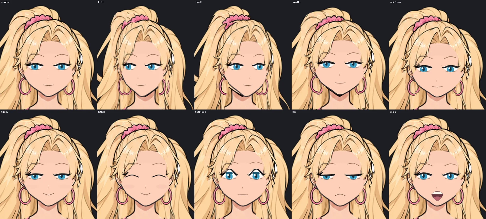
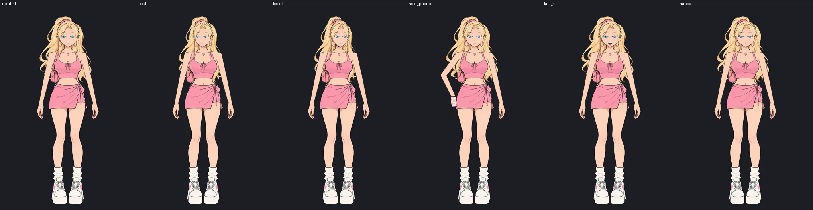
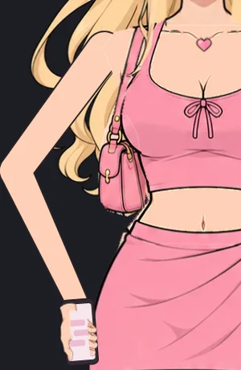

# English Club — полный риг, шаг 0: разбор того, что есть

01.11.2026. Шаг 0 [плана 28](28-full-rig-plan.md). Статус: **шаг 0 выполнен**.

## 1. Мастера

`source/masters/{mika,rei,iris}.png` — фронтальные мастера с Drive: `Мика в нейтральной фронтальной позе-3.png`, `Рэй в строгой фронтальной стойке-1.png`, `Ирис в строгой фронтальной позе-2.png`. Все три — 1024 × 1536, RGB, белый фон.

**Мика:**

- 1024 × 1536, RGB, **белый фон без прозрачности**. Это половина целевого холста рига (2048 × 3072). Как референс внешности годится, нарезать на слои его нельзя: слои рисуются заново по 2.2–2.3 брифа 27.
- Поза уже близка к позе для рига: анфас, рот закрыт, лёгкая улыбка, руки опущены и немного отведены, кисти расслаблены.
- Что придётся дорисовывать под перекрытиями: торс и бока за длинными волосами по обе стороны, плечо и бок под ремешком и сумкой (сумка висит у правого бедра Мики), шею под колье, бедро под бантом юбки.

**Рэй:** чёлка и прямые длинные волосы с цветными прядями закрывают плечи и бока — под ними дорисовать торс и руки. Куртка спущена с плеч и висит на локтях: рукава куртки — отдельные слои на костях предплечий, иначе руку не поднять. Цепочка с крестом на юбке, чокер, подвеска, серьги — отдельно, качаются. **Наушников в мастере нет** — решение по разделу 9 брифа нужно до генерации её слоёв.

**Айрис:** пучок и выбившиеся пряди, очки — оправа отдельно от лица. Рукава блузки закатаны до локтя: граница рукава на сгибе — место для `elbow_patch`. Ремешок сумки через правое плечо, сумка у правого бедра — дорисовать блузку под ремешком.

## 2. Как устроен v14 (`assets/rive/*.riv`)

Разобрано скриптом `scripts/riv_dump.py`: он читает файл объект за объектом, описание полей взято из официального rive-runtime. Формат 7.3, его читает наш рантайм 2.44.0.

| | Мика (`stand`, `phone`, `cheer`) | Айрис, Рэй |
|---|---|---|
| Тело | **одна картинка `Body Mesh` на позу**, сетка 70–112 вершин | так же |
| Кости | 3 независимые корневые кости на артборд: `Head_CTRL`, `Upper Body Motion`, `Lower Body Static`; дочерних костей нет, IK нет | так же |
| Лицо | на каждую эмоцию — целые картинки `Face`, `Eyelids`, `mouth_closed/half/open`, переключаются | так же |
| Ключи | 5,6 тыс., **все линейные**: ни одного кривого или easing-интерполятора | 20–22 тыс., тоже линейные |
| Логика | `CharacterVM`, слои state machine по свойствам, `lean` через blend 1D | так же |

**Почему движение выглядит плохо и что не повторять:**

1. Тело — одна плоская картинка, которую гнут три кости. Руки, волосы и одежда не могут двигаться отдельно, поэтому гнётся всё сразу, как резина. → В риге каждая часть — свой слой со своей костью (раздел 2.3 брифа).
2. Кости не связаны в цепочку: голова не наследует наклон корпуса, его приходится повторять ключами. → Иерархия таз → позвоночник → шея → голова.
3. Все ключи линейные: движение начинается и останавливается рывком. → Кубические кривые (ease in/out) на всех позах и жестах; линейные только там, где нужен механический ход.
4. Лицо меняется целиком, картинками на каждую эмоцию: отсюда 133 картинки на файл и эмоции, привязанные к позе. → Лицо собирается из частей (брови, веки, радужки, рот) и одно на все позы.
5. 20 тыс. ключей у Айрис и Рэй — результат того, что ключами имитируют движение, которого нет в риге. В риге ключей нужно на порядок меньше.

## 3. Проба ChatGPT `English_Club_FullRig_Stage0_Mika.zip`

### 3.1. Что внутри и как собрано

**Собрано не в редакторе, а через Rive CLI 1.8.0**: Python-генератор (`tools/build_rig.py`) пишет текстовый исходник `scene.rml`, CLI собирает из него `.riv`. Для этого не нужна авторизация в Rive, а `.rev` нет. В плане 28 этого пути не было. Что он значит для плана — раздел 4.

| | Проба | Бриф 27 |
|---|---|---|
| Артборд | один `Character` 2048 × 3072, `CharacterVM` v2, `CharacterSM` с 12 слоями | ✓ |
| Скелет | 21 кость: таз → позвоночник ×2 → шея → голова, хвост цепочкой из 4 костей, руки и ноги; IK на обеих руках | ✓ |
| Сетки | 29 сеток, ~550 вершин, ~1000 весов | ✓, с запасом по бюджету 2500 |
| Эмоции | 24 (включая 4 поздние) × 2 позы, лицо не зависит от позы | ✓ |
| Рот | 10 визем + 3 уровня громкости; модификаторы эмоций | ✓ |
| Голова | `lookX`/`lookY` | работает, но со швами (3.2) |
| Поза, предмет, жест | `stand` / `hold_side`, телефон с 4 экранами, `wave` | ✓ |
| Текстуры | **один атлас 2048 × 2048**: сетки берут из него свои участки | ✓ (в плане 28 я ошибся: атлас в Rive возможен) |
| Ключи | 4750, **все линейные** | ✗, та же ошибка, что в v14 |
| Разрешение арта | слои на холсте 2048 × 3072, но это **увеличенный мастер 1024 × 1536**; в атласе участки вдвое меньше своих мест на холсте | ✗, крупных планов в 2K нет |
| `.rev` | нет | ✗, редактировать в Rive нечего |
| Проверка на рантайме | `@rive-app/canvas@2.44.0` и `react-canvas@4.36.0`, без ошибок | ✓, моя проверка тоже чистая |

### 3.2. Как выглядит (рендер на нашем рантайме, тёмный фон)

1. **Лицо не похоже на мастер.** Глаза, брови, нос и рот — простые векторные формы, без ресниц и бликов мастера. Нарисованные волосы рядом с ними выглядят как другой стиль. Это главный провал пробы.
2. **Швы при повороте головы.** При `lookX = ±1` контур подбородка рвётся и съезжает вбок, у виска виден прямой край кожи, макушка хвоста срезана. При `lookY` контур подбородка становится толще. Приёмка этапа 0 («без швов и съезжающих черт») не пройдена.
3. **Мусор в волосах**: белые штрихи и пятно у правого уха — следы вырезания слоёв из мастера.
4. **Рука в `hold_side`** — плоская заливка цвета кожи без контура и теней, локоть торчит острым углом. Рядом с остальным артом выглядит чужой.
5. **Кайма на тёмном фоне** почти чистая: светлые полупрозрачные пиксели по краю есть только там, где они нарисованы светлыми (носки, белки глаз, зубы). У `top` их 468 — проверить вблизи при перегенерации.
6. Движение по-прежнему линейное: позы и жесты будут начинаться и останавливаться рывком.

### 3.3. Таблица слоёв

| Слои | Оценка | Что делать |
|---|---|---|
| `hair_back`, `hair_top`, `bangs`, `side_lock_*`, `ponytail_1…4`, `scrunchie` | доработать | вычистить белые штрихи; дорисовать верх хвоста, который виден при повороте |
| `head_base`, `ear_*`, `face_shadow`, `blush` | перегенерировать | от кропа головы мастера, в 2×; край лица без резкой границы под волосами |
| `eye_white_*`, `iris_*`, `highlight_*`, `lid_*`, `lashes_*`, `brow_*`, `nose` | перегенерировать | **растровыми, от мастера**, а не векторными; глаза мастера с ресницами и бликами |
| `mouth_*`, `teeth`, `tongue` | доработать | формы годятся, стиль контура свести к мастеру |
| `neck`, `chest`, `torso`, `pelvis`, `top`, `skirt`, `skirt_bow`, `necklace`, `bag`, `bag_strap` | годится как монтаж | при перегенерации в 2× — дорисовать бока под волосами и под ремешком |
| `upper_arm_*`, `forearm_*`, `elbow_patch_*`, `arm_*` | перегенерировать | растр с контуром как у мастера; локоть со вставкой |
| `hand_*_relaxed/open/hold_phone(_back)` | доработать | есть 3 формы из 17; остальные — этап 2 |
| `thigh_*`, `shin_*`, `foot_*`, `leg_*_full` | годится | ноги в сценах почти не видны |
| `earring_*` | годится | |

### 3.4. Что взять из пробы

Структуру: скелет из 21 кости, IK, слои state machine, `contract.json`, Preview и QA-скрипты. Всё это совпадает с брифом и проверено на нашем рантайме. Переделывать нужно **арт** (лицо и руки — растром от мастера, в настоящем 2×) и **кривые движения**.

## 4. Что меняется в плане 28

1. **Атлас в Rive возможен**: сетки берут участки одной текстуры. Пункт «в Rive атласа нет» в плане 28 неверен, исправляю. Обрезка слоёв по-прежнему нужна.
2. **Rive CLI собирает `.riv` из текстового `scene.rml`** с костями, весами и IK. Это сильнее запасного варианта A (OpenRive). Шаг 1 дополняется проверкой: можно ли открыть RML пробы в редакторе Early Access (через CLI или импорт). Если можно, вариант C стартует **не с нуля, а с каркаса пробы**, и ручной работы над костями почти не останется.
3. Приёмка шага 2 дополняется пунктом: **кубические кривые** на позах, жестах и поворотах.

## 5. Что осталось

Бриф на послойную генерацию Мики — [бриф 30](30-rig-art-brief.md).

`English_Club_Rive_v14_Part1.zip` — это тот же v14, что в `assets/rive`: в приложении файлы те же, только с текстурами, пережатыми в WebP. Нового для рига в нём нет.
