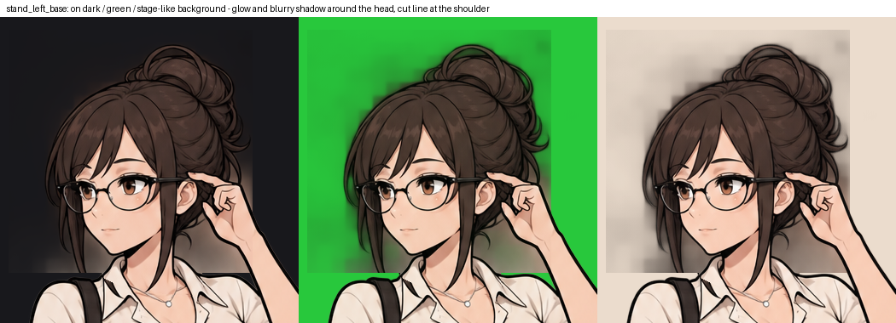

# English Club — бриф: Айрис, поворот головы — переделать чисто

Версия 1 · 03.11.2026. Комплект `Iris_39_Stand_Left_57_Frames` (поворот влево, стоячая поза) встроен и работает, но вокруг повёрнутой головы остались следы перерисовки. Его нужно **перегенерировать**. По этим же правилам делаются остальные три направления: `stand_right`, `notebook_left`, `notebook_right` (объёмы и эмоции — [бриф 39](39-iris-turns-after-class-rewards-brief.md), часть 1).

## 1. Что было не так

1. **Свечение вокруг головы.** Полупрозрачная бурая дымка вокруг волос и шеи. На тёмном и зелёном фоне — заметное пятно, на светлом фоне сцены — грязный ореол.
2. **Размытая тень за головой.** Непрозрачные бурые пятна без контура: справа за затылком, слева у шеи под волосами, у кисти. Похоже на остатки прежней, неповёрнутой головы, которые стёрли не до конца.
3. **Голова чуть прозрачная.** Внутри волос и лица альфа 240–254, а не 255: на тёмном фоне голова темнеет.
4. **Видна граница перерисовки.** Горизонтальный шов у левого плеча, где кончается перерисованная область и начинается исходный кадр.

## 2. Как сделать

Главное правило: **всё, что не фигура, — полностью прозрачно (альфа 0); всё, что фигура, — полностью непрозрачно (альфа 255).** Полупрозрачен только край фигуры по контуру, 1–2 px.

- **Основа направления — от принятой основы позы** `iris_stand_base.png` (из архива `art_kit_v2`), как раньше. Перерисовываются голова, шея, волосы и кисть у очков; остальное пиксель в пиксель как у основы.
- **Перед перерисовкой** убрать старую голову целиком: всё, что было головой, волосами, шеей и кистью в исходном кадре и не войдёт в новый рисунок, — **прозрачным**, без остатков. Место, где раньше была голова, а теперь пусто, — фон (альфа 0), а не тень.
- **Повёрнутая голова — с тем же тёмным контуром**, что у остальной фигуры: снаружи контура сразу прозрачный фон, без мягкой дымки, градиента или «тени от волос» на фоне.
- Под головой и волосами, где это часть тела (шея, плечи, воротник блузки), — **дорисованное тело**, непрозрачное, с контуром, а не размытое пятно.
- **Без шва:** граница перерисовки не должна быть видна. Проще всего — маска перерисовки по контуру фигуры, а не прямоугольником; если всё же прямоугольником, то ниже воротника его не опускать и сверить шов попиксельно.
- **Кадры эмоций** (`_half`, `_open`, `_blink`, лица эмоций) — только правкой лица от готовой чистой основы направления. Вне лица они совпадают с основой направления пиксель в пиксель, включая альфу, — тогда чистота основы переходит во все кадры.
- Поворот, имена файлов, объём — как в брифе 39, часть 1: `iris_stand_left_base.png` + 14 эмоций × 4 кадра.

## 3. Проверка перед отправкой (обязательно)

Положить **каждую основу направления** на три фона: тёмный `#18181c`, ярко-зелёный `#28c83c` и светлый `#ebdccd` (как пол и стены комнаты 17).

- [ ] Вокруг головы, волос и кисти — ни дымки, ни пятен, ни ореола: сразу за тёмным контуром виден чистый фон.
- [ ] Внутри фигуры альфа 255 (проверить: на тёмном и зелёном фоне голова одного цвета).
- [ ] Между прядями, у шеи и между кистью и головой — либо фигура, либо прозрачный фон, без полупрозрачных «окон».
- [ ] Шва перерисовки не видно ни на одном фоне.
- [ ] Кадры эмоций вне лица совпадают с основой направления (в `qa.json`: 0 изменённых пикселей вне лица, альфа совпадает).
- [ ] В `qa.json` добавить на каждую основу: число пикселей с альфой от 1 до 254 вне 2-пиксельной полосы по контуру — **должно быть 0**.

Приложить в архив `check_backgrounds.png`: основа направления на трёх фонах рядом.

## 4. Что пришлю обратно, если что-то не так

Тот же лист на трёх фонах с обведёнными местами. Чистить автоматически я могу (так встроен нынешний комплект), но аккуратнее, когда чисто изначально: автоматическая чистка не отличает тень от тёмных прядей и оставляет следы у шеи.

## 5. Порядок

1. `stand_left` — заново, 57 кадров. Встрою вместо нынешнего.
2. `stand_right` — 57 кадров.
3. `notebook_left`, `notebook_right` — по 29 кадров (основа + 7 × 4).
