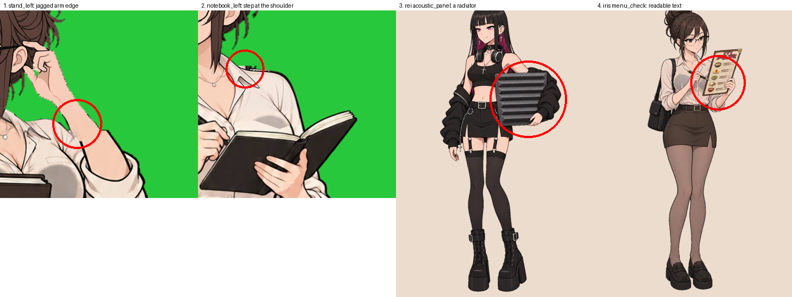

# English Club — бриф: мелкие правки арта

Версия 1 · 04.11.2026. Четыре небольшие правки. Всё остальное в этих кадрах принято — менять **только** отмеченное.

Приложено: `small_fixes_kit.zip` — нынешние кадры.

## 1. Айрис, поворот влево стоя — край руки

`stand_left`: на контуре поднятой руки (предплечье у локтя, где к руке подходят волосы) — ступенька и рваный край.

- Исправить только контур руки в этом месте: ровная тёмная линия, сглаженный край 1–2 px.
- Делается **на основе направления** `iris_stand_left_base.png` и потом переносится **во все 57 кадров** `stand_left` (они отличаются только лицом — правка руки должна совпасть в каждом кадре пиксель в пиксель).

## 2. Айрис, поворот влево с блокнотом — уступ у плеча

`notebook_left`: на линии плеча у воротника блузки (справа от шеи) — уступ, где кончается перерисованная голова.

- Свести контур плеча и воротника в одну ровную линию; ткань — как у основы.
- Так же: на основе `iris_notebook_left_base.png`, затем одинаково во все 29 кадров `notebook_left`.

## 3. Рэй на пути — акустическая панель

`map/rei/acoustic_panel.png` (юнит 008): панель похожа на металлический радиатор с рёбрами.

- Нужна **мягкая акустическая панель из поролона**: квадрат примерно 50 × 50 см, толщиной 5 см, тёмно-серая, с рельефом «пирамидками» или «волнами» (как в студиях звукозаписи), матовая, мягкие края.
- Поза, Рэй, наушники на шее, кадрирование — как сейчас.

## 4. Айрис на пути — меню

`map/iris/menu_check.png` (юнит 010): на меню почти читаются надписи.

- Вместо текста — только картинки блюд (тарелка, миска, чашка) и **ровные линии** вместо строк; заголовок — полоса без букв.
- Поза, ручка у строчки, кадрирование — как сейчас.

## Общие требования

- Тот же холст и формат: спрайты 1024 × 1536, позы пути 1024 × 1536, PNG, прозрачный фон.
- Без свечения и шва вокруг правки; внутри фигуры альфа 255; край сглажен.
- **`Preview.html`** с переключением «было / стало» и тремя фонами (тёмный, зелёный, светлый) — Иван смотрит до отправки.
- Архив: `sprites/stand_left/` (все 57), `sprites/notebook_left/` (все 29), `map/rei/acoustic_panel.png`, `map/iris/menu_check.png`.
