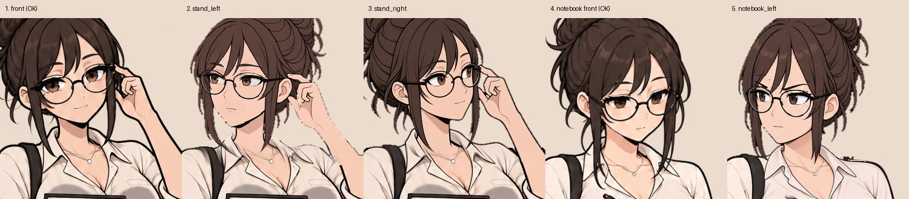

# English Club — бриф: Айрис — лица в поворотах как у мастера

Версия 1 · 04.11.2026. В поворотах головы у Айрис **лицо получилось другим**: глаза уже и меньше, лицо длиннее, черты взрослее, чем спереди и на мастере. Повороты нужно перерисовать так, чтобы это была **та же Айрис**, что на мастер-референсе и во фронтальных кадрах.

Приложено: `iris_turned_faces_kit.zip` — нынешние основы поворотов, фронтальные кадры всех эмоций для сверки, эта картинка.

## 1. Лицо — от мастер-референса

- **Источник лица — мастер-референс Айрис** (`source/masters/iris.png`, он у тебя есть): разрез, размер и цвет глаз, ресницы, брови, нос, губы, мягкий овал и подбородок, возраст и выражение. Не от предыдущих поворотов и не цепочкой правок.
- Айрис — студентка лет двадцати: **большие мягкие глаза**, как спереди; мягкие щёки; короткий нос; без заострённых скул и вытянутого подбородка.
- В повороте на ¾ ближний глаз чуть шире дальнего — но **оба такого же размера, как на мастере** в этом ракурсе, не прищуренные и не «узкие».
- Очки — те же круглые в тонкой чёрной оправе, того же размера относительно лица, что спереди.
- Сверка: положить голову поворота рядом с фронтальным кадром той же эмоции (`front/iris_stand_{эмоция}.png`) — должно читаться как один человек, повернувший голову, а не другая девушка.

## 2. Что сохранить из нынешних поворотов

Остаются как есть (их уже приняли): поза, тело, руки, книга и блокнот, сумка; **направление и угол поворота**; пучок и объём волос (после переделки 45 они правильные); линия пола, рост; чистые края без свечения и шва.

Меняются **только черты лица** (и, если нужно, линия щеки и подбородка) — поверх нынешних основ направлений.

## 3. Что нарисовать

| Очередь | Направление | Основа (тело, волосы, поворот) | Эмоции | Кадров |
|---|---|---|---|---|
| 1 | `stand_left` | `bases/iris_stand_left_base.png` | все 14 стоячей позы | основа + 14 × 4 = **57** |
| 2 | `notebook_left` | `bases/iris_notebook_left_base.png` | все 7 позы с блокнотом | основа + 7 × 4 = **29** |
| 3 | `stand_right` | `bases/iris_stand_right_base.png` | все 14 | основа + 14 × 4 = **57** |

На сцене Айрис всегда справа и поворачивается **влево** — очереди 1–2 главные. `stand_right` почти не встречается: можно сделать последним или позже.

На эмоцию 4 кадра: `…_{эмоция}.png` (рот закрыт), `_half`, `_open`, `_blink`. Эмоции — как в одноимённых фронтальных кадрах (`front/`), с характером Айрис: эмоции в бровях и губах, не во всём лице; `dry_smile` — мягкий взгляд и улыбка одним уголком (согласованный вариант из брифа 45).

## 4. Правила

- Холст 1024 × 1536, PNG без потерь; вне лица кадр совпадает с основой направления пиксель в пиксель, **включая альфу**.
- Эмоции — правкой только лица от новой основы направления; речь меняет только рот, моргание — только глаза; оправа на одном месте во всех кадрах.
- Без свечения, тени и шва; внутри фигуры альфа 255; край сглажен 1–2 px.
- **`Preview.html`** (без сервера): выбор направления, эмоции, рта и моргания, три фона и **рядом фронтальный кадр той же эмоции** — чтобы сразу было видно, одно ли это лицо. Плюс `all_faces.png`, `check_head.png`, `qa.json`.

## 5. Проверка

- [ ] Рядом с фронтальным кадром — тот же человек: размер глаз, мягкость лица, возраст совпадают.
- [ ] Глаза не уже и не меньше, чем на мастере в этом ракурсе; лицо не длиннее.
- [ ] Поза, волосы, пучок, угол поворота — как в нынешних основах.
- [ ] Вне лица изменённых пикселей 0.

Каждое направление — отдельным архивом.
